---

---

# OmniRisk 技术分析报告：论文原理、系统架构与代码实现

> **交付阶段：复现前技术分析。** 本报告面向熟悉机器人与深度学习的技术评审者，重建论文方法及当前仓库实现，作为后续论文复现的技术依据。本文未开展训练、闭环仿真或实机飞行，论文实验结果不代表本地复现结果。
>
> **核对基准：** [论文 PDF](../OmniRisk/2609.18191v2.pdf)，arXiv:2609.18191v2，PDF 标注日期 2026-09-20，共 8 页；代码基准 `041ef58`，核对日期 2026-11-03。保留原文件路径以兼容已有引用。
>
> **引用约定：** “论文式（n）”保留原文编号；“实现公式”根据代码整理；“解释性推导”和“教学示例”用于说明机制，不作为论文实验数据。代码链接以文件及函数名定位。

## 目录

- [1. 技术摘要与核心结论](#sec-1)
- [2. 问题定义与方法设计动机](#sec-2)
- [3. 系统总体架构与模块边界](#sec-3)
- [4. 感知表示：从点云到网络输入](#sec-4)
- [5. 候选轨迹表示与双分支网络](#sec-5)
- [6. 离线训练与非对称动态风险](#sec-6)
- [7. 在线规划、轨迹提交与执行](#sec-7)
- [8. 实验依据与方法适用边界](#sec-8)
- [9. 论文—代码对照与复现前结论](#sec-9)
- [附录 A：符号与缩写索引](#appendix-a)
- [附录 B：公式—代码—配置索引](#appendix-b)
- [附录 C：训练、导出与部署入口](#appendix-c)
- [附录 D：参考资料与版本信息](#appendix-d)

<a id="sec-1"></a>

## 1. 技术摘要与核心结论

**OmniRisk 将轨迹风险评价转移到离线训练，以一次网络推理完成全向候选生成与评分。**

其核心计算链为：

**点云与动态跟踪 → 统一全景表示 → 双分支网络 → 36 个终端状态及两类评分 → 候选选择 → 五次轨迹重建 → 控制参考。**

| 核心机制 | 解决的问题 | 对应实现及成立条件 |
| --- | --- | --- |
| 距离、动态掩码和三维速度组成固定尺寸输入 | 单帧几何难以区分静态物体与横向运动威胁 | 前端必须提供可信的目标速度，并保持时间、坐标及通道对齐 |
| 非对称动态风险场及轨迹级监督 | 仅按距离惩罚不能有效区分接近与远离 | 风险结合相对位置、速度方向和未来预测；依赖短时运动模型 |
| 固定全向候选与双分支预测 | 在线逐障碍物、逐轨迹积分或迭代优化占用反应时间 | 静态头生成候选，动态头学习候选风险，在线仅融合评分并重建选中轨迹 |

论文的技术价值在于联合设计**感知表示、训练目标和在线决策形式**。网络不是直接输出电机动作，也不是在线求解连续风险积分。几何和运动学计算没有消失，而是分别进入训练监督、感知预处理和闭式轨迹重建。

论文报告：在 6 个障碍物、障碍物速度 10 m/s 的仿真条件下，OmniRisk 成功率为 84%，FAPP 为 8%；Jetson Orin NX 上对应规划 P95 延迟为 45.6 ms；实机室内、室外总体成功率分别为 90.7% 和 86.7%（PDF pp.7–8，表 III–VI）。这些结果支持其在作者测试条件下的收益，并不构成任意场景的安全保证。

当前代码已经具备从数据生成、可微轨迹代价、联合训练到 ROS 推理与控制参考发布的主要链条。复现前需要明确：论文与当前实现存在风险场尺度、投影离散方式、卷积边界和在线可行性检查等差异；当前默认运行参数也不能直接当作论文实验配置。第 9 章集中记录这些边界。

阅读建议：第 3 章建立系统地图，第 4–7 章完成算法与代码理解，第 8–9 章用于评估证据及复现准备程度。操作入口仅在附录保留。

<a id="sec-2"></a>

## 2. 问题定义与方法设计动机

### 2.1 高速动态避障首先受到反应时间约束

在稀疏 LiDAR 观测下，快速目标可能只有少量回波。系统需经过自身定位、动态检测、目标确认、速度估计、规划和执行才能产生有效避让。即使规划器本身只需几十毫秒，上游检测与跟踪延迟仍可能占用显著的反应窗口。

论文针对的是**规划阶段**：将逐障碍物的连续风险评价从在线循环移到离线学习中。与一次只精修一条轨迹的轻量方案相比，固定的全向候选集合保留前、后、左、右及不同俯仰方向的动作选择；代价是有限候选集可能遗漏需要复杂时序或曲线形状的逃逸路线。

“全向”在本文中特指 **360° 水平方位角覆盖**。当前配置垂直视场为 −7° 至 +52°，不代表完整球面感知或任意方向均可通行。

### 2.2 状态、候选与总体目标

设规划参考时刻为 $t_0$，局部规划系为 $P_{t_0}$；候选内部时间记为 $\tau\in[0,T]$，避免与 ROS 绝对时间混淆。无人机起始状态为 $\mathbf x_0=(\mathbf p_0,\mathbf v_0,\mathbf a_0)$，导航目标为 $\mathbf g$。动态目标集合 $\mathcal O_{t_0}$ 中每个目标包含中心 $\mathbf c_o$、速度 $\mathbf v_o$、尺寸和身份标识。

候选集合 $\Pi=\{\boldsymbol\pi_i\}_{i=1}^{N}$ 中，$\boldsymbol\pi_i(\tau)\in\mathbb R^3$ 表示三维位置曲线，$N=36$。总体目标原式为：

$$
\boldsymbol\pi^*=\arg\min_{\boldsymbol\pi_i\in\Pi}
\left[J_{\mathrm{prog}}(\boldsymbol\pi_i,\mathbf g)
+\lambda_s J_{\mathrm{smooth}}(\boldsymbol\pi_i)
+J_{\mathrm{risk}}(\boldsymbol\pi_i,\mathbf I_t)\right].
\tag{2}
$$

**来源：论文 §III-A，PDF p.3，式（2）。**

| 符号 | 含义与作用 |
| --- | --- |
| $J_{\mathrm{prog}}$ | 目标进展代价，推动候选朝向导航目标 |
| $J_{\mathrm{smooth}}$ | 平滑代价，论文采用 jerk 平方积分；jerk 为加速度对时间的导数 |
| $\lambda_s$ | 平滑代价权重，吸收尺度差异 |
| $J_{\mathrm{risk}}$ | 通过网络近似的风险项；实际评分还需结合静态净空 |
| $\mathbf I_t$ | 全景几何与动态运动表示，见式（1） |
| $\boldsymbol\pi^*$ | 所选候选轨迹，不代表连续轨迹空间的全局最优解 |

式（2）是问题层面的抽象。实际在线代码不重新计算目标、平滑和静态距离代价；这些信息已经进入静态评分的训练标签，最后按第 7 章的式（11）选择。

### 2.3 贯穿示例：横穿目标

下文采用同一教学场景：无人机在局部原点，以 $(2,0,0)$ m/s 向前飞，目标位于 $(8,0,0)$ m；一颗球位于 $(2,-2,0)$ m，以 $(0,2,0)$ m/s 横穿。此处坐标是相对当前无人机的局部坐标，$z=0$ 不表示地面高度。

若双方维持速度，1 s 后都到达 $(2,0,0)$ m。距离图只说明球现在约在 2.83 m 之外；三维速度通道和本机状态才提供“未来同一时刻相遇”的依据。训练时，直行候选会得到较大的动态风险；在线时，网络预测该风险，系统再从静态可行的备选方向中选择风险与目标代价更合适的一条。

<a id="sec-3"></a>

## 3. 系统总体架构与模块边界

### 3.1 离线监督与在线执行

先观察论文图 2：左侧是仿真和实机输入来源，中部是统一表示与网络，右上是仅训练时使用的解析监督，右下是在线评分与轨迹恢复。

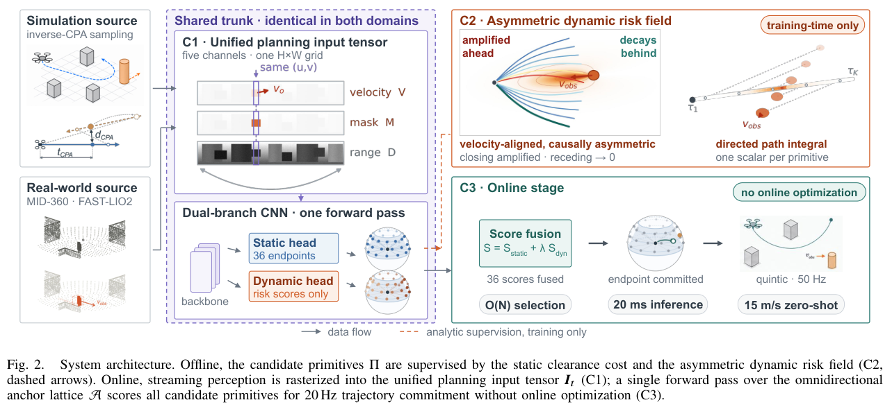

图中的虚线监督箭头是理解方法的关键：真实地图和动态目标真值负责构造训练目标，部署时网络只接收约定的观测表示与本机状态。仿真输入可由真值生成，但完整地图、未来轨迹和风险标签不会作为额外网络输入泄漏到实机接口。

下面的工程图将论文模块映射到仓库实现。它按默认 LiDAR＋静态点云路径组织；图内历史提交标识仅表示制图版本，本报告事实以当前核对基准为准。图中加速度来源是概括描述：当前 LiDAR 网络输入具体采用里程计速度差分，轨迹重建起点采用期望加速度，分别见第 4.6、7.3 节。

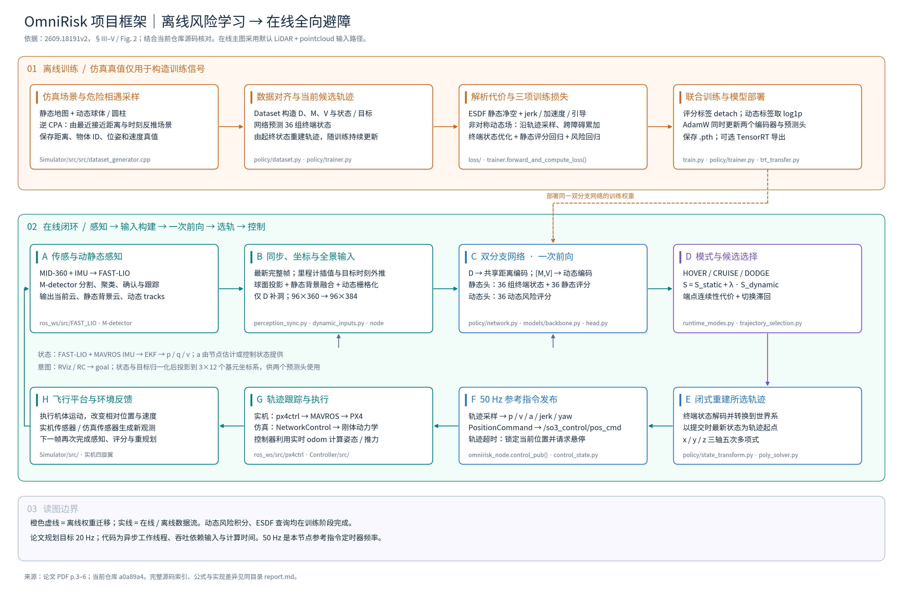

沿在线部分阅读，可以看到网络只占系统的一段。时间同步和几何投影位于网络之前，轨迹重建、控制采样和执行位于网络之后。TensorRT 加速针对网络前向，不会替代这些外围处理。

### 3.2 默认实机链路与接口

| 模块 | 主要输入 | 主要输出 | 职责与关键边界 |
| --- | --- | --- | --- |
| MID360 驱动 | 雷达与内置 IMU 测量 | `/livox/lidar`、`/livox/imu` | 提供原始点流和惯性测量 |
| FAST-LIO | 雷达点云、雷达 IMU、外参 | `/Odometry`、`/cloud_registered_no_point_filter` | 定位、扫描运动补偿、点云注册；当前云可同时包含静态和动态点 |
| 额外 EKF | `/Odometry`、`/mavros/imu/data` | `/ekf_quat/ekf_odom`，`nav_msgs/Odometry` | 结合飞控 IMU 传播高频状态，与 FAST-LIO 内部融合的雷达 IMU 不同 |
| M-detector 与跟踪器 | 世界系当前点云、默认 `/Odometry` | `/m_detector/std_points`、`/m_detector/confirmed_tracks` | 静态背景、动态目标的位置/速度/尺寸/身份；目标数组类型为 `m_detector/TrackedObjectArray` |
| OmniRisk 节点 | 当前云、静态云、目标跟踪、EKF 状态、导航目标、权重 | `/so3_control/pos_cmd`，`quadrotor_msgs/PositionCommand` | 构造输入、推理、选轨、发布位置/速度/加速度/jerk/偏航参考 |
| px4ctrl | 轨迹参考、EKF 状态、飞控 IMU、遥控和飞控状态 | `/mavros/setpoint_raw/attitude`，`mavros_msgs/AttitudeTarget` | 状态机及轨迹跟踪，当前发布姿态四元数和归一化推力 |
| MAVROS / PX4 | 姿态与推力设定、传感器与模式信息 | MAVLink 通信、飞控执行与状态回传 | MAVROS 连接 ROS 与飞控；PX4 执行下层姿态/角速度控制及电机分配 |

导航目标常由 `/move_base_simple/goal` 输入，消息为 `geometry_msgs/PoseStamped`；遥控目标由 `rc_goal_teleop.py` 生成。各模块不要求处于同一进程，通信正确性依赖消息、坐标与时间约定。

启动组合见 [fastlio_ekf.launch](../ros_ws/src/FAST_LIO/launch/fastlio_ekf.launch)、[detector_mid360.launch](../ros_ws/src/M-detector/launch/detector_mid360.launch) 和 [run_ctrl.launch](../ros_ws/src/px4ctrl/launch/run_ctrl.launch)。检测器默认使用 FAST-LIO 里程计，规划器与控制器使用额外 EKF 输出，不能把两者视为同一状态流。

### 3.3 定位与动态跟踪的关键机制

**FAST-LIO。** 先用 IMU 传播运动，补偿扫描期间各点的采样时差，再以点云与局部地图的几何残差更新状态并维护地图。世界系是局部参考系；默认初始化包含重力对齐，但没有由此获得地理正北。雷达、IMU 和机体安装关系必须在外参中一致表达。

**额外 EKF。** 用状态 $\mathbf x=(\mathbf p,\mathbf q,\mathbf v,\mathbf b_g,\mathbf b_a)$ 表示位置、姿态四元数、速度和两类 IMU 偏置。机制可用以下简化传播式说明：
$$
\dot{\mathbf p}=\mathbf v,\qquad
\dot{\mathbf v}=R(\mathbf q)(\mathbf a_m-\mathbf b_a)+\mathbf g_{\mathrm{grav}}.
$$

这是状态估计的解释性表达，并非论文编号公式。$\mathbf a_m$ 是 IMU 比力，$R$ 将 IMU 向量转到世界系，$\mathbf g_{\mathrm{grav}}$ 是重力；姿态由去偏后的角速度推进。FAST-LIO 位姿到达时做测量校正，延迟测量结合历史状态/IMU 处理。高频输出来自状态传播，不是简单重复低频位置。入口见 [EKF 节点](../ros_ws/src/ekf_quat_pose/src/ekf_node_vio_timesync_with_acc_pub.cpp)。

**M-detector 与目标跟踪。** 多帧几何一致性与遮挡关系用于区分自身运动导致的观测变化和真实动态点；动态点聚类为目标后，跟踪器进行预测、门限过滤、匈牙利关联、滤波更新及轨迹确认/删除。当前实机配置启用带已知重力的抛体模型，适合投掷物；匀速目标需要匹配相应配置。检测、聚类、关联和目标确认共同决定能否及时得到可靠速度。实现见 [DynObjFilter.cpp](../ros_ws/src/M-detector/src/DynObjFilter.cpp) 和 [FrameTracker.cpp](../ros_ws/src/M-detector/src/FrameTracker.cpp)。

### 3.4 仿真与实机的共用部分

仿真以 CUDA 环境和 LiDAR 模拟器提供观测，以仿真里程计替代真实定位，默认通过 `NetworkControl` 和四旋翼刚体模型执行规划参考。实机使用 MID360、FAST-LIO/EKF 和 px4ctrl/MAVROS/PX4。两条路径共用网络及规划表示，但观测误差、跟踪质量、状态延迟和执行误差不同。

**训练数据生成、闭环仿真评测和实机部署是三个不同阶段。** 数据生成器提供带真值的场景样本；闭环仿真需要规划与动力学持续交互；实机还增加传感器与执行器的真实约束。能加载模型并产生轨迹，只证明部分接口可用。

<a id="sec-4"></a>

## 4. 感知表示：从点云到网络输入

### 4.1 坐标系与参考时刻

本文使用列向量约定，$R_{AB}$ 表示把 B 系向量旋转到 A 系。代码部分采用行向量乘法，需注意转置。

| 坐标系 | 原点与方向 | 主要用途 |
| --- | --- | --- |
| 世界系 $W$ | 定位初始化建立的局部参考系 | 保存点云、目标跟踪与无人机状态 |
| 机体/IMU 系 $B$、雷达系 $L$ | 随传感器运动，二者通过外参关联 | 原始观测和惯性状态 |
| 局部规划系 $P_{t_0}$ | 当前参考时刻无人机位置为原点；全向模式轴向与世界系一致 | 全景投影、网络输入和终端状态 |
| 基元系 $A_i$ | 沿第 $i$ 个方向锚点构建 | 表示各候选对应的状态、终端速度和加速度 |

点坐标转换的实现关系为：

$$
\mathbf p^W=R_{WB}(R_{BL}\mathbf p^L+\mathbf t_{BL})+\mathbf t_{WB},\qquad
\mathbf p^{P_{t_0}}=R_{WP}^{\mathsf T}(\mathbf p^W-\mathbf p_{\mathrm{uav}}^W(t_0)).
$$

$\mathbf t$ 是平移，单位 m。当前全向模式 `_planning_rotation` 返回 $R_{WP}=I$，所以世界系到规划系只需减去无人机位置；无人机转头不会使规划坐标轴跟着转动。速度只旋转，不减位置，也不在此阶段减去本机速度。

例如无人机位于 $(10,3,1)$，墙面点位于 $(14,5,2)$，则规划系坐标为 $(4,2,1)$ m。下一帧无人机位置变化后，必须重新计算相对点坐标。

默认 LiDAR 流水线以主点云时间戳组帧，缓存并匹配静态背景、跟踪及里程计；里程计可插值或在容差内取邻近状态。相应实现集中在 [omnirisk_node.py](../OmniRisk/omnirisk_node.py) 的 `_frame_assembly_worker`、`_interpolate_odom_locked` 与 `_prepare_perception_frame`，缓存与时效规则见 [perception_sync.py](../OmniRisk/perception_sync.py)。

### 4.2 跟踪状态的时延补偿

在投影动态目标之前，需把不同测量时刻的目标状态传播到统一参考时刻。论文采用：

$$
\mathbf c_o^r=\mathbf c_o^m+\mathbf v_o^m\Delta t+\frac12\mathbf g\Delta t^2,
\qquad
\mathbf v_o^r=\mathbf v_o^m+\mathbf g\Delta t.
\tag{4}
$$

**来源：论文 §IV-B，PDF p.4，式（4）。** 这里原文的 $\mathbf g$ 表示重力，即本文的 $\mathbf g_{\mathrm{grav}}$，不是第 2 章的导航目标。

| 符号 | 含义与单位 |
| --- | --- |
| 上标 $m,r$ | 测量状态、传播后的参考状态 |
| $\mathbf c_o$、$\mathbf v_o$ | 目标中心位置 m、速度 m/s，均为三维向量 |
| $\Delta t$ | 参考时间与测量时间之差，s |
| $\mathbf g_{\mathrm{grav}}$ | 已知加速度，m/s²；匀速模型使用零向量 |

`_tracks_at` 调用 `predict_kinematics`，仅使用已确认目标，并限制预测时域。当前实现传播到点云参考时刻，随后才进入预处理与推理；不是无限外推到任意未来，也不是自动补偿全部执行延迟。

教学例：横向速度 2 m/s、延迟 0.1 s 时，位置补偿为 0.2 m；若启用 $g_z=-9.81$ m/s²，竖直位移还包含 −0.04905 m，竖直速度变化 −0.981 m/s。这解释了为什么运动模型和时间戳会直接影响输入几何。

### 4.3 五通道表示与球面投影

论文的统一输入定义为：

$$
\mathbf I_t=[\mathbf D_t,\mathbf M_t,\mathbf V_t]\in\mathbb R^{H\times W\times5}.
\tag{1}
$$

**来源：论文 §III-A，PDF p.3，式（1）。** $H,W$ 是表示网格的行、列数；$\mathbf D_t$ 为 1 通道表面距离，$\mathbf M_t$ 为 1 通道动态掩码，$\mathbf V_t$ 为 3 通道笛卡尔速度。论文采用通道在最后的记法，PyTorch 实现采用 `B×C×H×W`。

对规划系点 $\mathbf p=(x,y,z)^{\mathsf T}$，球面投影首先计算：

$$
r=\sqrt{x^2+y^2+z^2},\qquad
\theta=\operatorname{atan2}(y,x),\qquad
\phi=\operatorname{atan2}(z,\sqrt{x^2+y^2}).
$$

$r$ 是沿射线到表面的欧氏距离，单位 m；$\theta$ 是方位角，$\phi$ 是俯仰角，单位 rad。论文写作 $\phi=\arcsin(z/\|\mathbf p\|)$，对非零点与这里的表达一致。该距离不同于针孔相机沿光轴定义的深度。

论文用每格最近表面定义距离图：

$$
\mathbf D_t(u,v)=
\min_{\{\mathbf p\in\mathcal L_t\mid\lfloor\kappa(\mathbf p)\rfloor=(u,v)\}}
\|\mathbf p\|_2.
\tag{3}
$$

**来源：论文 §IV-A，PDF p.4，式（3）。** $\mathcal L_t$ 为当前点集，$\kappa$ 为连续球面到像素映射，$(u,v)$ 为像素索引。最近表面能遮挡后方表面，因此同一格保留最小距离。

当前 [dynamic_inputs.py](../OmniRisk/dynamic_inputs.py) 的 `project_points_to_range_image` 使用最近网格舍入，具体为：

$$
u=\operatorname{clip}\!\left(\operatorname{rint}\!\left[
\frac{\phi_{\max}-\phi}{\phi_{\max}-\phi_{\min}}(H-1)\right],0,H-1\right),
\qquad
v=\operatorname{rint}\!\left[\frac{\theta+\pi}{2\pi}W_p\right]\bmod W_p.
$$

这是**实现公式**；`np.rint` 的半整数规则不能泛化为任意语言的“四舍五入”。论文式（3）中的下取整与当前舍入策略也不应混写。$W_p=360$ 为原始全景宽度，$H=96$，俯仰范围为 −7° 至 +52°。对应射线为：

$$
\theta_v=-\pi+\frac{2\pi v}{360},\qquad
\phi_u=52^\circ-u\frac{59^\circ}{95}.
$$

因此列方向每格 1°，行方向间隔约 0.621°；行从上到下对应俯仰角从高到低。输入首先过滤非有限值、距离和垂直视场外点。默认有效距离区间为大于 0.1 m、小于 20 m；空格使用最大距离哨兵值。**哨兵值表示缺少有效测量，不能等同于已验证的自由空间。**

### 4.4 静态背景融合与动态表面栅格化

默认 `static_input_mode=pointcloud`：近期静态背景由 M-detector 输出，规划节点将当前云与静态云都转到同一规划系，再分别投影。基础距离图为：

$$
D_{\mathrm{base}}(u,v)=\min\{D_{\mathrm{current}}(u,v),D_{\mathrm{static}}(u,v)\}.
$$

当前云保留即时观测，静态背景补充稀疏扫描的空间覆盖；历史误分类也可能留下残影，因此累积窗口与动态分割质量会影响输入。代码还支持 `range_image` 路径：检测器直接提供静态距离图和配套位姿，由 [static_range_input.py](../OmniRisk/static_range_input.py) 检查时间戳、坐标标识、尺寸、`32FC1` 编码及数值范围。这是接口分支，不改变网络的物理输入定义。

动态目标不是简单把聚类点涂到掩码上。节点以目标中心和尺寸构建球体，用射线交点补充稀疏动态表面。半径由最大尺寸的一半取得，再施加配置上下界；球体近似不保留物体真实形状。

设单位射线为 $\mathbf d$，球心为 $\mathbf c$，半径为 $R_o$，射线位置为 $s\mathbf d$。由 $\|s\mathbf d-\mathbf c\|^2=R_o^2$ 得到**解释性推导**：

$$
s_{\pm}=\mathbf d^{\mathsf T}\mathbf c\pm
\sqrt{(\mathbf d^{\mathsf T}\mathbf c)^2-\|\mathbf c\|^2+R_o^2}.
$$

判别式非负时才相交；实现取大于最小距离阈值的近交点，近交点无效时尝试远交点。多个目标竞争同一方向时保留最近动态表面及其速度。只有当动态深度不远于基础表面加遮挡容差时，该像素才视为可见动态像素。可选虚拟顶棚也参与可见性限制。

可见像素写入 $M=1$、$\mathbf V=\mathbf v_o^{P}$，并与基础距离取较小值；其余动态掩码和速度为零。这里编码的是目标在规划系中的速度，**尚未减去无人机速度**；相对速度在训练风险计算中形成。实现见 `rasterize_dynamic_spheres`，其角度 ROI 优化减少求交范围，但输出仍遵循同一网格。

### 4.5 距离补全、尺寸映射与归一化

补全仅修改距离通道，不能把掩码和速度一起扩散，否则可能把静态表面伪造为动态运动区域。当前 [depth_completion.py](../OmniRisk/depth_completion.py) 的 `complete_depth` 使用行列方向插值、支持距离选择及两轮填充，再平滑原本缺失的像素；已有有效测量保留。水平方向周期延拓，竖直方向不周期延拓。全图无有效支持时保留有限哨兵值，无法凭空恢复几何。

论文 §IV-A 将补全概括为保边缘最近邻传播；上述是当前代码的具体算法，不能照抄概括替代实现说明。

网络输入宽度为 $W_n=384$，通过统一列索引表映射：

$$
v_{\mathrm{src}}(j)=\left\lfloor j\frac{W_p}{W_n}\right\rfloor,
\qquad j=0,\ldots,W_n-1.
$$

这是全向 `map_panorama_to_network` 的实现公式。距离、掩码和速度使用同一索引，保持空间对齐；它是重采样，不是额外增加 24° 视场。384 和 96 经编码器 32 倍降采样得到 $12\times3$ 的候选网格。

距离输入按 $D_{\mathrm{norm}}=\min(D,d_{\max})/d_{\max}$ 归一化，当前节点默认 $d_{\max}=20$ m；映射归一化后仍可能再对无效距离补全。速度图保持 m/s 的物理数值，不能误写为和状态速度一样除以 `vel_max`。

### 4.6 九维状态与网络调用约定

局部状态向量为：

$$
\mathbf o=[\mathbf v_0^{\mathsf T},\mathbf a_0^{\mathsf T},
(\mathbf g-\mathbf p_0)^{\mathsf T}]^{\mathsf T}\in\mathbb R^9.
$$

当前 LiDAR 同步路径中，`_odom_acceleration_locked` 用邻近里程计速度差分估计 $\mathbf a_0$；缺少满足容差的邻居时返回零。它既不是原始 IMU 比力，也不是后续轨迹重建所用的 `desire_acc`。后者见第 7.3 节。

[StateTransform](../OmniRisk/policy/state_transform.py) 的归一化为：
$$
\bar{\mathbf v}=\frac{\mathbf v}{v_{\max}},\qquad
\bar{\mathbf a}=\frac{\mathbf a}{a_{\max}},\qquad
\bar{\mathbf g}=\frac{\mathbf g-\mathbf p_0}
{\max(\|\mathbf g-\mathbf p_0\|,L_g)}.
$$

$L_g$ 是目标归一化长度，默认由两倍 `radio_range` 派生。远目标保留方向，近目标同时保留距离比例。每组向量再转到各候选基元系，得到 `obs: [B,9,3,12]`；`state_backbone` 是恒等映射，没有额外 MLP。

| `forward` 参数 | 形状 | 内容 |
| --- | --- | --- |
| `depth` | `[B,1,96,384]` | 归一化距离 |
| `mask` | `[B,1,96,384]` | 动态可见性 |
| `vel_img` | `[B,3,96,384]` | 目标三维速度 |
| `obs` | `[B,9,3,12]` | 各基元系中的归一化本机状态和目标 |

教学场景中，球的速度像素写作 $(0,2,0)$ m/s，本机速度作为状态输入 $(2,0,0)$ m/s；两者共同提供横穿风险依据。网络调用的四个参数与概念上的五个图像通道并不矛盾。

<a id="sec-5"></a>

## 5. 候选轨迹表示与双分支网络

### 5.1 36 个锚点固定，终端状态自适应

当前配置为 12 个方位角、3 个俯仰方向、1 个径向层，共 36 个候选。锚点固定了方向单元，网络则在单元内预测角度偏移、径向长度和终端导数。因此这不是 36 条预先固定且永不变化的曲线。

设第 $i$ 个锚点角度为 $(\theta_i,\phi_i)$，网络经过 `tanh` 的前九个输出为 $\mathbf z_i\in[-1,1]^9$，则解码关系为：

$$
\begin{aligned}
\theta_i'&=\theta_i+z_{i,1}\Delta\theta,\quad
\phi_i'=\phi_i+z_{i,2}\Delta\phi,\quad
\rho_i=(z_{i,3}+1)r_a,\\
\mathbf p_{f,i}^{P}&=\rho_i
\begin{bmatrix}\cos\phi_i'\cos\theta_i'\\\cos\phi_i'\sin\theta_i'\\\sin\phi_i'\end{bmatrix},\\
\mathbf v_{f,i}^{P}&=R_{PA_i}(v_{\max}\mathbf z_{i,4:6}),\qquad
\mathbf a_{f,i}^{P}=R_{PA_i}(a_{\max}\mathbf z_{i,7:9}).
\end{aligned}
$$

以上为 `pred_to_endstate` / `pred_to_endstate_cpu` 的实现公式。$r_a$ 对应 `radio_range`，是半径尺度，实际终点距离范围为 $[0,2r_a]$；$\Delta\theta,\Delta\phi$ 是允许的角度偏移半宽；$R_{PA_i}$ 是锚点基元到规划系的旋转。当前水平偏移半宽为 15°，垂直为 10°。

角度、径向和导数缩放使终端参数有界，但速度/加速度是**逐分量**限幅，不能推出向量范数小于同一阈值，更不能推出整条多项式的中间时刻满足运动学约束。

图像行从高俯仰到低俯仰排列，基元生成顺序相反。`lattice_reorder` 在全向模式只反转垂直索引，保证图像格、状态特征、评分与候选终点一一对应。

### 5.2 双分支网络的数据依赖

下面的网络图重点标出共享距离特征和两个预测头的不同输入。

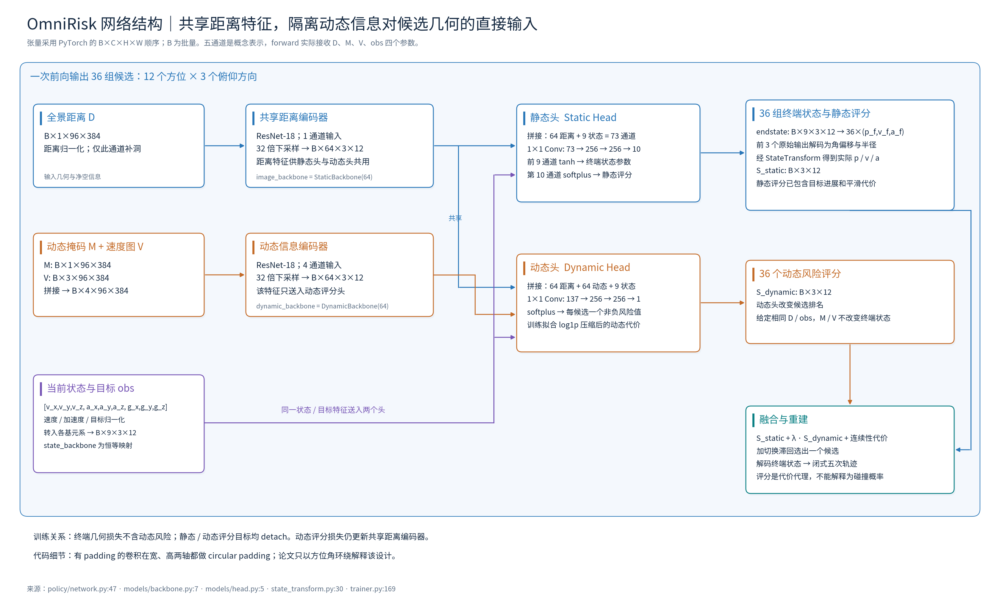

对应 [network.py](../OmniRisk/policy/network.py) 的 `forward`：

$$
F_D=f_D(D),\quad F_{MV}=f_{MV}([M,V]),\quad
(\mathbf z,\hat J_s)=h_s([F_D,o]),\quad
\hat J_d=h_d([F_D,F_{MV},o]).
$$

$f_D$、$f_{MV}$ 分别是单通道与四通道 ResNet-18 编码器；$h_s$、$h_d$ 为静态头和动态头。静态头每格输出 9 个终端参数和 1 个评分，动态头每格输出 1 个评分，两类评分均经 Softplus 保持非负。

| 阶段 | 距离分支形状 | 动态分支差异 |
| --- | --- | --- |
| 输入 | `[B,1,96,384]` | 输入为 `[B,4,96,384]` |
| 首层卷积 | `[B,64,48,192]` | 空间尺寸相同 |
| 池化及 layer1 | `[B,64,24,96]` | 同左 |
| layer2 / layer3 | `[B,128,12,48]` / `[B,256,6,24]` | 同左 |
| layer4 / 输出投影 | `[B,512,3,12]` / `[B,64,3,12]` | 同左 |
| 预测头输入 | 64 距离特征＋9 状态＝73 通道 | 64 距离＋64 动态＋9 状态＝137 通道 |
| 预测头 | `73→256→256→10` | `137→256→256→1` |

预测头使用 $1\times1$ 卷积和中间 ReLU。空间信息已由编码器聚合，头部按候选网格输出；36 个候选并不是 36 次独立网络前向。

论文使用方位角循环填充处理 ±180° 接缝。当前 `_CircularConv2d` 对有 padding 的卷积在宽、高两轴都做循环拼接；俯仰本身并非周期变量，这是实现差异，详见第 9 章。

**分支隔离的准确含义：** 固定权重、固定 $D,o$ 时，只改 $M,V$ 不会改变静态头的终点输出；动态头也没有显式接收解码后的终点参数。它学习当前网络候选对应的风险标签。实际系统中动态目标球面可能同时改变距离图 $D$，训练时共享编码器也会更新，所以不能扩大为“动态障碍物永远不会影响候选几何”。

### 5.3 从终端状态恢复五次轨迹

每个轴的轨迹写为：

$$
p(\tau)=\sum_{k=0}^{5}c_k\tau^k,\qquad 0\le\tau\le T.
$$

六个边界条件是 $p(0),\dot p(0),\ddot p(0),p(T),\dot p(T),\ddot p(T)$。记边界向量 $\mathbf b=[p_0,v_0,a_0,p_f,v_f,a_f]^{\mathsf T}$，则：

$$
\underbrace{\begin{bmatrix}
1&0&0&0&0&0\\
0&1&0&0&0&0\\
0&0&2&0&0&0\\
1&T&T^2&T^3&T^4&T^5\\
0&1&2T&3T^2&4T^3&5T^4\\
0&0&2&6T&12T^2&20T^3
\end{bmatrix}}_{A(T)}\mathbf c=\mathbf b,
\qquad \mathbf c=A(T)^{-1}\mathbf b.
$$

这是 [Poly5Solver](../OmniRisk/policy/poly_solver.py) 的边界求解表达，$T>0$ 时使用预先写出的闭式逆矩阵。三个轴各有 6 个系数，共 18 个系数。对多项式求导得到：

$$
\mathbf v=\dot{\mathbf p},\quad \mathbf a=\ddot{\mathbf p},\quad
\mathbf j=\dddot{\mathbf p};\qquad
j(\tau)=6c_3+24c_4\tau+60c_5\tau^2.
$$

固定时间和六个端点约束下，五次多项式对应无其他路径约束的最小 jerk 解；加入障碍物、推力或中间状态约束后，不能仅由五次形式保证安全可执行。

教学例：单轴从 0 m 静止出发，到 1 m 静止结束，$T=1$ s，两端加速度为零，则 $p(\tau)=10\tau^3-15\tau^4+6\tau^5$。代入端点可验证六个约束；在 $\tau=0.5$ s 时速度为 1.875 m/s，说明两端速度为零也不代表中途速度很低。

<a id="sec-6"></a>

## 6. 离线训练与非对称动态风险

### 6.1 数据生成与 inverse-CPA 采样

均匀随机放置障碍物可能产生大量“离得很远、不会相遇”的无效训练样本。inverse-CPA 先指定最近接近时刻与距离，再反推障碍物初始位置，使训练包含有意义的相遇场景。CPA 是 closest point of approach，即最近接近事件。

对匀速教学模型，设相对位置 $\mathbf q(\tau)=\mathbf q_0+\mathbf v_{\mathrm{rel}}\tau$。若预设 $\tau_*$、最近相对位移 $\mathbf q_*$，并使 $\mathbf q_*^{\mathsf T}\mathbf v_{\mathrm{rel}}=0$，则：

$$
\mathbf q_0=\mathbf q_*-\mathbf v_{\mathrm{rel}}\tau_*,\qquad
\mathbf c_{o,0}=\mathbf p_0-\mathbf q_0,\qquad
\|\mathbf q_*\|=d_{\mathrm{CPA}}.
$$

这是解释性逆构造。$\tau_*$ 单位 s，$d_{\mathrm{CPA}}$ 单位 m；实际生成器还包含球体/圆柱几何、水平面求解、竖直分布、速度约束和不同样本桶，不能把所有分支缩写为一个三维点模型。

[dataset_generator.cpp](../Simulator/src/src/dataset_generator.cpp) 生成距离图、目标 ID、状态及动态真值；[dataset.py](../OmniRisk/policy/dataset.py) 的 `__getitem__` 按 ID 构造速度图，并读取相应状态。威胁桶使用保存的本机速度/目标以保持 CPA 构造一致，仍可采样加速度；无动态等桶使用相应随机状态分布。

训练使用完整静态地图和动态真值评价**当前网络生成的候选**。候选不断变化，标签在每次前向中重新计算；不是提前离线保存一套永久不变的“36 个风险标签”，也不是模仿专家给出的一条最优轨迹。

### 6.2 静态净空代价

论文在 $K$ 个采样时刻 $\tau_j=jT/K$ 评价静态净空：

$$
J_{c,i}=\frac1K\sum_{j=1}^{K}
\exp\left[-\frac{d(\boldsymbol\pi_i(\tau_j))-d_{\mathrm{safe}}}
{\sigma_{\mathrm{static}}}\right].
\tag{5}
$$

**来源：论文 §V-A，PDF p.4，式（5）。**

| 符号 | 含义 |
| --- | --- |
| $d(\cdot)$ | 到最近静态边界的距离查询，单位 m |
| $d_{\mathrm{safe}}$ | 目标净空尺度，m；当前代码对应 `d0=1.2` |
| $\sigma_{\mathrm{static}}$ | 指数衰减尺度，m；当前对应 `r=0.6` |
| $K$、$\tau_j$ | 采样点数和时刻；当前 `eval_points=30`，不包含 $\tau=0$ |
| $J_{c,i}$ | 第 $i$ 条轨迹的平均静态惩罚，尚未乘外部损失权重 |

在 $d=d_{\mathrm{safe}}$ 时单点代价为 1；多出一个 $\sigma_{\mathrm{static}}$ 时为 $e^{-1}\approx0.368$；少一个尺度时为 $e\approx2.718$。连续指数使安全边界附近仍有优化梯度，但它是软代价，不是碰撞禁止约束。

当前 [safety_loss.py](../OmniRisk/loss/safety_loss.py) 从 `pointcloud-*.ply` 栅格化占据，以 0.2 m 体素和距离变换构建距离场，再用 `grid_sample` 插值查询。论文称为解析 ESDF，代码实际是离散地图距离场近似；薄障碍、体素化和地图外查询边界会影响标签精度。

### 6.3 未来同一时刻的相对状态

仅比较“路径是否经过目标当前位置”不足以表示动态碰撞。论文先沿规划时域同步推进无人机候选和目标：

$$
\mathbf q(\tau)=\boldsymbol\pi_i(\tau)-(\mathbf c_o^r+\mathbf v_o^r\tau),
\qquad
\mathbf v_{\mathrm{rel}}(\tau)=\dot{\boldsymbol\pi}_i(\tau)-\mathbf v_o^r.
\tag{6}
$$

**来源：论文 §V-B，PDF p.5，式（6）；时间变量由原文 $t$ 改记为 $\tau$。** $\mathbf q$ 是从目标中心指向无人机候选位置的相对向量，单位 m；$\mathbf v_{\mathrm{rel}}$ 是无人机减目标的相对速度，m/s；上标 $r$ 是式（4）同步后的状态。

式（4）补偿测量到参考时刻的延迟，式（6）预测参考时刻之后的相遇；后者采用匀速模型，没有重力项。当前动态损失也使用 `centers + velocities * time`。因此“跟踪开启抛体模型”不等于“训练风险沿完整抛物线预测未来”。

教学场景中，直行时 $\mathbf q(\tau)=(2\tau-2,2-2\tau,0)$，1 s 后变为零。若改变候选横向运动，使同一时刻错开，则动态风险相应下降。

### 6.4 各向异性风险场

风险场沿目标运动方向延伸，为高速相遇提前建立较长的警戒区，同时保留横向逃逸空间。定义目标运动轴：

$$
\mathbf e_o=\frac{\mathbf v_o^r}{\max(\|\mathbf v_o^r\|_2,\epsilon_v)},\qquad
\mathbf A_o=\sigma_\perp^{-2}\mathbf I_{3\times3}
+(\sigma_\parallel^{-2}-\sigma_\perp^{-2})\mathbf e_o\mathbf e_o^{\mathsf T}.
\tag{7}
$$

**来源：论文 §V-B，PDF p.5，式（7）；前面的运动轴定义来自同段。**

$\sigma_\perp$ 为横向尺度，$\sigma_\parallel$ 为沿目标速度方向的尺度，单位均为 m；$\epsilon_v>0$ 防止零速除零；$\mathbf A_o$ 为 $3\times3$ 度量矩阵，单位 m⁻²。论文高斯基函数为：

$$
\phi_o(\mathbf q)=\exp(-\mathbf q^{\mathsf T}\mathbf A_o\mathbf q).
$$

$\mathbf q^{\mathsf T}\mathbf A_o\mathbf q$ 是按不同方向尺度归一化的距离平方。增大 $\sigma_\parallel$ 会减弱纵向距离惩罚的衰减，使风险场更长；横向尺度决定侧向安全间隔。

**当前球体实现**显式分解平行与垂直分量：

$$
\begin{aligned}
q_\parallel&=\mathbf q^{\mathsf T}\mathbf e_o,\quad
m^2=\frac{q_\parallel^2}{\sigma_\parallel^2}
+\frac{\|\mathbf q\|^2-q_\parallel^2}{\sigma_\perp^2},\quad S=\exp(-\tfrac12m^2),\\
\sigma_\perp&=0.4R_o+0.1,\qquad
\sigma_\parallel=1.0R_o+0.5+0.4\|\mathbf v_o\|.
\end{aligned}
$$

这里 $R_o$ 是训练球体半径，当前默认配置系数分别承担长度缩放、长度偏置和速度到长度的时间尺度；常数取自 `traj_opt.yaml`，不能默认是论文全部实验的取值。圆柱分支在水平面定义运动轴，竖直方向按超出柱高范围的距离增加惩罚，详见 `_aniso_cost_cylinder`。

论文 $\exp(-m^2)$ 与代码 $\exp(-m^2/2)$ 在相同尺度下不相等。若仅比较理想高斯形状，可通过 $\sigma_{\mathrm{paper}}=\sqrt2\sigma_{\mathrm{code}}$ 重参数化；但配置值、梯度稳定项及训练结果不能据此直接认定等价。

### 6.5 方向门控：区分接近与远离

对称高斯满足 $\phi_o(\mathbf q)=\phi_o(-\mathbf q)$。论文进一步使用风险增长方向与相对速度的投影：

$$
\mathbf g_o=\nabla_{\mathbf q}\phi_o=-2\phi_o\mathbf A_o\mathbf q,
\qquad
\mathbf n_o=\frac{\mathbf g_o}{\max(\|\mathbf g_o\|_2,\epsilon_g)},
\qquad z_o=\alpha\mathbf v_{\mathrm{rel}}^{\mathsf T}\mathbf n_o,
$$

$$
r_o(\mathbf q,\mathbf v_{\mathrm{rel}})
=\phi_o(\mathbf q)\operatorname{softplus}(z_o)
=\phi_o(\mathbf q)\ln(1+e^{z_o}).
\tag{8}
$$

**来源：论文 §V-B，PDF p.5，式（8）及其前置定义。** $\mathbf g_o$ 为风险梯度，不是导航目标或重力；$\mathbf n_o$ 指向风险增大的方向；$\epsilon_g$ 防止梯度过小导致除零；$\alpha>0$ 调节速度投影对门控的影响。若严格按物理量纲记账，$\alpha$ 吸收速度单位的倒数，使 $z_o$ 无量纲。$r_o$ 是风险代价代理，不是概率。

当 $\mathbf v_{\mathrm{rel}}^{\mathsf T}\mathbf n_o>0$ 时，无人机与目标的相对运动进入更高风险区域；投影为负则正在离开。教学例：固定 $\phi_o=0.5$，令 $z_o=2,0,-2$，风险约为 1.0635、0.3466、0.0635，接近方向明显更贵。Softplus 在有限负值下仍大于零，不能写成“远离时风险严格为零”。

**方向含义需要保持精确。** 正投影对应椭球度量 $\mathbf q^{\mathsf T}\mathbf A_o\mathbf q$ 减小；一般情况下不必等同于欧氏距离减小。两者在各向同性，或相对位置沿运动轴/垂直运动轴等条件下符号一致。零相对速度也不会自动得到零风险：此时 Softplus 为 $\ln2$，空间高斯项仍起作用。

先看下图的目标速度方向，再比较候选曲线的风险着色，可观察到风险区域沿运动轴延伸。

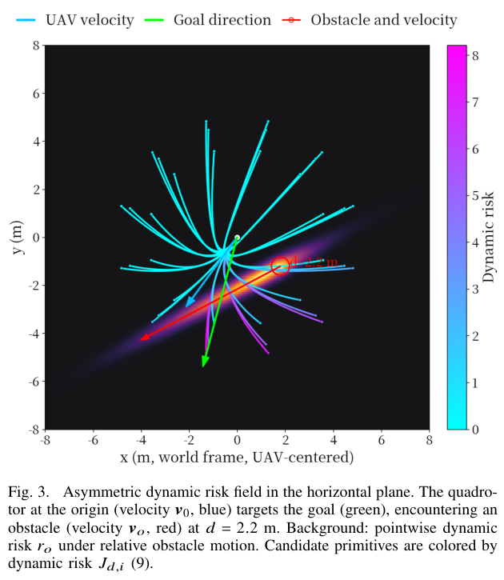

论文图 3（PDF p.5）以水平面展示点风险背景和候选轨迹风险。长轴说明各向异性尺度的作用，候选风险还取决于整条轨迹与目标未来位置的关系。该图用于解释机制；闭环安全收益需由第 8 章的消融和试验结果支持，不能仅凭热力图判断。

### 6.6 沿候选轨迹累积风险

论文对时间与目标求和：

$$
J_{d,i}=\sum_{j=1}^{K}\sum_{o\in\mathcal O_t}
 r_o\bigl(\mathbf q(\tau_j),\mathbf v_{\mathrm{rel}}(\tau_j)\bigr).
\tag{9}
$$

**来源：论文 §V-B，PDF p.5，式（9）。** $J_{d,i}$ 为第 $i$ 条候选的动态风险，$K$ 为时间采样数，$o$ 为目标索引；相对状态对每个候选和目标分别计算，公式中省略了相关下标。

每个时刻都比较同一时间的无人机与目标状态。严格的时间积分黎曼和还需乘 $\Delta\tau=T/K$，论文说明固定比例由风险尺度吸收；代码也直接累加。改变采样数量或时域时，必须重新考虑风险尺度，而不是假设标签不变。

该步骤复杂度随候选数、采样数和障碍物数增长，发生在训练标签计算中。在线动态头直接预测风险代理，不重复运行这段解析求和。没有有效动态目标时，解析动态代价为零；网络经 Softplus 输出仍可能有残余预测误差。

### 6.7 三项训练目标及梯度路径

训练必须区分“如何让候选几何更好”与“如何评价候选”。定义未经加权的平滑及加速度代价：

$$
J_{\mathrm{jerk},i}=\int_0^T\|\dddot{\boldsymbol\pi}_i(\tau)\|_2^2\,d\tau,
\qquad
J_{\mathrm{acc},i}=\int_0^T\|\ddot{\boldsymbol\pi}_i(\tau)\|_2^2\,d\tau.
$$

代码将其写为边界状态的二次型并解析计算，分别见 [loss_function.py](../OmniRisk/loss/loss_function.py) 的 `qp_generation` 和 [smoothness_loss.py](../OmniRisk/loss/smoothness_loss.py)。二者物理单位分别为 m²/s⁵ 和 m²/s³，损失权重负责尺度平衡；当前代码还按训练速度尺度的五次方、三次方反向缩放权重。

引导代价的当前实现为：

$$
\begin{aligned}
\mathbf d&=\mathbf p_f-\mathbf p_0,\quad
\mathbf h=\mathbf g-\mathbf p_0,\quad
\hat{\mathbf h}=\frac{\mathbf h}{\|\mathbf h\|+\epsilon},\\
J_{\mathrm{guide}}&=\ell_{\mathrm{SL1}}(\|\mathbf h\|,\mathbf d^{\mathsf T}\hat{\mathbf h})
+0.5\|\mathbf d-(\mathbf d^{\mathsf T}\hat{\mathbf h})\hat{\mathbf h}\|.
\end{aligned}
$$

第一项鼓励沿目标方向推进，第二项约束横向偏离；当前 `GuidanceLoss.similarity_loss` 中系数为 0.5，旧权重相关注释不代表当前训练值。$\ell_{\mathrm{SL1}}$ 为默认 $\beta=1$ 的 Smooth-L1：误差绝对值小于 1 时取 $e^2/2$，否则取 $|e|-1/2$。引导权重吸收数值尺度，该损失不是具有统一物理单位的能量函数。

为连接前面的积分定义与训练实现，先明确加权关系：

$$
C_{j,i}=w_jJ_{\mathrm{jerk},i},\qquad
C_{a,i}=w_aJ_{\mathrm{acc},i},\qquad
C_{c,i}=w_cJ_{c,i}.
$$

其中 $w_j,w_a,w_c$ 是训练中实际使用的平滑、加速度和静态净空权重，分别对应 `smoothness_weight`、`accele_weight`、`safety_weight`；前两者已经包含前述速度尺度换算，不能直接等同于 YAML 中未经换算的 `ws`、`wa`。$J_{c,i}$ 来自式（5）。代码以解析二次型计算两个积分，并把加权结果作为 `smooth_cost`、`acc_cost` 传入训练器。

再记 $C_{\mathrm{anchor}}$ 为以当前候选锚点作目标的加权引导代价，$C_{\mathrm{goal}}$ 为以全局导航目标作目标的加权引导代价，则实现为：

$$
\begin{aligned}
\mathcal L_{\mathrm{traj}}&=\frac1N\sum_i
(C_{j,i}+C_{a,i}+C_{c,i}+C_{\mathrm{anchor},i}),\\
Y_{s,i}&=C_{j,i}+C_{a,i}+C_{c,i}+C_{\mathrm{goal},i},\\
\mathcal L_{\mathrm{static}}&=\frac1N\sum_i
\ell_{\mathrm{SL1}}(\hat J_{s,i},\operatorname{sg}[Y_{s,i}]).
\end{aligned}
$$

这是 [trainer.py](../OmniRisk/policy/trainer.py) 的 `forward_and_compute_loss` 的实现公式；实际还对批次平均。终端状态损失不含动态风险，并用各自锚点方向保持候选多样性；静态评分则以全局目标评价“哪条候选更值得执行”。若所有候选几何都被同一个全局目标吸引，背向锚点可能收缩，破坏全向动作覆盖。

动态风险回归采用论文原式：

$$
\mathcal L_{\mathrm{risk}}=\frac1N\sum_{i=1}^{N}
\ell_{\mathrm{smooth}\text{-}L_1}\!\left(
\hat J_{d,i},\operatorname{sg}\left[\ln(1+w_{\mathrm{scale}}J_{d,i})\right]\right).
\tag{10}
$$

**来源：论文 §V-C，PDF p.5，式（10）。** $\hat J_{d,i}$ 为网络输出；$w_{\mathrm{scale}}$ 平衡动态标签幅值；$\operatorname{sg}$ 表示停止梯度，在代码中是 `.detach()`。对数压缩避免极大风险样本支配回归。举例：加权原始风险为 0、1、9、99 时，标签为 0、0.693、2.303、4.605。

当前代码的 `dynamic_safety` 已包含外层 `wc` 和内部 `dynamic_weight`，再进行 `log1p`；因此不能把 YAML 的 `dynamic_weight` 单独当作论文全部 $w_{\mathrm{scale}}$。在线融合权重 $\lambda$ 又是另一层权重。

默认训练入口使三项损失等权相加：

$$
\mathcal L=\mathcal L_{\mathrm{traj}}+\mathcal L_{\mathrm{static}}+\mathcal L_{\mathrm{risk}}.
$$

下图箭头标出依赖关系，停止梯度节点是评分标签与候选几何之间的分界。

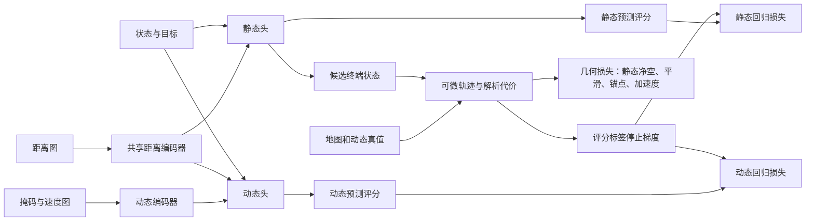

从计算图可得：动态标签虽由候选计算，但 `.detach()` 阻断其通过标签回传到终点；动态评分损失仍会通过动态预测路径更新共享距离编码器。因此不存在“动态分支完全不影响共享参数”的隔离，也没有冻结某一个头。几何损失经多项式、距离查询与引导项直接优化候选端点。

### 6.8 输入扰动、训练配置与迁移条件

`_augment_mask` 包含随机膨胀/腐蚀以及假阳性、假阴性扰动，当前配置概率为 0.02 和 0.05；速度图先从真实目标 ID 构造，不随掩码扰动同步清零。因此训练时可能出现掩码为零而速度非零的像素，促使网络不只依赖二值定位。

在线则由跟踪可见性共同生成掩码与速度，并把掩码外速度设零。这种训练扰动有鲁棒性动机，但不能完全模拟真实漏检时“目标身份和速度都不可用”的情况。输入单位、坐标方向、列映射、背景累积和补全语义一致，才是迁移成立的基础。

当前 `train.py` 使用 AdamW、学习率 $1.5\times10^{-4}$、batch size 16、200 epochs，保存间隔 30，种子 0；这些是当前脚本值，不应标注为论文已报告的完整训练协议。`--epoch` 用于选择预训练权重编号，并不设置训练轮数。训练与导出入口见附录 C。

<a id="sec-7"></a>

## 7. 在线规划、轨迹提交与执行

### 7.1 运行模式和评分融合

运行时状态机优先处理动态威胁：有威胁选 `DODGE`，无威胁但有导航意图选 `CRUISE`，否则 `HOVER`。威胁判据及保持窗口由节点逻辑决定，不由动态评分头单独决定。

论文在线选择写为：

$$
i^*=\arg\min_i\left(\hat J_{s,i}+\lambda\hat J_{d,i}+\mathcal R_{\mathrm{con}}(i)\right).
\tag{11}
$$

**来源：论文 §V-D，PDF p.6，式（11）。** 该式将前文的候选表示、训练代价和网络预测连接为在线决策，各变量的来源如下。

| 符号 | 与前文的对应关系 | 在线作用 |
| --- | --- | --- |
| $i$ | 第 2.2 节候选集合 $\Pi=\{\boldsymbol{\pi}_i\}_{i=1}^{N}$ 的索引，当前 $N=36$ | 指定正在评价的候选 |
| $i^*$ | 对应式（2）的所选轨迹 $\boldsymbol{\pi}^*=\boldsymbol{\pi}_{i^*}$ | 返回最小综合评分对应的候选编号 |
| $\hat J_{s,i}$ | 第 5.2 节静态头输出；由第 6.7 节的标签 $Y_{s,i}$ 监督 | 综合评价平滑性、加速度、静态净空和目标进展 |
| $\hat J_{d,i}$ | 第 5.2 节动态头输出；由式（10）的对数域标签监督，标签中的 $J_{d,i}$ 来自式（9） | 预测第 $i$ 个候选的压缩动态风险 |
| $\lambda$ | 在线动态评分融合权重，对应运行配置 `fusion_lambda` | 决定动态评分相对于静态综合评分的影响 |
| $\mathcal R_{\mathrm{con}}(i)$ | 论文对第 7.2 节连续性惩罚与切换迟滞的概括 | 抑制相邻规划周期频繁切换候选 |

具体而言，两个预测评分学习的目标为：

$$
\begin{aligned}
\hat J_{s,i}&\approx Y_{s,i}
=\underbrace{w_jJ_{\mathrm{jerk},i}}_{\text{平滑代价}}
+\underbrace{w_aJ_{\mathrm{acc},i}}_{\text{加速度代价}}
+\underbrace{C_{c,i}}_{\text{加权静态净空}}
+\underbrace{C_{\mathrm{goal},i}}_{\text{加权目标引导}},\\
\hat J_{d,i}&\approx\ln(1+w_{\mathrm{scale}}J_{d,i}).
\end{aligned}
$$

这里的近似号表示训练目标与网络预测之间的关系，不是在线重新求值的等式。**第 6.7 节的 jerk 和加速度积分已经通过静态评分标签进入式（11）**：训练时既参与终端轨迹优化，也监督静态评分；在线直接读取静态头预测，不再次计算或重复添加这些积分。静态评分使用全局目标引导 $C_{\mathrm{goal},i}$，不是训练候选几何时使用的锚点引导 $C_{\mathrm{anchor},i}$。

动态评分的来源依次为：**式（8）计算点风险 → 式（9）沿轨迹累积解析风险 → 式（10）训练对数域预测 → 式（11）融合评分选轨。** 帽子 $\hat{}$ 表示网络预测；$J_{d,i}$ 与 $\hat J_{d,i}$ 不在同一数值尺度上，后者不能解释为碰撞概率。当前代码直接融合预测评分，不先做指数还原。

三类权重也不能混淆：式（2）的 $\lambda_s$ 调节平滑项，式（10）的 $w_{\mathrm{scale}}$ 缩放训练动态标签，式（11）的 $\lambda$ 调节在线动态评分。相对于式（2），式（11）中的静态预测评分承接目标、平滑和静态净空等综合代价，动态预测评分提供学习后的运动风险评价。

此外，$\mathcal R_{\mathrm{con}}$ 是论文层面的概括写法。当前实现先加连续性代价，再进行独立的迟滞判断；不能将全部迟滞逻辑理解为一个普通的可加代价项，具体条件见下一节。

当前 [runtime_modes.py](../OmniRisk/runtime_modes.py) 从模式配置派生：

$$
\eta=\frac{v_{\mathrm{runtime}}}{v_{\mathrm{train}}},\quad
v_{\max}=v_{\mathrm{runtime}},\quad a_{\max}=\eta^2a_{\mathrm{train}},\quad
T=\frac{2r_a}{v_{\mathrm{runtime}}},\quad L_g=2r_a.
$$

| 当前默认模式 | 速度尺度 | `radio_range` | $T$ | $\lambda$ |
| --- | --- | --- | --- | --- |
| CRUISE | 4 m/s | 4 m | 2 s | 0 |
| DODGE | 4 m/s | 4 m | 2 s | 10 |
| HOVER | 配置继承巡航 | 同巡航 | 不执行普通规划轨迹 | 不用于普通选轨执行 |

训练速度和加速度尺度均为 6，因此上述在线加速度尺度为 $6(4/6)^2\approx2.667$ m/s²。顶层 `fusion_lambda=100` 不等于在线避障默认使用 100；LiDAR 节点启动时读取模式配置形成快照，不能假设修改 YAML 会实时生效。

### 7.2 连续性惩罚与迟滞是两个步骤

设上一轮候选编号为 $k$，当前帧各候选世界系终点为 $\mathbf p_{f,i}$。代码先计算：

$$
S_i=\hat J_{s,i}+\lambda\hat J_{d,i},\qquad
\tilde S_i=S_i+w_{\mathrm{con}}
\frac{\|\mathbf p_{f,i}-\mathbf p_{f,k}\|}
{\max_j\|\mathbf p_{f,j}-\mathbf p_{f,k}\|}.
$$

若没有有效上一编号、权重为零或所有距离为零，则不加该项。这里参照的是**上一编号在当前帧对应的终点**，不是上一帧保存的历史世界系终点。随后令 $b=\arg\min_i\tilde S_i$，仅在：

$$
\tilde S_b+\delta_{\mathrm{switch}}<\tilde S_k
$$

时切换到 $b$，否则保留 $k$。当前默认 $w_{\mathrm{con}}=0.8$、$\delta_{\mathrm{switch}}=0.8$。实现见 [trajectory_selection.py](../OmniRisk/trajectory_selection.py)。上一编号主要在持续避障选择中生效，不能描述为所有模式永久保留旧方向。

教学例：旧候选调整后评分为 5.0，新候选为 4.5，迟滞阈值 0.8，则保持旧候选；新候选降至 4.0 时才切换。这会减少近似等价动作之间的抖动，也可能延缓切换，阈值需要通过后续闭环试验验证。

回到横穿球的贯穿示例，假设首次选择时直行候选的静态、动态预测评分为 1.0、0.9，侧移候选为 2.0、0.1；取避障模式 $\lambda=10$，则融合评分分别为 10.0 和 3.0，选择侧移。这里的分数是教学构造，不是实际网络输出。虽然侧移的目标推进或静态代价较高，它仍可能因较低的动态风险胜出；最终曲线还取决于该候选预测的终端速度、加速度和最新起始状态。

### 7.3 轨迹重建使用两个不同时间基准

`_run_prepared_inference` 将预测终点用**感知参考时刻**的规划原点转回世界系，再读取**重建时最新里程计**作为起始位置和速度，并用当前 `desire_acc` 作为起始加速度。这样保持目标端点对应已推理场景，同时衔接计算期间已发生的本机运动。

这也意味着最终执行曲线可能与网络评分隐含的原起始状态曲线不同。延迟越大，差异可能越明显；时效检查降低过期结果被使用的风险，但不是对新曲线重新解析验证全部动态碰撞。

正常选轨路径先选择候选，再为选中终点分别创建三个 `Poly5Solver`；不需要为全部 36 条曲线执行在线风险积分。可视化展开全部轨迹属于诊断路径。

### 7.4 异步处理、提交与轨迹有效期

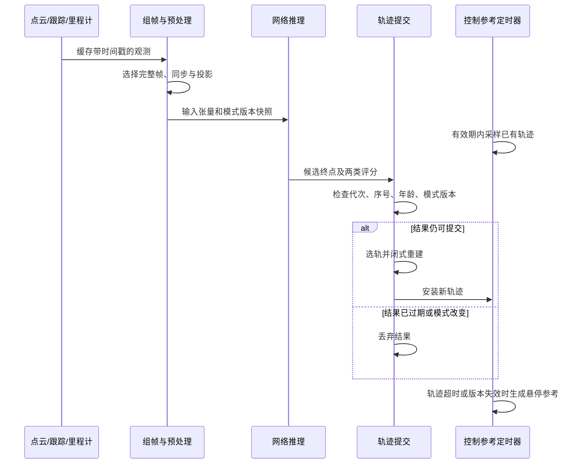

感知参考时间、消息到达时间、推理完成时间与轨迹提交时间承担不同作用。代码使用序号和代次防止旧结果覆盖新结果，使用模式版本防止旧模式结果被安装，使用单调时钟衡量计算阶段年龄及刷新超时。

当前 `trajectory_refresh_timeout=0.2` s；轨迹还需满足自身时域和模式版本要求。某轮推理未完成时，可以继续执行仍有效的已提交轨迹；若超时且具备有效状态，则锁定当前位置发布悬停参考。**悬停是工程退化行为，不保证在快速动态威胁中仍然安全。**

### 7.5 从连续轨迹到控制器

节点内部保存多项式，但向控制器发送采样后的 `PositionCommand`：位置、速度、加速度、jerk、偏航、偏航角速度和轨迹状态。`control_pub` 的定时周期为 0.02 s，即名义 50 Hz；新轨迹提交时还可能触发即时发布，实际频率应测量。

贯穿示例的最后一步因此是：取得侧移候选的终端状态，以六个边界条件逐轴求系数，再按参考定时器采样。控制器收到的是某一时刻的期望位置及其导数，结合实际状态跟踪；下一帧球和无人机位置更新后，整个感知—推理—选轨过程重新执行。风险监督只在训练链条中出现，实际飞行由这些离散更新的观测和连续参考共同闭环。

当前全向模式保持已有偏航参考，偏航角速度为零，机头不必朝向运动方向。起飞尚未完成、目标到达、遥控回中和威胁保持等分支也会影响发布状态，不能只按常规轨迹采样理解所有输出。

px4ctrl 使用位置—速度反馈和轨迹前馈。忽略误差限幅、阻力与姿态补偿时，可用以下**简化控制表达**理解：

$$
\mathbf v_{\mathrm{cmd}}=\mathbf v_d+K_p(\mathbf p_d-\mathbf p),\qquad
\mathbf a_{\mathrm{cmd}}=\mathbf a_d+K_v(\mathbf v_{\mathrm{cmd}}-\mathbf v),
\qquad \mathbf F_d=m(\mathbf a_{\mathrm{cmd}}-\mathbf g_{\mathrm{grav}}).
$$

下标 $d$ 是期望参考，$K_p,K_v$ 是反馈增益，$m$ 是质量。期望力方向和偏航确定姿态；力的大小还需通过推力模型转换为归一化指令。实际 [controller.cpp](../ros_ws/src/px4ctrl/src/controller.cpp) 包含限幅及更完整的前馈/姿态处理，不能直接用上式替代控制器。

[PX4CtrlFSM.cpp](../ros_ws/src/px4ctrl/src/PX4CtrlFSM.cpp) 的 `publish_attitude_ctrl` 设置忽略三个角速度字段，发送姿态四元数和推力。MAVROS 负责 ROS/MAVLink 通信与约定的坐标转换；PX4 内部姿态和角速度控制属于外部飞控实现，本仓库接口核对不等于审查了具体飞控固件。

| 时间指标 | 本文采用的准确含义 |
| --- | --- |
| 论文 20 Hz | 论文的规划目标循环，50 ms 时间预算 |
| 论文约 20 ms | 网络推理耗时，不包括整个传感—执行链 |
| 节点 0.02 s | 参考轨迹采样定时周期，名义 50 Hz |
| px4ctrl 最大循环频率 | 当前配置为 200 Hz，受输入和实际调度影响 |
| EKF 输出频率 | 依赖有效 IMU 输入及处理，不能由 launch 注释保证 |

<a id="sec-8"></a>

## 8. 实验依据与方法适用边界

本章数据均来自指定版本论文。实验没有在本地重新执行，图表用于说明论文证据，而不是报告当前项目验收结果。

### 8.1 协议与指标

论文 §VI-A（PDF p.6）定义成功为在规定时间内无碰撞到达目标；物理接触和运动学不可行属于失败。每种条件使用 50 个配对评测种子，与训练种子分离；主要成功率提供 Wilson 95% 置信区间。

| 指标 | 含义 | 判断方向 |
| --- | --- | --- |
| SR | 完成任务的成功试验比例 | 越高越好 |
| DCR | 发生动态碰撞的试验比例 | 越低越好；它不是全部失败率 |
| A–R accuracy | 接近/远离方向判别准确率，标签来自欧氏距离变化率 | 越高越好；与各向异性门控符号并非在所有几何下严格等价 |
| Collision AUC | 未来碰撞判别的 ROC 曲线下面积 | 越高通常表示排序区分能力越好，不是概率校准结果 |
| P95 latency | 95% 的规划周期延迟不超过该值 | 越低越好，需保留测量边界 |
| Deadline miss | 规划超过 50 ms 的周期比例 | 按周期计数，不直接等于试验失败率 |
| Clearance | 无人机与目标的净空间隔 | 应核对中心距离还是表面距离；图 5 明确使用表面间距 |

规划延迟从规划输入到达计到轨迹提交，包含栅格化和推理，排除上游传感、检测和目标确认。网络推理近似恒定不意味着这些上游延迟可忽略。

### 8.2 五通道表示是否必要：表 I

表 I 对比只用距离、距离加掩码和完整输入，重点观察横穿与后方威胁列。

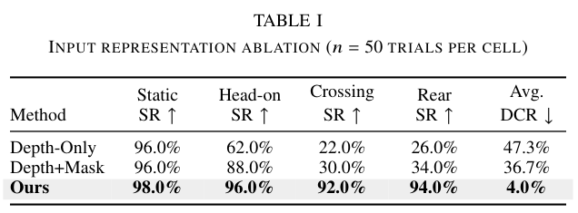

只用距离时，静态 SR 为 96%，横穿和后方 SR 分别为 22%、26%；加入掩码后为 30%、34%；完整输入达到 92%、94%，平均 DCR 从 47.3% 降至 4.0%。这些结果支持速度通道提供了掩码无法替代的运动信息。它没有证明真实速度估计在任意噪声下均足够可靠，速度误差与跟踪延迟仍是迁移风险。

### 8.3 风险设计各部分是否有效：表 II

表 II 逐步去除动态监督、未来预测、各向异性或方向门控，可用于核对第 6 章的每项设计是否具有实验证据。

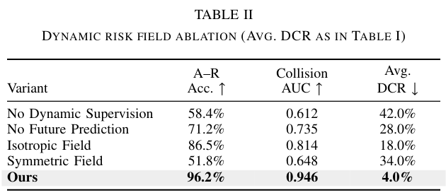

完整方法 A–R 为 96.2%、AUC 为 0.946、DCR 为 4.0%；去掉方向门控后对应 51.8%、0.648、34.0%。去掉未来预测后 AUC 降至 0.735、DCR 为 28.0%。这支持“未来同一时刻位置”和“风险增长方向”均有贡献；但消融结果不等于理论保证，仍受作者训练与评测分布约束。

### 8.4 计算是否稳定：表 III

表 III 随障碍物数量改变报告规划延迟；应同时看 P95、最大值和超时比例。

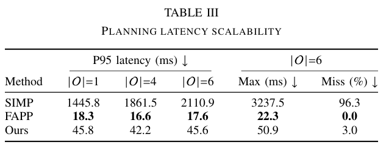

OmniRisk 在 1、4、6 个目标下 P95 为 45.8、42.2、45.6 ms，6 个目标时最大值 50.9 ms、超时比例 3.0%。FAPP 对应 P95 为 17.6 ms，明显更快；SIMP 为 2110.9 ms、超时比例 96.3%。论文另报告网络推理 P95 为 20.0–20.5 ms，剩余变化来自外围处理。

证据支持“该测试范围内规划成本较稳定”，而不是“OmniRisk 最快”或“永不超过 50 ms”。选择操作对候选数为 $O(N)$，固定 $N$ 时不随目标数增加；前端动态投影仍需处理目标列表，不能把这一结论推广为整个系统严格 $O(1)$。

### 8.5 更多候选评价是否带来闭环收益：表 IV、V

表 IV 联合改变障碍物数量与速度，用于检验固定计算开销是否换来复杂相遇条件下的成功率。

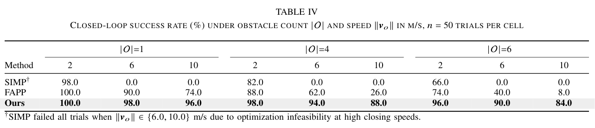

6 个目标、10 m/s 时，OmniRisk 为 84%，FAPP 为 8%，SIMP 为 0%；论文对 OmniRisk 的 84% 给出 95% CI `[71.5%,91.7%]`。SIMP 表下注释将 6、10 m/s 下失败归因于高速接近时的优化不可行；不能仅从成功率表将其全部归因为时间超限。

表 V 进一步拆解最困难条件下的失败原因，避免把所有失败都归为动态碰撞。

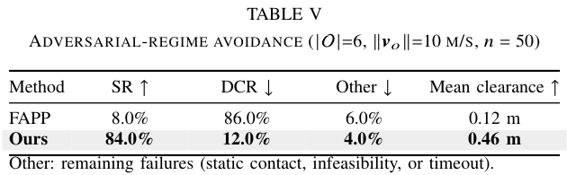

OmniRisk 的 DCR 为 12%、其他失败为 4%、平均净空 0.46 m；FAPP 为 86%、6%、0.12 m。结果支持全向多候选选择的闭环收益，同时表明完整方法仍会失败。平均净空不是最坏情况安全下界。

### 8.6 仿真到实机迁移是否成立：图 5、表 VI

图 5 展示一段连续躲避三个目标的实机案例。先看上部轨迹与最近接近事件，再看下部表面间距随时间的变化。

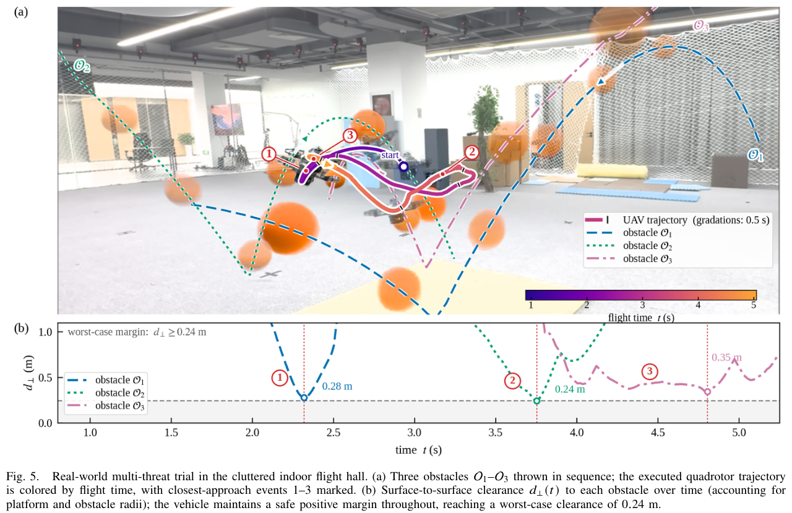

三个事件的标注间距为 0.28、0.24、0.35 m，该案例最小表面间距为 0.24 m。它证明论文展示了连续响应的具体案例，单条成功轨迹本身不能估计总体成功率。

表 VI 在室内、室外对三类未见实物分别进行 50 次试验，用于补足总体统计。

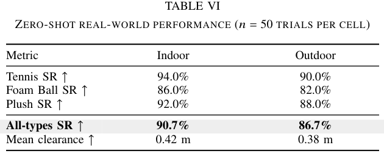

室内 SR 为网球 94%、泡沫球 86%、毛绒玩具 92%，总体 90.7%；室外分别为 90%、82%、88%，总体 86.7%。论文将泡沫球较低成功率归因于低反射导致的确认延迟与跟踪丢失，并报告相对相遇速度最高 15 m/s。这个速度不应写成无人机自身速度或所有试验的固定速度。

表 VI 支持作者平台和场景下的零微调迁移；不同雷达、飞行器动力学、目标尺寸或跟踪器设置是否仍成立，需要新的证据。论文图 1 是静动态混合场景引入，图 4 是作者硬件平台，本报告不将二者重复作为独立性能证据。

<a id="sec-9"></a>

## 9. 论文—代码对照与复现前结论

### 9.1 已确认的对应与差异

| 核对项 | 论文表述 | 当前实现及影响 |
| --- | --- | --- |
| 输入与候选 | 五通道表示、36 个全向候选 | 已在网络、状态转换与配置中定位；九维本机状态另行输入 |
| 球面离散 | 式（3）写下取整 | 当前采用 `rint` 最近网格映射及水平取模；边界像素归属可能不同 |
| 距离补全 | 最近邻传播、保边缘 | 当前为行列插值、支持距离选择及缺失区域平滑；需要单独核查训练/部署输入分布 |
| 循环卷积 | 解释方位角周期性 | 当前宽、高两轴均循环填充，竖直边界引入了额外周期邻接 |
| 静态距离场 | 解析 ESDF | 当前从点云体素化及距离变换构建，再插值查询；不是精确连续几何距离 |
| 动态高斯 | $\exp(-\mathbf q^{\mathsf T}\mathbf A\mathbf q)$ | 当前球体为 $\exp(-m^2/2)$，相同尺度参数下风险分布不同 |
| 动态运动模型 | 时延补偿用弹道；未来风险用匀速 | 代码保持这两个阶段的区别；快速加速、反弹或曲线运动可能偏离标签假设 |
| 训练分工 | 几何不直接优化动态风险 | 代码终点损失无动态项，评分标签 detach；动态评分仍更新共享距离特征 |
| 在线时序连续性 | 式（11）以一项概括 | 代码为当前帧终点距离惩罚，随后做离散迟滞判断 |
| 运动学不可行剔除 | §III-A 声称剔除违反速度/加速度范数约束的候选 | 在当前 LiDAR `_run_prepared_inference`、`process_output`、状态解码及选轨辅助函数中未发现整条轨迹范数约束检查；终端分量限幅不能替代该检查 |
| 推理与执行起点 | 论文以统一起始状态描述候选 | 当前评分基于参考帧，执行重建使用最新位置/速度；延迟会改变实际曲线 |
| 复杂度 | 风险推理对障碍物数为常量规模 | 固定网络与候选选择支持此结论；目标投影、检测跟踪与调度仍可能随负载变化 |
| 参数与运行频率 | 论文实验配置和 20 Hz 规划预算 | 当前分模式参数与异步调度属于具体工程实现；不可直接认定复现了论文全部配置 |

上述“未发现”限定于已核查的当前路径，并非声称整个项目所有历史版本都没有该机制。源码注释、函数名和旧文档可能保留历史语义；本报告按实际数据流解释，例如 `body` 命名在全向路径中可能对应世界轴向的局部规划系。

### 9.2 方法边界

**候选覆盖边界。** 动态头只能给已有候选重新排序，无法直接创造静态头没有提出的逃逸曲线。通道齐全、风险预测正确，也不意味着集合中必然存在安全动作。

**感知边界。** 确认延迟、漏检、错误速度、球体近似和遮挡处理都会改变网络输入。补全距离图与零掩码不能证明场景没有未知动态物体。

**监督边界。** 风险场是人为设计的连续代价代理；相对运动模型、采样密度及各向异性尺度定义了它关注的危险。对数回归准确不等于碰撞概率校准，有限采样也可能遗漏两个采样时刻之间的近碰撞。

**执行边界。** 端点限制、平滑损失和闭式求解均不能自动保证整条轨迹满足飞行器约束；控制器限幅可能进一步使实际执行偏离规划曲线。悬停退化和异步继续执行提高了运行连续性，但需要单独评估动态场景下的后果。

### 9.3 当前可交付结论与后续验证问题

当前通过论文和静态代码阅读可以确认：输入张量构建、网络依赖关系、候选解码、解析损失、停止梯度、选轨与控制参考发布均有可定位实现；论文主要机制已能逐段对应到代码。尚未确认的是这些实现及当前权重、数据、配置组合能否达到论文报告的指标。

后续复现应围绕以下问题收集证据，而不是只确认“程序能启动”：

| 验证问题 | 最小验证方式 | 应记录的证据 |
| --- | --- | --- |
| 输入几何与运动是否正确 | 静态墙、横穿球、±180° 接缝及无目标场景 | 投影位置、通道值、速度方向、时间戳对应 |
| 风险是否按设计响应 | 同位置反转相对速度、改变目标速度、零速和空目标 | 解析风险及网络评分随变量变化的曲线 |
| 候选隔离是否成立 | 固定 $D,o$ 和权重，只改变 $M,V$ | 终点不变、动态评分变化；再单独改变 $D$ |
| 轨迹是否可执行 | 端点约束复算、整段极值或密采样检查 | 六个边界残差、速度/加速度范数、控制饱和 |
| 时序退化是否正确 | 迟到结果、模式改变、输入中断 | 丢弃原因、提交版本、轨迹年龄及悬停参考 |
| 论文收益能否复现 | 配对种子闭环对比与消融 | 成功率、失败分类、净空、延迟测量边界及配置快照 |

当前没有机型和设备实测，不对这些项目填写“已通过”。后续硬件选型与部署参数应在算法理解和仿真证据基础上确定。

<a id="appendix-a"></a>

## 附录 A：符号与缩写索引

| 符号/缩写 | 含义与约定 |
| --- | --- |
| $t_0,\tau,T$ | 感知参考绝对时间、候选内部时间、规划时域；s |
| $W,B,L,P,A_i$ | 世界、机体/IMU、雷达、局部规划、第 $i$ 个基元坐标系 |
| $R_{AB},\mathbf t_{AB}$ | B 到 A 的旋转和平移；旋转无量纲，平移 m |
| $\mathbf p,\mathbf v,\mathbf a,\mathbf j$ | 位置 m、速度 m/s、加速度 m/s²、jerk m/s³ |
| $\mathbf q$ | 第 3 章为姿态四元数；第 6 章按论文表示目标到候选的相对位置，依上下文区分 |
| $\mathbf g$、$\mathbf g_{\mathrm{grav}}$、$\mathbf g_o$ | 导航目标、重力加速度、风险梯度；论文式（4）的 $\mathbf g$ 特指重力 |
| $\mathbf c_o,\mathbf v_o,R_o$ | 障碍物中心、速度、球体半径 |
| $H,W_p,W_n,B$ | 图像高度、原全景宽度、网络宽度、批量大小；批量 $B$ 与坐标系 B 依上下文区分 |
| $D,M,V,I$ | 距离、动态掩码、速度图、五通道表示 |
| $N,K,\mathcal O_t$ | 候选数、轨迹时间采样数、动态目标集合 |
| $r_a,L_g$ | 终点径向尺度、目标归一化长度；m |
| $\sigma_\perp,\sigma_\parallel,\mathbf A_o$ | 横向/纵向风险尺度 m、各向异性度量矩阵 m⁻² |
| $\phi_o,r_o,J_c,J_d$ | 高斯基函数、点风险、静态距离代价、轨迹动态风险 |
| $\hat J_s,\hat J_d$ | 静态预测评分、对数域动态预测评分 |
| $\lambda,w_{\mathrm{scale}},\operatorname{sg}$ | 在线融合权重、动态标签尺度、停止梯度 |
| ESDF | 欧氏有符号距离场；本仓库采用点云体素化近似 |
| CPA | 最近接近事件；inverse-CPA 为从目标相遇条件反构初始状态 |
| ENU / FLU、NED / FRD | 东北天/前左上、北东地/前右下；ROS 与飞控接口须核对各自约定 |
| SR / DCR / P95 | 成功率、动态碰撞率、95 分位延迟 |

<a id="appendix-b"></a>

## 附录 B：公式—代码—配置索引

| 公式或机制 | 正文位置 | 代码与核对入口 |
| --- | --- | --- |
| 论文式（1）输入表示 | 4.3、4.6 | [network.py](../OmniRisk/policy/network.py) `forward`；节点 `_prepare_perception_frame` |
| 论文式（2）总体目标 | 2.2 | [trainer.py](../OmniRisk/policy/trainer.py) `forward_and_compute_loss`；在线按式（11）落实 |
| 论文式（3）投影 | 4.3 | [dynamic_inputs.py](../OmniRisk/dynamic_inputs.py) `project_points_to_range_image` |
| 论文式（4）时延补偿 | 4.2 | [omnirisk_node.py](../OmniRisk/omnirisk_node.py) `_tracks_at`；[perception_sync.py](../OmniRisk/perception_sync.py) `predict_kinematics` |
| 论文式（5）静态净空 | 6.2 | [safety_loss.py](../OmniRisk/loss/safety_loss.py) `cost_function`、`forward`；`d0`、`r` |
| 论文式（6）相对预测 | 6.3 | 同上 `_aniso_cost_sphere`、`_aniso_cost_cylinder` |
| 论文式（7）各向异性 | 6.4 | 同上；`aniso_perp_*`、`aniso_par_*`、`aniso_sigma_z` |
| 论文式（8）方向门控 | 6.5 | 同上 `_aniso_cost`；`aniso_alpha` |
| 论文式（9）风险累积 | 6.6 | 同上 `reduce_dynamic_cost`；`eval_points=30` |
| 论文式（10）风险回归 | 6.7 | [trainer.py](../OmniRisk/policy/trainer.py) 中 `log1p(dynamic_safety).detach()` |
| 论文式（11）在线选择 | 7.1–7.2 | 节点 `_run_prepared_inference`；[trajectory_selection.py](../OmniRisk/trajectory_selection.py) |
| 终端状态与状态归一化 | 4.6、5.1 | [state_transform.py](../OmniRisk/policy/state_transform.py)；[primitive.py](../OmniRisk/policy/primitive.py) |
| 边界求解与导数 | 5.3 | [poly_solver.py](../OmniRisk/policy/poly_solver.py) `Poly5Solver` |
| jerk/加速度二次型 | 6.7 | [loss_function.py](../OmniRisk/loss/loss_function.py)、[smoothness_loss.py](../OmniRisk/loss/smoothness_loss.py) |
| 锚点/目标引导 | 6.7 | [guidance_loss.py](../OmniRisk/loss/guidance_loss.py)；trainer 的两类标签 |
| 模式参数与时域 | 7.1 | [runtime_modes.py](../OmniRisk/runtime_modes.py)；[traj_opt.yaml](../OmniRisk/config/traj_opt.yaml) |
| 轨迹提交与有效期 | 7.3–7.4 | 节点 `_run_prepared_inference`、`control_pub`；[control_state.py](../OmniRisk/control_state.py) |

关键配置分为训练/导出顶层参数、在线模式参数、ROS 节点参数及检测控制模块参数，使用时必须沿读取位置追踪。变量名相同不代表取值来源和生效时机相同。

<a id="appendix-c"></a>

## 附录 C：训练、导出与部署入口

本附录保留后续工作的程序入口。以下命令依据当前 README 和源码整理，**本次文档工作没有执行这些命令，也没有验证环境、权重或设备就绪**。环境基线为 README 所列 Ubuntu 20.04、ROS Noetic、CUDA；作者实机计算平台为 Jetson Orin NX。

### C.1 构建与数据生成

在仓库根目录构建；生成器需要先完成 Simulator 构建并准备 ROS 运行环境：

```bash
bash scripts/build.sh
cd Simulator
source devel/setup.bash
rosrun sensor_simulator dataset_generator
```

数据来源及采样配置见 `Simulator/src/config/config.yaml`；训练读取路径见 `OmniRisk/config/traj_opt.yaml` 的 `dataset_path`。生成数据后应核对图像、目标 ID、动态对象和状态文件的对应关系。

### C.2 训练与模型导出

从仓库根目录进入训练环境：

```bash
source omnirisk_env/bin/activate
cd OmniRisk
python train.py
```

另一个终端可在相同目录执行 `tensorboard --logdir saved`。权重保存在 `saved/run_<n>/epoch<k>.pth`；具体运行号和保存轮次以实际产物为准。`python train.py --pretrained 1 --trial 1 --epoch 60` 表示从指定权重继续训练，不表示只训练 60 轮。

在部署设备和匹配环境中导出 TensorRT，例如已存在 `run_1/epoch60.pth` 时：

```bash
python trt_transfer.py --trial 1 --epoch 60
python omnirisk_node.py --use_tensorrt 1
```

导出不会验证 ROS 感知链路。两种后端还需比较相同输入下的终端状态和评分，特别关注循环填充、输入连续性及掩码/距离缓冲区是否独立。

### C.3 仿真与实机入口索引

| 工作 | 入口 | 依赖与用途 |
| --- | --- | --- |
| 闭环仿真驱动 | `omnirisk_env/bin/python experiments/simulation/run.py --scenario head_on --speed 2` | 从根目录运行；构建、权重和 ROS 环境就绪后使用 |
| 实机飞控通信 | `roslaunch mavros px4.launch fcu_url:=/dev/ttyACM0:57600` | 设备路径、权限与波特率须匹配具体硬件 |
| 定位链路 | `roslaunch fast_lio fastlio_ekf.launch` | 包含雷达驱动、FAST-LIO、额外 EKF；EKF 需要 MAVROS IMU |
| 动态检测 | `roslaunch m_detector detector_mid360.launch` | 检查点云坐标、里程计和目标模型 |
| 实机控制器 | `roslaunch px4ctrl run_ctrl.launch` | 读取实际机型控制参数与状态机输入 |
| 规划节点 | `python omnirisk_node.py --use_tensorrt 1` | 在 `OmniRisk` 目录，感知和模型输入已就绪 |
| 可视化 | `rviz -d OmniRisk/omnirisk.rviz` | 从仓库根目录；可视化成功不等于控制闭环通过 |
| 遥控目标 | `python3 rc_goal_teleop.py _input_mode:=usb` | 在 `OmniRisk` 目录；也支持 MAVROS 遥控来源 |

ROS 终端需加载相应工作空间，例如根目录下 `source ros_ws/devel/setup.bash`。原文中的 MAVLink 频率请求可作为通信调试入口保留：

```bash
rosrun mavros mavcmd long 511 105 5000 0 0 0 0 0
rosrun mavros mavcmd long 511 31  5000 0 0 0 0 0
rosrun mavros mavcmd long 511 83  5000 0 0 0 0 0
```

其中 5000 μs 对应请求 200 Hz，并不保证链路和飞控实际达到该频率。原起降接口为 `/px4ctrl/takeoff_land`，`quadrotor_msgs/TakeoffLand` 中 1 表示起飞、2 表示降落；是否接受请求取决于状态机和控制状态，不能当作任意时刻强制起降命令。当前阶段不将这些入口编排成可直接执行的飞行流程。

观测入口包括 `rostopic hz /ekf_quat/ekf_odom`、`rostopic hz /so3_control/pos_cmd`、`rostopic hz /mavros/setpoint_raw/attitude`，以及节点自身的同步、预处理、推理和提交统计。频率正常只能说明消息流存在，还需验证时间戳、坐标、数值和轨迹有效期。

<a id="appendix-d"></a>

## 附录 D：参考资料与版本信息

1. **主要依据：** [OmniRisk: Omnidirectional Trajectory-Risk Learning for Agile Quadrotor Dynamic Avoidance](../OmniRisk/2609.18191v2.pdf)，arXiv:2609.18191v2，PDF 页码从 1 起计。方法主要位于 pp.2–6，实验位于 pp.6–8。
2. **实现依据：** 当前仓库提交 `041ef58`，读取规划、网络、训练、配置、感知辅助、检测器和控制接口源码；本文未将当前工作树认证为论文实验原始版本。
3. **工程入口：** [README](../README.md)、[Simulator 说明](../Simulator/src/readme.md)、[Controller 说明](../Controller/src/readme.md)。命令与默认值均需以实际使用版本复核。
4. **已有辅助资料：** [论文精读](../paper-notes/omnirisk-deep-read/report.md)、[框架解析](omnirisk-framework/report.md)、[代码审查与原理补充](实机仿真复现流程_代码审查与原理补充.md)。这些资料用于发现线索；本报告关键机制重新对照 PDF 和源码，历史版本结论不自动沿用。
5. **图示来源：** 论文图 2、图 3 与工程图使用 `omnirisk-framework/assets/`；实验截图使用 `paper-notes/omnirisk-deep-read/assets/crops/`。论文页和相关截图经视觉核对；公式以可编辑 LaTeX 重排。分享 Markdown 时应同时保留相对路径引用的图像目录，或由支持数学与 Mermaid 的渲染器导出。
