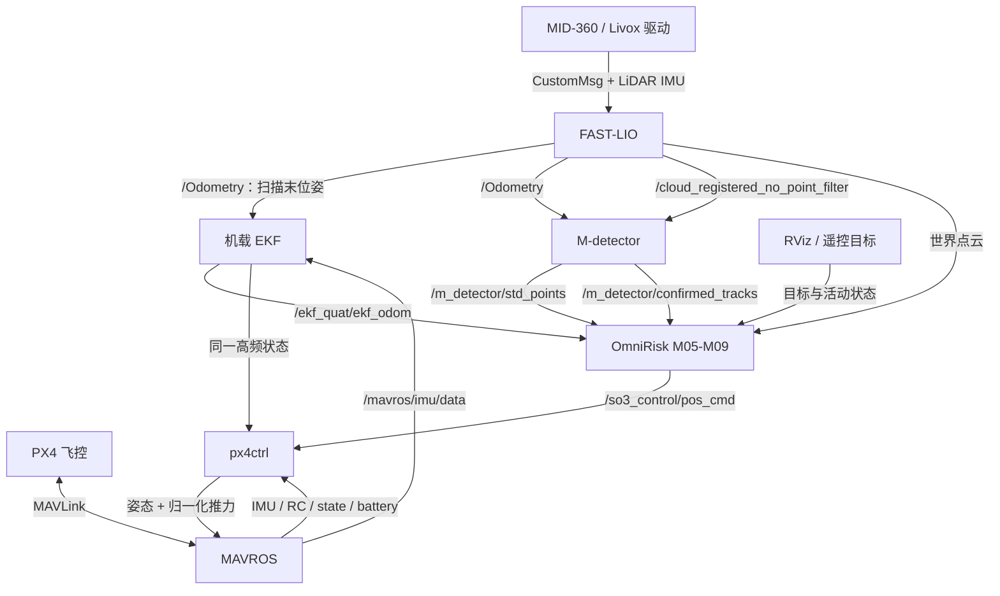
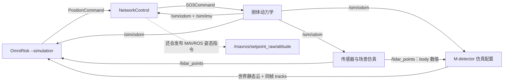
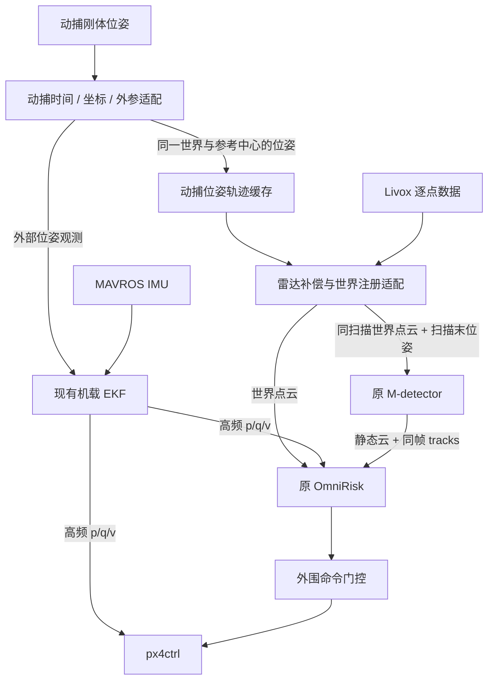
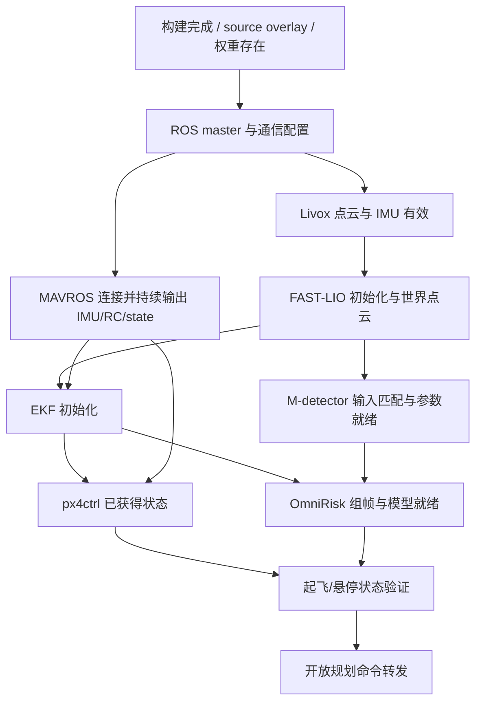
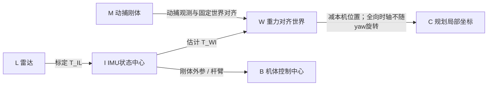
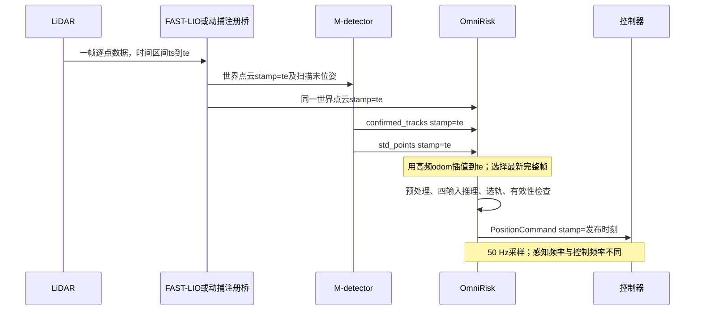
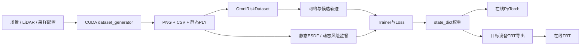

# OmniRisk 架构解析与实机迁移指南

> 本文面向需要在真实无人机上复现 OmniRisk、同时替换外围模块的工程人员。分析对象是本仓库的实际实现，而非仅根据论文框图推断。核心目标：讲清输入输出、通信链路、环境依赖、成功条件与替换方法，保持规划核心不变。

## 目录

- [1. 基线、结论与证据范围](#s1)
- [2. 项目地图与模块边界](#s2)
- [3. 三条在线链路与启动依赖](#s3)
- [4. 逐模块黑盒契约](#s4)
- [5. 通信接口与消息字段字典](#s5)
- [6. 坐标、外参与时间体系](#s6)
- [7. OmniRisk 核心处理过程与保留边界](#s7)
- [8. 环境依赖、构建与部署成功条件](#s8)
- [9. PX4 替代方案与外围任务管理](#s9)
- [10. FAST-LIO 到动捕的替代方案](#s10)
- [11. 替换决策矩阵与简化路线](#s11)
- [12. 启动检查、故障定位与验收](#s12)
- [附录 A. 离线数据、训练与模型产物](#appendix-a)
- [附录 B. 参数与源码索引](#appendix-b)
- [附录 C. 待确认硬件信息与分析覆盖率](#appendix-c)

<a id="s1"></a>
## 1. 基线、结论与证据范围

### 1.1 分析基线

| 项目 | 值 |
|---|---|
| 分析日期 | 2026-10-30 |
| 分支 | `simulation-reproduction` |
| 分析源码提交 | `0cadc2c3b4407b04ac19774ed36ae996b8ebc63a` |
| 本地预训练权重 | `OmniRisk/saved/run_1/epoch60.pth` |
| 权重大小 | 90,624,747 bytes |
| 权重 SHA256 | `013a517db96384e7bd2da8face1be1fb0db756fef6c57548d750082936597b2d` |
| 实机硬件、PX4 版本、动捕协议 | 用户尚未确定 |
| 分析方式 | 主 Agent 整合；三个 GPT-6-Astra / medium 子 Agent 分别分析核心、感知、控制，并交叉核验 |
| 本次执行范围 | 读取源码、配置、消息定义和构建脚本，核对本地产物及链接，编写本文 |
| 未执行 | 安装或构建工程、启动 ROS 节点、加载模型推理、仿真试飞、连接飞控、实机飞行 |

文件行号对应上述提交。链接使用相对于本文的仓库路径，`#L数字` 便于代码托管页面定位；不支持该锚点的本地阅读器可打开文件后按旁边的行号查找。权重哈希只固定本地文件身份，不证明其训练来源或飞行效果。

### 1.2 四个问题的明确回答

1. **输入输出能否说明清楚？** 可以。核心输入包括主点云、静态云、动态目标、本机状态和目标意图，输出是带位置/速度/加速度/jerk 的 `PositionCommand`。消息类型以外，还必须匹配坐标、时间、布局与状态语义。
2. **什么条件下能部署成功？** 必须依次通过构建、启动、数据契约、实时性、控制闭环五层验收。README 的环境声明和启动命令不等于当前目标硬件已经通过这些验收。
3. **核心能否原样保留？** 可以把适配放在核心输入和输出边界，冻结网络、权重、输入构造、基元、模式、选轨和轨迹生成，不进行算法改进或重训练。
4. **外围能否替换？** 已有 `px4ctrl + MAVROS` 可用于 PX4 执行链；动捕可以替代定位，但必须另行提供 FAST-LIO 原本承担的雷达去畸变和世界点云注册。只提供动捕位姿不能替代整条感知链。

### 1.3 如何理解本文的证据

- **[代码确认]**：由实际发布/订阅、调用、配置或构建文件确认。
- **[文档声明]**：README 或注释的说明，尚未在当前设备复验。
- **[适配设计]**：为保持核心不变而提出的外围接口和执行流程，仓库尚未实现。
- **[待验证]**：需要设备型号、标定、录制数据或运行测量才能确定。

默认以“学习与规划核心不变”为复现边界。控制器可以替换，但必须报告跟踪行为的变化；不宣称复现原控制律、原感知误差分布或论文统计结果。当前模式切换、滞回和最新帧调度并非都由仿真分支新增，不能擅自删除来追求所谓“原版简化”。

### 1.4 首先需要知道的部署阻点

| 编号 | 已发现事实 | 直接影响 | 处理边界 |
|---|---|---|---|
| B01 | 节点默认 epoch50，本地只有 epoch60 | 不显式指定会找错文件 | 启动参数 |
| B02 | 本地没有默认 `omnirisk_trt.pth` | 不能直接启 TRT 模式 | 目标设备导出与验证 |
| B03 | 自动起飞调用旧 service，px4ctrl 用 topic | 不能自动贯通起飞 | 外围任务管理 |
| B04 | 默认仿真控制器也发布 MAVROS 姿态指令 | 与 px4ctrl 双发布冲突 | 启停编排 |
| B05 | px4ctrl 不区分 READY/EMPTY | EMPTY 不代表停止接管；降落可能被拒 | 命令门控 |
| B06 | FAST-LIO 输出的不只是位姿 | 直接换 Pose 会丢失核心点云输入 | 状态与点云适配 |
| B07 | 动态目标必须保留原始点云时间戳 | 改成发布时刻会无法组帧 | 替代感知接口 |
| B08 | SDK 安装与驱动查找路径不完全一致 | 干净设备构建可能找不到库 | 构建配置 |
| B09 | 消息源码目录存在旧生成副本 | Python 导入错包会导致字段/MD5 不匹配 | 环境与消息构建 |
| B10 | `ros_ws` 引用 `Controller/src/utils` | 删除 Controller 整目录会破坏实机依赖 | 工程打包 |
| B11 | M-detector 有固定原点 ROI、弹道和目标大小先验 | 改场地或坐标原点可能过滤全部目标 | 外围配置与坐标适配 |
| B12 | 规划器 fallback 仍依赖最近 odom；控制状态机并非覆盖所有断流 | 不能把“发了悬停”当作有效定位或完整故障处置 | 外围监督与飞控验证 |

各项证据与验证方法在对应章节展开，不将这些问题自动归为需要修改核心算法。

<a id="s2"></a>
## 2. 项目地图与模块边界

### 2.1 目录到功能的对应

| 目录/文件组 | 实际职责 | 实机在线是否必需 |
|---|---|---|
| `OmniRisk/omnirisk_node.py` | ROS 接口、同步、预处理调度、推理、选轨、控制采样 | 是 |
| `OmniRisk/policy/network.py`、`models/` | 共享距离编码、动态编码、终端状态与风险评分 | 是 |
| `policy/primitive.py`、`state_transform.py`、`poly_solver.py` | 候选基元、坐标与尺度变换、五次多项式 | 是 |
| `perception_sync.py`、`dynamic_inputs.py`、`depth_completion.py` | 帧缓存、最新数据调度、球面投影、动态目标成像、补洞 | 是 |
| `runtime_modes.py`、`trajectory_selection.py`、`control_state.py` | 模式、连续性/滞回、轨迹有效性和悬停状态 | 是 |
| `static_range_input.py` | 可选上游静态距离图解码 | 默认 pointcloud 路径不使用 |
| `rc_goal_teleop.py`、`rc_home.py` | 遥控目标生成、目标保持/高度返回辅助 | 按任务选择；不等于飞控 RC 接管逻辑 |
| 可视化相关 Python、RViz 配置 | 轨迹、图像、模式及场景观察 | 不要求上机显示，但部分模块仍被节点导入 |
| `train.py`、`policy/dataset.py`、`trainer.py`、`loss/` | 数据读取、监督目标、训练、权重保存 | 预训练推理不需要运行 |
| `trt_transfer.py`、`inference_inputs.py` | TRT 导出、连续内存输入包装 | TRT 可选；输入包装在线复用 |
| `ros_ws/src/livox_ros_driver2`、`Livox-SDK2` | MID-360 驱动与 SDK | 保留 MID-360 时需要 |
| `ros_ws/src/FAST_LIO` | 雷达惯性定位、去畸变、点云注册、地图支持 | 默认需要；替换时逐项覆盖职责 |
| `ros_ws/src/M-detector` | 动静态点分类、聚类、跟踪、静态云输出 | 默认需要；可按契约替代 |
| `ros_ws/src/ekf_quat_pose` | 外部位姿与 IMU 融合；ROS 包名 `ekf_quat` | 默认需要高频状态 |
| `ros_ws/src/px4ctrl` | 实机轨迹跟踪、起降 FSM、飞控指令 | 推荐复用 |
| `Controller/src/so3_control` | 主仿真 NetworkControl 和备用 SO3ControlNodelet | 实机选 px4ctrl 后停用控制节点 |
| `Controller/src/so3_quadrotor_simulator` | 刚体动力学与模拟 odom/IMU | 实机不运行 |
| `Controller/src/utils` | quadrotor_msgs、uav_utils、cmake_utils | 实机仍依赖，不能随仿真一起删除 |
| `Simulator/src` | CUDA/CPU 传感器渲染、场景与离线数据生成 | 实机不运行 |
| `experiments/simulation` | 本分支新增的场景触发、进程编排和功能检查 | 离线验证用 |
| `scripts/`、`docker/` | 构建环境和镜像模板 | 工程辅助，不能视作部署已完成 |
| `paper-notes/`、`assets/` | 论文笔记、展示图片和演示素材 | 不参与在线计算 |

第三方库的内部类不逐个当独立业务黑盒；在依赖表说明其功能及链接边界。相反，单个 `omnirisk_node.py` 内部存在多个关键功能黑盒，不能因为同处一个文件就合并成一个无法分析的大模块。

### 2.2 模块编号

后文固定使用：M01 驱动、M02 FAST-LIO、M03 EKF、M04 动态感知、M05 帧同步、M06 输入构造、M07 网络、M08 模式与选轨、M09 轨迹与命令、M10 仿真控制、M11 PX4 控制、M12 目标输入、M13 仿真环境、M14 可视化/评估、M15 离线训练导出。

核心冻结范围为 M05–M09 以及它们调用的辅助逻辑和权重；控制状态所需的 RC/home 辅助行为也应保留。M01–M04、M10–M14 可以在契约成立时替代。M15 不是在线进程，但其模型与输入定义决定在线兼容性。

<a id="s3"></a>
## 3. 三条在线链路与启动依赖

### 3.1 现有实机链路 [代码确认]



证据：[组合感知启动](../ros_ws/src/FAST_LIO/launch/fastlio_ekf.launch#L16)（16）、[控制 remap](../ros_ws/src/px4ctrl/launch/run_ctrl.launch#L15)（15）、[规划订阅](../OmniRisk/omnirisk_node.py#L354)（354）、[飞控通信](../ros_ws/src/px4ctrl/src/px4ctrl_node.cpp#L25)（25）。机载 EKF 输出没有自动成为 PX4 内部 EKF 的外部定位输入。

### 3.2 默认仿真链路 [代码确认]



README 和实验脚本选择 [attitude 启动文件](../Controller/src/so3_quadrotor_simulator/launch/simulator_attitude_control.launch#L18)（18）的 NetworkControl。另一个 [position 启动文件](../Controller/src/so3_quadrotor_simulator/launch/simulator_position_control.launch#L18)（18）选择 SO3ControlNodelet，其控制语义不同，不能混用分析结论。

实验脚本 `--perception truth` 使用仿真真值旁路，适合诊断规划/控制，不证明真实检测链通过。该脚本默认独立 ROS master 端口 11321，自动检查目标到达、检测、DODGE 和碰撞标记，退出删除临时日志；不能代替论文大样本统计或持久化回放记录。[实验实现](../experiments/simulation/run.py#L117)（117）。

### 3.3 动捕替代后的目标链路 [适配设计，尚未实现]



EKF 的外部位姿观测来自动捕适配器，不能反过来依赖“用 EKF 计算出的扫描末位姿”，否则形成无新外部信息的反馈环。第 10 节给出具体设计。

### 3.4 启动依赖图与真正的就绪条件



进程启动成功不等于就绪：需要观测消息内容、时间、连接状态和连续性。M-detector 参数必须在规划器读取前载入；EKF 要先收到有效外部位姿；px4ctrl 默认等待 RC 和 FCU 连接；起飞前规划命令不得提前进入 px4ctrl。

<a id="s4"></a>
## 4. 逐模块黑盒契约

### 4.1 M01：MID-360 驱动与 SDK

**职责和入口。** `livox_ros_driver2_node` 读取设备网络包，转换成 ROS 点云与 IMU。[ROS1 launch](../ros_ws/src/livox_ros_driver2/launch_ROS1/msg_MID360.launch#L3)（3）默认 `xfer_format=1`、`multi_topic=0`、`data_src=0`；组合启动覆盖 `publish_freq=20`，单独 launch 默认 10。

| 边界 | 契约 |
|---|---|
| 输入 | MID-360 UDP 数据、`MID360_config.json`、Livox SDK |
| 点云输出 | `/livox/lidar`，`livox_ros_driver2/CustomMsg`，`livox_frame` |
| 点云字段 | Header、uint64 timebase、uint32 point_num、uint8 lidar_id、保留字节、CustomPoint 数组 |
| 单点字段 | offset_time、float32 xyz（m）、reflectivity、tag、line |
| 时间 | timebase 基准加逐点 offset_time；偏移为 ns，FAST-LIO 转成 ms 使用 |
| IMU输出 | `/livox/imu`，`sensor_msgs/Imu`；实际量纲/时间需结合驱动和设备校验 |
| 依赖 | ROS1、PCL、SDK 静态库、网络接口、设备配置 |
| 异常/就绪 | SDK/网络连接正常不代表两条消息都有效；逐条检查频率、非零时间和有限数值 |
| 替换条件 | 为 FAST-LIO 提供兼容格式或选择已有对应预处理分支；保留逐点时间、线号/有效标记等预处理需要的字段 |

当前 host IP 是 `192.168.1.50`，雷达 IP 是 `192.168.1.126`，属于样机配置，不是任意设备默认值。[网络配置](../ros_ws/src/livox_ros_driver2/config/MID360_config.json#L13)（13）。不能将普通 XYZ 云直接宣称为 Livox 原始数据的无损替代。

### 4.2 M02：FAST-LIO

**职责。** 预处理与基础过滤 → IMU 初始化/传播 → 逐点运动补偿 → 雷达惯性更新 → 扫描末位姿、世界点云和内部地图。`no_point_filter` 云仍经过 line/tag、重复点、盲区等基础过滤；名称只表示没有后续抽点。

| 边界 | 契约 |
|---|---|
| 输入 | `/livox/lidar` CustomMsg，`/livox/imu` Imu，外参与噪声配置 |
| 输出1 | `/Odometry`，nav_msgs/Odometry，frame=`world`，child=`body`；pose 来自雷达 IMU 状态中心 |
| 输出2 | `/cloud_registered_no_point_filter`，PointCloud2；已去畸变、世界系 xyz；扫描结束 stamp |
| 消费者 | 输出1→EKF、M-detector；输出2→M-detector、OmniRisk |
| 内部状态 | IMU bias、姿态/位置/速度、地图、扫描与 IMU 缓存；启动需要初始化 |
| 地图 | 默认增量地图；可选初始 PCD/重定位路径不是当前核心必需输入 |
| 配置 | `mid360.yaml`、`anomaly_detection.yaml` 和 mapping launch 的参数覆盖 |
| 替换条件 | 位姿、点云处理、时间和坐标都覆盖；可不复刻未被在线核心消费的全局地图发布 |

关键事实：`/Odometry` 没有填充可用 twist；输出 pose covariance 在 publish 后赋值，不应把它解释为已验证的当帧精确协方差。去畸变实际同时补偿旋转和平移，不能按“only rotation”注释删掉平移项。默认 `no_point_filter_scan_publish_en=true`，普通 scan 发布关闭。[预处理](../ros_ws/src/FAST_LIO/src/preprocess.cpp#L173)（173）、[补偿](../ros_ws/src/FAST_LIO/src/IMU_Processing.hpp#L342)（342）、[发布](../ros_ws/src/FAST_LIO/src/laserMapping.cpp#L610)（610、742）。

断流时下游不能依赖 FAST-LIO 自动产生有效替代状态；应以新数据和时间新鲜度判断健康。重新启动或重定位可能改变世界原点，必须协调清空下游历史；仅恢复话题流不足以证明坐标连续。

### 4.3 M03：机载 EKF

**职责。** 将低频外部位姿和高频飞控 IMU 融合成控制级状态。源码目录 `ekf_quat_pose`，ROS package 和实际执行文件叫 `ekf_quat`。

| 边界 | 契约 |
|---|---|
| 输入位姿 | private `bodyodometry` remap `/Odometry`；只读取 pose，不采用输入 twist |
| 输入惯性 | private `imu` remap `/mavros/imu/data`；本EKF传播使用角速度和比力，要求正确轴系和单位；姿态观测来自外部pose |
| 主输出 | `/ekf_quat/ekf_odom`；world p/q、world 线速度；stamp 跟随 IMU；child_frame_id 未填 |
| 附加输出 | ahead/cam odom 辅助分支；不能据 advertise 推断所有分支持续发布 |
| 无效接口 | `acc_filtered` 的实际发布调用被注释；不是可直接使用的 world 去重力加速度 |
| 状态 | p、q、v、陀螺/加速度 bias、历史 IMU 与延迟观测缓存 |
| 初始化 | 先收到外部位姿，再产生初始化后的融合输出；存在延迟更新与重传播 |
| 依赖 | ROS、Eigen、有效 IMU、外部位姿、外参/噪声参数 |
| 替换条件 | 相同参考中心的 p/q/v、同一 world、真实时间、稳定速度和明确失效状态 |

MAVROS 配置有 `tr_i=[0,0,0.08]`、`Rr_i=[1,0,0,0]`、`rotation_imu=I`、`scale_g=1`；这些属于样机假设，接动捕时必须重新解释刚体到状态中心变换。`imu_trans` 默认零；非零杆臂位置输出与线速度表达必须一并核对，不能只移动位置而忽略旋转产生的速度。[launch](../ros_ws/src/ekf_quat_pose/launch/ekf_quat_lidar_mavros.launch#L3)（3）、[外参](../ros_ws/src/ekf_quat_pose/launch/PX4_vio_drone_mavros.yaml#L1)（1）、[状态发布](../ros_ws/src/ekf_quat_pose/src/ekf_node_vio_timesync_with_acc_pub.cpp#L1206)（1206）。

外部位姿停止后 IMU 传播可能继续，话题仍有频率不代表定位没有漂移。外围监督必须跟踪最后一次有效外部观测，不能仅检查 EKF 输出频率。

### 4.4 M04：M-detector 与目标跟踪

**职责。** 配对点云和位姿 → 转换/检查坐标 → 历史深度一致性动态分类 → 聚类 → 目标关联/滤波 → 输出静态背景及目标列表。跟踪器直接消费进程内数据，不要求调试点云开关打开。

| 边界 | 契约 |
|---|---|
| 输入 | 默认世界点云 `/cloud_registered_no_point_filter`、`/Odometry` |
| 同步 | approximate sync + 显式 10 ms 门槛；零 stamp 拒绝；待处理队列满时丢旧帧 |
| 静态输出 | `/m_detector/std_points` PointCloud2；历史静态点累积、可降采样，标记当前扫描时间 |
| 动态输出 | `/m_detector/confirmed_tracks` TrackedObjectArray；world position/velocity/full dimensions；保持原始点云 stamp |
| 无目标 | 仍发布空数组；“没有消息”与“明确无目标”不能等价 |
| 预测输出 | 独立 predicted_tracks，带测量时间、预测时长、stale；不是规划器默认订阅对象 |
| 调试输出 | tentative_tracks、MarkerArray、可视化 odom；point_out/frame_out 可因配置不实际输出 |
| 历史状态 | 深度图缓存、聚类关联、目标 ID、Kalman 状态、命中/失配计数 |
| 替换条件 | 静态背景与动态状态两者都提供；时间、速度、尺寸、确认语义及预测模型保持兼容 |

`confirmed` 不等于本帧真实观测；已确认目标可短时失配预测，`matched/missed_frames` 区分。实际 MID360 `min_init_hits=1`、近距离确认阈值为 2，不能照注释写成所有目标至少命中两次。输出速度过滤又会影响零速初始目标能否出现。

默认先验：弹道重力 −9.81 m/s²、预测上限 0.10 s、最小速度 3 m/s、水平距离≤7 m、固定原点盒 x/y±6 m、z∈[−0.1,2] m、最大包围盒体积 0.04 m³。仿真 overlay 改为恒速、关闭固定原点盒、放宽尺寸/速度等，不能把仿真成功直接当实机配置正确。

M-detector 对整帧使用扫描位姿，不为原始 Livox 点逐点去畸变。换定位后仍需前置补偿。[同步](../ros_ws/src/M-detector/src/dynfilter_with_odom.cpp#L234)（234、295）、[静态云](../ros_ws/src/M-detector/src/DynObjFilter.cpp#L2023)（2023）、[跟踪发布](../ros_ws/src/M-detector/src/FrameTrackerRosPublisher.cpp#L61)（61）、[实机参数](../ros_ws/src/M-detector/config/mid360/mid360.yaml#L140)（140）。

### 4.5 M05–M09：规划核心各黑盒

| 模块 | 输入 → 输出 | 内部状态与失败行为 | 替换边界 |
|---|---|---|---|
| M05 帧同步 | ROS 点云/静态云/tracks/odom → PerceptionFrame | 短缓存、sequence、generation；只处理最新完整帧；时间回退清理，缺帧跳过 | 本次冻结；外围匹配其要求 |
| M06 输入构造 | 完整帧 → depth/mask/velocity/obs 四张量 | 世界平移、球面投影、球栅格化、补洞；空主云跳过；异常帧记录后丢弃 | 本次冻结；不要外部复制后又重复转换 |
| M07 学习网络 | 四张量 → endstate/static/dynamic | 固定权重；静态与动态双分支；加载失败不能推理 | 不替换、不重训 |
| M08 模式/选轨 | 目标、威胁、候选分数 → action 与终端状态 | HOVER/CRUISE/DODGE、模式版本、上一 action；模式变化废弃旧轨迹 | 不改融合、索引、滞回 |
| M09 轨迹/命令 | 当前 p/v、参考 a、目标 p/v/a → 五次多项式 → PositionCommand | 50 Hz 定时采样；home 门槛；0.2 s 刷新超时 fallback | 保持原命令内容；外围决定是否转发 |

详细形状、公式、时序和字段在第 5–7 节，不把网络输出误称为直接电机命令。核心源码入口：[节点](../OmniRisk/omnirisk_node.py#L84)（84）、[缓存与调度](../OmniRisk/perception_sync.py#L18)（18）、[轨迹有效性](../OmniRisk/control_state.py#L31)（31）。

### 4.6 M10：默认仿真控制器及备用控制器

默认 `NetworkControl` 输入 `PositionCommand`、`/sim/odom`、`/sim/imu`；输出 SO3Command 中的世界系力、姿态四元数和旋转反馈增益，同时还发布 MAVROS 姿态/推力消息。READY 时使用规划加速度加 HGDO 扰动补偿；非 READY 时使用位置/速度反馈悬停。HGDO 是根据运动和命令估计外部扰动的观察器。

起降服务为 `SetTakeoffLand`，服务返回成功只代表请求被接受，实际线程随后起降。仿真模式自动启动起飞逻辑，目标 2 m；收到第一条有效规划命令后常规 timer 直接返回，未见完整的失去规划命令后自动回悬停机制。它不能充当实机监督器。

备用 `SO3ControlNodelet` 读取 p/v/a/yaw、可采用非零 kx/kv，通常不检查 trajectory_flag。不要把备用节点的语义套到默认 NetworkControl。[默认控制实现](../Controller/src/so3_control/src/NetworkControl.cpp#L234)（234）、[构造与服务](../Controller/src/so3_control/include/so3_control/NetworkControl.h#L48)（48）、[备用控制](../Controller/src/so3_control/src/so3_control_nodelet.cpp#L108)（108）。

### 4.7 M11：px4ctrl 与 MAVROS/PX4 边界

`px4ctrl` 读取世界系状态和 PositionCommand，用位置/速度反馈与加速度参考产生归一化推力及姿态。默认 `pose_solver=0` 还利用jerk/yaw_dot计算期望角速度，但主流程只发布四元数姿态与推力、忽略三个角速度字段，因此不能称jerk角速度前馈已经送给PX4，也不能因为存在bodyrate发布函数就说当前采用角速度控制。

输入还包括 MAVROS 的 state、extended_state、IMU、RC、电池；输出包括 attitude、debug、traj_start_trigger；通过 MAVROS 服务请求 Offboard、解锁及其他状态动作。内部 FSM 有 MANUAL_CTRL、AUTO_TAKEOFF、AUTO_HOVER、CMD_CTRL、AUTO_LAND。

默认控制循环 200 Hz，cmd 接收超时 0.1 s，odom 超时 0.5 s；配置存在其他超时值不代表每个状态都持续检查。CMD 丢失可回 AUTO_HOVER，odom 丢失可能退出 Offboard。起飞topic没有完成响应；内部Offboard/解锁服务返回与真实飞控状态需要分别确认。

`trajectory_flag`、header.frame_id、snap、yaw_dot_dot、kx/kv 不由当前 px4ctrl 命令回调消费。EMPTY 数值仍被跟踪。控制参数中的“其他项目验证过”“无需调参”属于注释声明，不能替代本机验证。[节点](../ros_ws/src/px4ctrl/src/px4ctrl_node.cpp#L25)（25）、[命令读取](../ros_ws/src/px4ctrl/src/input.cpp#L226)（226）、[FSM](../ros_ws/src/px4ctrl/src/PX4CtrlFSM.cpp#L38)（38）、[控制律](../ros_ws/src/px4ctrl/src/controller.cpp#L30)（30）。

### 4.8 M12：目标输入、RC 与 home

`rc_goal_teleop.py` 可读取 USB joystick 或 `/mavros/rc/in`，结合本机 odom，在 world 下生成目标 PoseStamped 和 `/rc_goal_active` Bool。默认循环 20 Hz、固定高度 0.6 m；目标消息按变化阈值发布，不应理解为每次循环都发目标。

规划器收到目标时仅采用 xy，z 设置为自身 hover_height，忽略输入 frame_id 和目标姿态；所以外部任务系统必须事先转换目标。收到 RC active 后，导航状态受其门控；中心/超时会影响旧目标和高度返回，不能只持续发送 goal 而忽略 active 状态。

这里的“遥控目标”与 px4ctrl 用于模式切换的 RC 逻辑是两层。USB 手柄能给规划目标，不代表满足 px4ctrl 默认 `no_RC=false` 的接收机要求。[目标节点](../OmniRisk/rc_goal_teleop.py#L85)（85）、[规划目标处理](../OmniRisk/omnirisk_node.py#L467)（467）、[home 辅助](../OmniRisk/rc_home.py#L1)（1）。

### 4.9 M13：动力学、传感器与场景仿真

动力学输入 SO3Command、可选外力/力矩；内部计算姿态误差、力矩和旋翼响应，积分刚体运动；默认积分频率 1000 Hz，launch 设置 odom 100 Hz。输出 `/sim/odom` 与 `/sim/imu`，提供理想化本机反馈。

传感器仿真读取 odom 和场景配置，输出 `/lidar_points`、深度图、场景/碰撞/动态目标可视化。点云数值是局部 body 坐标，但 header 可写 `odom`；必须依源码和 `points_in_world_frame=false` 解释。点云 stamp 沿用触发 odom，帧率受配置限速，这种理想同步不证明实机同步成立。

CUDA simulator 和 dataset generator 都依赖 CUDA；不运行仿真不代表规划网络不需要 GPU 达到现有时限。地图、障碍物和点击触发只属于仿真输入，不应搬进真实感知路径。[动力学](../Controller/src/so3_quadrotor_simulator/src/quadrotor_simulator_so3.cpp#L238)（238）、[传感器输出](../Simulator/src/src/test_simulator_cuda.cpp#L291)（291）、[配置](../Simulator/src/config/config.yaml#L1)（1）。

### 4.10 M14–M15：可视化、评估和离线链

可视化消费核心快照，输出 Marker、PointCloud2、Image，默认限制最高 15 Hz；独立最新任务线程避免堆积。部分 range_image 是彩色显示图，不是可直接送网络的浮点距离图。可关闭 RViz 和显示订阅，但不要未经依赖检查删掉被节点 import 的辅助文件。

评估脚本可替换成 rosbag 回放与统计工具，但必须注明使用真实检测还是仿真真值。离线训练与导出完整输入输出见附录 A；实机复现选择现成 epoch60，不要求重新生成数据或训练。[可视化编码](../OmniRisk/omnirisk_node.py#L795)（795）、[可视化线程](../OmniRisk/omnirisk_node.py#L1671)（1671）、[训练入口](../OmniRisk/train.py#L27)（27）。

<a id="s5"></a>
## 5. 通信接口与消息字段字典

### 5.1 主链话题总表 [代码确认]

除注明外，接口为 ROS1 topic；服务另列。队列长度属于消息缓存，不是承诺的实时性。频率需在运行环境测量。

| Topic | 类型 | 生产者 → 消费者 | 坐标/时间语义 | 频率/队列要点 |
|---|---|---|---|---|
| `/livox/lidar` | livox_ros_driver2/CustomMsg | Livox → FAST-LIO | 雷达坐标，保留逐点 ns 偏移 | 组合启动 20 Hz；FAST-LIO 订阅队列10 |
| `/livox/imu` | sensor_msgs/Imu | Livox → FAST-LIO | 雷达 IMU；时钟与点云关联 | FAST-LIO 订阅队列200 |
| `/Odometry` | nav_msgs/Odometry | FAST-LIO → EKF/M-detector | world/body，扫描末 pose | 每有效扫描；不提供有效 twist |
| `/cloud_registered_no_point_filter` | sensor_msgs/PointCloud2 | FAST-LIO → M-detector/规划器 | world，去畸变云，扫描末 stamp | 与 `/Odometry` 同源扫描 |
| `/ekf_quat/ekf_odom` | nav_msgs/Odometry | EKF → 规划器/px4ctrl/目标节点 | world p/q/v；IMU stamp | 由 IMU 驱动；px4ctrl 接收队列100 |
| `/m_detector/std_points` | sensor_msgs/PointCloud2 | detector → 规划器 | world 历史静态背景，当前扫描 stamp | 发布队列1 |
| `/m_detector/confirmed_tracks` | m_detector/TrackedObjectArray | tracker → 规划器 | world 目标状态，原始扫描 stamp | 发布队列1；空列表也发布 |
| `/move_base_simple/goal` | geometry_msgs/PoseStamped | RViz/任务节点 → 规划器 | 必须事先处于规划 world；z 将被覆盖 | 事件输入，规划器订阅队列1 |
| `/rc_goal_active` | std_msgs/Bool | 遥控目标节点 → 规划器 | 是否有活动摇杆意图，无 Header | 规划器按接收时间判超时0.6 s |
| `/so3_control/pos_cmd` | quadrotor_msgs/PositionCommand | 规划器 → 控制器或新增 gate | world p/v/a/j；stamp=发布时刻，frame_id未赋值 | timer 50 Hz + 提交时立即发布；规划发布队列1 |
| `/sim/odom` | nav_msgs/Odometry | 动力学 → 仿真各模块 | 理想本机位置/姿态/世界速度 | launch 100 Hz |
| `/sim/imu` | sensor_msgs/Imu | 动力学 → NetworkControl | 仿真实现定义的惯性数据 | 不直接代替真实 IMU 标定 |
| `/lidar_points` | sensor_msgs/PointCloud2 | 传感器仿真 → detector/规划器 | 数值为 body，header 可为 odom | 独立配置10 Hz，实验脚本覆盖20 Hz |
| `/so3_cmd` | quadrotor_msgs/SO3Command | 仿真控制 → 动力学 | 世界力、姿态及反馈增益 | 当前根命名空间下的解析名称 |

M-detector MID360 输入队列3、同步队列5、工作队列2；规划主输入回调大多队列1并使用短时间缓存，采用最新帧覆盖。EKF 位姿订阅队列40、IMU队列1000，但实际滤波历史仅100帧，两种“队列”不可混同。[detector 订阅与队列](../ros_ws/src/M-detector/src/dynfilter_with_odom.cpp#L475)（475、523）、[EKF接口](../ros_ws/src/ekf_quat_pose/src/ekf_node_vio_timesync_with_acc_pub.cpp#L1084)（1084）、[FAST-LIO订阅](../ros_ws/src/FAST_LIO/src/laserMapping.cpp#L1159)（1159）。

### 5.2 飞控与起降接口

| 接口 | 类型 / 方向 | 消费内容与条件 |
|---|---|---|
| `/mavros/state` | State → px4ctrl | connected、armed、mode；队列10 |
| `/mavros/extended_state` | ExtendedState → px4ctrl | 落地状态；队列10 |
| `/mavros/imu/data` | Imu → EKF/px4ctrl | 姿态、角速度、加速度；px4ctrl队列100，要求不是 data_raw |
| `/mavros/rc/in` | RCIn → px4ctrl/可选目标节点 | channels；px4ctrl默认要求接收机，队列10 |
| `/mavros/battery` | BatteryState → px4ctrl | 电压等；队列100 |
| `/mavros/setpoint_raw/attitude` | AttitudeTarget ← px4ctrl | 四元数 + 归一化推力，忽略 body rates；发布队列10，循环目标200 Hz |
| `/px4ctrl/takeoff_land` | TakeoffLand → px4ctrl | `takeoff_land_cmd=1/2`；话题、无请求ID/完成响应；队列100 |
| `/network_controller_node/takeoff_land` | SetTakeoffLand service | 原 NetworkControl：takeoff bool、takeoff_altitude float32 → res bool |
| `/mavros/set_mode` | SetMode service | px4ctrl请求 Offboard/恢复模式，仍需核对 state 反馈 |
| `/mavros/cmd/arming` | CommandBool service | 解锁/上锁请求，仍需核对实际 armed 状态 |
| `/mavros/cmd/command` | CommandLong service | px4ctrl内部使用的飞控命令接口；不属于规划输入 |
| `/traj_start_trigger` | PoseStamped ← px4ctrl | 特定状态事件，不是持续FSM状态；发布函数未填 stamp |
| `/debugPx4ctrl` | Px4ctrlDebug ← px4ctrl | 控制诊断，不能当作FSM状态确认 |

当前仓库没有可靠的“请求ID → px4ctrl状态转换完成”协议。新增任务管理器必须公开这一限制，不能编造 `/px4ctrl/state` 等现有接口。[接口与服务](../ros_ws/src/px4ctrl/src/px4ctrl_node.cpp#L25)（25–85的起点）、[触发发布](../ros_ws/src/px4ctrl/src/PX4CtrlFSM.cpp#L588)（588）。

### 5.3 核心读取的 Odometry 字段

| 字段 | 核心用途 | 替代源要求 |
|---|---|---|
| `header.stamp` | 感知时刻匹配、缓存排序、速度差分 | 非零采集/估计时间，同一时钟，不用转发 now 冒充新观测 |
| `pose.pose.position.xyz` | 本机原点、轨迹起点、home/到达判断 | m，同一 world、同一物理参考中心 |
| `pose.pose.orientation.xyzw` | body↔world、yaw和状态插值 | 有效归一化四元数；ROS字段顺序与CSV不同 |
| `twist.twist.linear.xyz` | world速度、a差分、控制起点 | m/s，明确是 world 速度，不是 body 速度 |
| `header.frame_id` | 默认点云路径不据此自动完成TF | 名称与数值都正确；不能期待自动转换 |
| 其他 twist/covariance | 不是默认网络的直接状态输入 | 保持消息合法；不能假设被核心使用或校验 |

示例仅说明语义：world 下 p=(1,2,0.6)、v=(0.2,0,0)、q=(0,0,0,1) 表示当前位置及沿 world X 的运动；若机体 yaw=90°，world 速度仍为 `(0.2,0,0)`，不可改成 body 速度后直接送入同一字段。

### 5.4 TrackedObjectArray 字段

| 字段 | 含义 | 核心处理 |
|---|---|---|
| `header.stamp` | 状态对应的雷达测量帧时间 | 与主点云纳秒精确匹配 |
| `tracks[]` | 已确认输出列表，可为空 | 空列表是完整帧的一部分 |
| `confirmed` | 轨迹确认标志 | false 被忽略 |
| `track_uid` | 轨迹唯一标识 | 保留为内部目标身份 |
| `position` | world 目标中心，m | 转为相对本机的规划坐标 |
| `velocity` | world 目标绝对速度，m/s | 构造三通道速度图；不是相对速度/光流 |
| `dimensions` | world轴对齐包围盒完整长宽高，m | 需正且有限；最大边的一半转球半径并裁剪 |
| `id/matched/age/total_hits/missed_frames/point_count/last_iou` | 跟踪诊断与生命周期 | 当前核心不据此判断所有质量问题；外围可监测 |

例如 dimensions=(0.30,0.20,0.20) 对应在线球半径0.15 m；dimensions=(1,1,1) 会被核心裁到0.20 m，**并不保守覆盖1 m物体**。保持核心不变时，替代检测器不能任意扩大到超出该几何假设的任务而声称等价复现。

另外，M-detector内部异常可能发布空 tracks，因此“收到空列表”只能证明下游组帧条件成立，不能独立证明感知成功且无障碍；应结合感知健康日志/状态。[消息定义](../ros_ws/src/M-detector/msg/TrackedObject.msg#L1)（1）、[核心读取](../OmniRisk/omnirisk_node.py#L1110)（1110）、[球栅格化](../OmniRisk/dynamic_inputs.py#L146)（146）。

### 5.5 PositionCommand 字段与双侧语义

| 字段 | 规划器填充 | 单位 | px4ctrl消费 | 默认NetworkControl消费 |
|---|---|---|---|---|
| header.stamp | 当前ROS时间 | s/ns | 超时实际按接收时刻计算 | 不代表原始感知时刻 |
| header.frame_id | 默认未填 | — | 不做TF | 不做通用TF |
| position | 多项式p或保持位置 | m | 是 | READY主要用于状态/记录，非READY用于反馈 |
| velocity | 多项式v或保持参考 | m/s | 是 | 非READY用于反馈 |
| acceleration | 多项式a或保持参考 | m/s² | 是 | READY主要执行量 |
| jerk | 多项式三阶导数 | m/s³ | 读取并参与内部角速度计算；默认未发送该角速度前馈 | 不使用 |
| snap | 默认0 | m/s⁴ | 不使用 | 不使用 |
| yaw / yaw_dot | 全向模式保持yaw、yaw_dot=0 | rad / rad/s | yaw用于姿态；yaw_dot参与内部角速度计算，默认未发送该前馈 | yaw两分支使用，yaw_dot仅非READY使用 |
| yaw_dot_dot | 默认0 | rad/s² | 不使用 | 不使用 |
| kx / kv | 默认0 | 控制器相关 | 不使用 | 默认主路径不作为在线增益输入 |
| trajectory_id | 默认值 | — | 不作为任务代次 | 不可依赖它区分新任务 |
| trajectory_flag | READY=1，EMPTY=0等 | 枚举 | 忽略 | 决定加速度执行或位置反馈分支 |

到达分支可能把上一条命令改成 EMPTY 后继续发布，不能把所有 EMPTY 都概括为“速度/加速度一定为零”。fallback/home 分支通常显式置零，RC高度返回可有非零vz。必须看该消息字段与触发路径。[输出实现](../OmniRisk/omnirisk_node.py#L1876)（1876、1938）、[消息原定义](../Controller/src/utils/quadrotor_msgs/msg/PositionCommand.msg#L1)（1）。

### 5.6 可选、调试与不完整路径

| 路径 | 当前状态 | 迁移判断 |
|---|---|---|
| `/m_detector/static_range` | 规划器有解码，当前detector未找到生产实现 | 不能只切换配置就认为可用 |
| `/m_detector/static_range_pose` | 类型是 Odometry，不是 PoseStamped | 要求同stamp、world p/q/v及完整上游参数契约 |
| `/camera/depth/image_rect_raw` | 相机分支输入，32FC1米或16UC1毫米 | 动态mask/velocity为零，不等价于当前全向动态链 |
| `/m_detector/predicted_tracks` | 独立 PredictedTrackedObjectArray | 不应直接重映射成 confirmed_tracks 类型/时间语义 |
| `/m_detector/odometry` | 输入位姿的可视化复制/偏移 | 不是新的融合定位 |
| `/omnirisk/range_image*` | 部分为JET彩色显示图 | 不可直接当32FC1距离输入 |
| `/omnirisk/depth_input`、轨迹云、Marker | 诊断/显示 | 删除显示端不改变输入契约；不是控制确认 |
| `/drone/odom` | 当前主源码/配置未发现 | 不按旧项目惯例臆造接口 |

<a id="s6"></a>
## 6. 坐标、外参与时间体系

### 6.1 坐标符号与变换约定

本文令 `T_AB` 表示“把 B 坐标的点变换到 A”，即 `p_A=R_AB p_B+t_AB`。W为统一世界，B为选定机体/控制参考中心，I为状态估计IMU，L为雷达，M为动捕标记刚体，C为规划局部坐标。避免使用“外参XYZ”但不说明方向和参考中心。



FAST-LIO世界注册实际为：

```text
p_W = R_WI (R_IL p_L + t_IL) + p_WI
```

其 Odometry 的 `body` 标签并不证明原点就是质心。当前默认 FAST-LIO 与 EKF 还有各自外参，必须用真实机械安装定义统一。示例误差：把雷达中心和机体中心相差8 cm的状态混用，单纯平移时偏差固定；转动时还会出现杆臂速度，不能只减8 cm位置。

### 6.2 EKF 刚体外参与杆臂

EKF 输入外部刚体R的转换代码为 `R_WI=R_WR R_RI^-1`、`p_WI=p_WR−R_WI t_RI`。这里的参数命名应按实现解释，不能根据常见命名猜方向。输出位置另可加 `R*imu_trans` 和世界offset，速度仍直接取状态world v，未发现对应输出杆臂速度项。

若外围把IMU中心改到机体B中心，且 `r_IB` 为I系下I到B的固定向量，应同时处理：

```text
p_WB = p_WI + R_WI r_IB
v_WB = v_WI + omega_W × (R_WI r_IB)
R_WB = R_WI R_IB
```

这些是适配设计公式，不是声称当前EKF自动完成。默认 `imu_trans=0` 可避免额外输出杆臂不一致；若要统一到别的中心，优先在外围状态桥同时转换位置、姿态和速度。**当前EKF输出没有填twist.angular**，状态桥不能取默认零值当真实角速度：需要另订阅同时间/轴系的 `/mavros/imu/data`，按 `rotation_imu` 和状态姿态变换到world，并评估陀螺bias影响；或者使用经验证的姿态差分估计。新桥必须明确选用哪一来源；本文默认采用时间对齐的飞控IMU角速度，bias不可直接观察的误差列入验收。来源：[EKF输入转换](../ros_ws/src/ekf_quat_pose/src/ekf_node_vio_timesync_with_acc_pub.cpp#L475)（475）、[输出](../ros_ws/src/ekf_quat_pose/src/ekf_node_vio_timesync_with_acc_pub.cpp#L1233)（1233）。

### 6.3 规划坐标与飞控坐标不能混为一层

全向模式 `Rotation_wc=I`，规划坐标原点在本机但轴保持world方位。点云只减本机平移；如果输入是body点云，则先用本机姿态转换到world。静态云始终按world解释。基元内部再将状态转到各候选的局部轴。

px4ctrl要求Z向上的world状态，并用 `imu.q * odom.q.inverse() * desired_attitude` 对齐飞控姿态参考。MAVROS插件内部的 ENU/NED、FLU/FRD 转换属于安装版本行为，本次未核验该外部实现。旧 NetworkControl 另有四元数y/z取负，不应复制到px4ctrl再次变换。[规划旋转](../OmniRisk/omnirisk_node.py#L1084)（1084）、[控制姿态](../ros_ws/src/px4ctrl/src/controller.cpp#L88)（88）、[旧接口转换](../Controller/src/so3_control/include/so3_control/mavros_interface.h#L157)（157）。

### 6.4 时间线：一帧扫描如何到达控制



雷达点时间应以整数计算 `t_i_ns=timebase_ns+offset_time_ns`。FAST-LIO用 `offset_time/1e6` 写curvature毫秒，再在IMU补偿中除1000变秒。原始点时间、扫描参考时间、ROS接收时间、控制发布时刻分别记录，不混成一个 `now()`。

### 6.5 时限、缓存及失效边界

| 参数/机制 | 当前值或行为 | 正确解释 |
|---|---|---|
| detector sync_max_interval | 0.01 s | 只限制detector输入点云与odom差，不是所有输出可随意错10ms |
| planner sync_cache_duration | 0.25 s | 数据缓存长度，不是任务FIFO容量 |
| planner sync_timeout | 0.15 s | 等待完整帧期限；晚来的required消息不能无限补回 |
| static_fallback_tolerance | 实机0.06 s；simulation=0 | 只允许静态背景取较早帧；tracks仍精确同stamp |
| odom_sync_tolerance | 0.03 s | 插值两侧/邻近状态约束；四元数用nlerp，不是SLERP |
| output_max_age_ms | 120 ms | 从本机主云到达起计；不包含上游扫描/定位全部耗时 |
| output_age_warn_ms | 150 ms | 诊断阈值；不是允许提交150ms结果 |
| trajectory_refresh_timeout | 0.2 s | 轨迹未刷新进入fallback，不证明odom本身新鲜 |
| px4ctrl cmd timeout | 0.1 s | 回调接收时间超时；下游排队可能延后计时 |
| px4ctrl odom timeout | 0.5 s | 不等于外部定位有效约束龄期 |
| EKF历史 | 100帧 | 延迟位姿补偿窗口随IMU频率变化；200Hz约0.5s，非实测保证 |

规划器对时间回退清缓存、增generation并废弃轨迹，但detector的队列/跟踪回退恢复并非全状态重置：大回跳可重置排序基准或清tracks，历史点云/待处理内容不一定全部清空。世界原点跳变更不会自动通过改stamp修好。外围应停接管，协调重初始化后才恢复。[同步选择](../OmniRisk/perception_sync.py#L212)（212）、[回退](../OmniRisk/omnirisk_node.py#L651)（651）、[detector队列](../ros_ws/src/M-detector/include/m-detector/BoundedFrameQueue.h#L53)（53）。

<a id="s7"></a>
## 7. OmniRisk 核心处理过程与保留边界

### 7.1 从ROS消息到四个张量

1. 回调把主云、静态云、tracks、odom存入按stamp排序的短缓存。主云是组帧基准。
2. assembly选最新完整帧；tracks必须精确匹配，odom在允许范围插值，静态云按模式允许回退。
3. 解码xyz。当前读取器假设每记录开头三个float32为xyz，未通用解析字段偏移、big-endian或row padding。
4. 将主云/静态云变到本机平移原点、world轴方向的规划坐标。
5. 各自投影为96×360球面距离图，同像素取最近距离，取两图逐像素最小值形成base range。
6. 根据目标中心/尺寸生成球，在相同射线上求交并做遮挡判定，输出组合range、动态mask和目标world速度图。
7. 对range做补洞与裁剪；按同一列查表从360映射到384，除20得到depth；mask和velocity使用对应映射，不能独立换resize规则。
8. 从本机world v、估计a和目标位移生成obs，归一化后转各基元局部轴；四张量转换为float32连续内存。

默认pointcloud有效点范围实际为 **0.1 < range < 20 m**，动态球求交近界也为0.1。类里的 `min_dis=0.3` 用于其他路径，不能取代实际调用值。球面顶行+52°、底行−7°，水平覆盖360°，azimuth从−π开始。球半径为 `clip(max(dimensions)/2,0.10,0.20)`，遮挡容差0.15m；补洞不应覆盖原本有效测量值。

证据：[投影调用](../OmniRisk/omnirisk_node.py#L771)（771）、[完整预处理](../OmniRisk/omnirisk_node.py#L1342)（1342）、[网格与映射](../OmniRisk/dynamic_inputs.py#L8)（8、56）、[补洞](../OmniRisk/depth_completion.py#L81)（81）。

### 7.2 网络输入输出与归一化

| 张量 | shape | dtype/数值语义 |
|---|---|---|
| depth | `[1,1,96,384]` | float32，range/20，补洞后的距离，不是RGB图 |
| mask | `[1,1,96,384]` | float32，动态可见射线二值标记 |
| velocity | `[1,3,96,384]` | float32，障碍物world vx/vy/vz，m/s；非动态像素0；不除4或6 |
| obs | `[1,9,3,12]` | float32，归一化本机v、a、目标位移，再转基元坐标 |
| endstate | `[1,9,3,12]` | tanh参数编码，需decode后才得到物理终端p/v/a |
| static_score | `[1,3,12]` | softplus非负分数，越小越好 |
| dynamic_score | `[1,3,12]` | softplus非负分数，训练目标涉及log1p风险，不是概率 |

obs归一化为 `v/v_max`、`a/a_max`、`goal_delta/max(norm(goal_delta),goal_length)`。目标距离较近时保留尺度，较远时保留方向。网络端点/static分支只读depth+obs；dynamic分支读depth+mask+velocity+obs，共用depth feature。前向静态分支不依赖mask，不代表训练时完全没有共享梯度。

编码器使用ResNet18派生结构和64通道特征，head为1×1卷积堆叠。既有卷积padding包含水平/垂直环绕实现；不要把“全景图”自行简化成更换padding。`inference_inputs.py`保持连续内存缓冲生命周期，尤其TRT路径需要保留。[网络](../OmniRisk/policy/network.py#L26)（26）、[编码器](../OmniRisk/policy/models/backbone.py#L7)（7）、[输入包装](../OmniRisk/inference_inputs.py#L1)（1）。

### 7.3 候选基元与输出解码

共有12方位×3俯仰=36候选。基元可以理解为36个预定义动作方向；网络在每个方向附近预测终端条件。

原始9通道为 `[δyaw_code,δpitch_code,radius_code,vpx,vpy,vpz,apx,apy,apz]`。前三项不是xyz：

```text
δyaw = code[0] × 15°
δpitch = code[1] × 10°
radius = (code[2] + 1) × radio_range
p_end_local = 球坐标(yaw_anchor+δyaw, pitch_anchor+δpitch, radius)
v_end_local = R_primitive × (code[3:6] × vel_max)
a_end_local = R_primitive × (code[6:9] × acc_max)
```

锚点yaw为−165°、−135°…+165°，pitch约2.833°、22.5°、42.167°。图像行从高俯仰到低俯仰，基元构造相反，因此重排仅翻垂直，不翻水平。错误重排可能把安全方向镜像到相反方向。

`vel_max=4`是终端速度各分量的缩放，**不保证速度向量范数≤4，也不保证五次曲线全程满足4m/s硬约束**。加速度参数也不能当作完整曲线的严格硬界。若机体能力不足，不能仅靠“参数叫max”就判定可执行。[基元](../OmniRisk/policy/primitive.py#L44)（44）、[解码](../OmniRisk/policy/state_transform.py#L69)（69）、[索引](../OmniRisk/policy/state_transform.py#L11)（11）。

### 7.4 模式、风险融合与连续性

| 模式 | 触发 | velocity/radio_range | λ | 是否安装可执行轨迹 |
|---|---|---|---|---|
| HOVER | 无活动导航且无威胁 | 沿用cruise配置 | 0 | 否，保持/返回策略处理 |
| CRUISE | 有导航意图且无威胁 | 4 / 4 | 0 | 是 |
| DODGE | 有确认目标进入威胁范围，及消失后0.2s保持窗 | 4 / 4 | 10 | 是 |

威胁范围默认6m；按目标距离触发，不是独立精确碰撞预测。模式优先级DODGE高于导航。配置推导 `acc_max=(4/6)^2×6≈2.667`、`T=2×4/4=2s`、`goal_length=8m`。

先算 `score_i=static_i+λ dynamic_i`，连续DODGE阶段加入端点连续性代价，最大权重0.8；新动作仅在 `new_score+0.8<previous_score` 时替代上一动作。连续性参考的是**本帧上一action对应的候选终点**，不等于直接与上一帧已执行世界终点比较。

模式切换递增version、清待处理槽、使旧轨迹失效。LiDAR路径在成功组装完整感知帧时刷新规划runtime mode，0.2s保持窗并非独立定时器到点就强制切mode。断流时规划mode可能暂留DODGE，控制侧却已因轨迹超时输出fallback并设置control_mode=HOVER；这两个状态应分别诊断。推理完成后还必须确认mode/version/generation未变、sequence新于最后提交且时限有效。[模式](../OmniRisk/runtime_modes.py#L30)（30）、[选轨](../OmniRisk/trajectory_selection.py#L4)（4）、[提交](../OmniRisk/omnirisk_node.py#L1534)（1534）。

### 7.5 五次曲线与控制采样

每轴曲线 `p(t)=c0+c1t+...+c5t^5`，由起终位置、速度、加速度6个约束决定。起点p/v取提交时最新odom，起点a取上一控制参考 `desire_acc`；终点位置锚定感知帧时刻本机位置加预测位移，不是全部取同一时刻状态。

曲线安装后立即调用一次control_pub，首次发布t=0.02s样本但保留采样时钟为0；下一次timer再次发布t=0.02s，之后按0.02s推进。这个首样本重复规则见control_state，不能省略后再宣称控制序列完全一致。采样不按墙钟重新计算真实执行进度。输出p/v/a/jerk是解析导数。默认全向yaw保持，不沿速度方向自动转头。

home_set前不发命令；home判据是绝对z>0.5且|vz|<0.1，home z固定0.6，不读取飞控已起飞确认。轨迹过期、版本不符或未就绪时可锁存当前odom位置保持。落地后home_set没有通用任务重置接口，第二轮任务需明确重新初始化流程。[多项式](../OmniRisk/policy/poly_solver.py#L1)（1）、[轨迹安装](../OmniRisk/omnirisk_node.py#L1575)（1575）、[采样](../OmniRisk/omnirisk_node.py#L1896)（1896）。

### 7.6 不改变核心的判定标准

| 改动 | 本次是否允许作为外围替换 | 原因 |
|---|---|---|
| 换定位源、校准外参、统一时间和ROS话题 | 可以，需契约验收 | 产生等义输入 |
| 用现有px4ctrl跟踪原PositionCommand | 可以，单独验证控制效果 | 改执行器而不改规划 |
| 关闭RViz、训练和仿真进程 | 可以 | 不删除在线必需导入与消息依赖 |
| 换depth/mask/velocity语义或基元排列 | 不可以 | 改变网络输入/输出解释 |
| 修改λ、滞回、球尺寸、补洞或模式判据来适应硬件 | 不在当前任务范围 | 已改变规划行为 |
| 重新训练、压缩网络、剪枝或优化算法 | 不在当前任务范围 | 用户要求原算法复现 |
| 使用已有TRT导出路径 | 可选，需数值与行为验证 | 运行后端变化仍可能影响近分数候选排序 |

<a id="s8"></a>
## 8. 环境依赖、构建与部署成功条件

### 8.1 多套环境来源不能混用成一份已验证清单

| 来源 | 声明/配置 | 证据与限制 |
|---|---|---|
| README | Ubuntu20.04、ROS Noetic、CUDA；Orin NX/JetPack5.1.x | 作者测试声明，不是本次目标设备实测 |
| build.sh x86 | Torch2.4.1+cu118 / torchvision0.19.1+cu118 | 仅在import失败时安装，不强制纠正已有不匹配版本 |
| build.sh Jetson | NVIDIA特定Torch2.1 wheel、torchvision0.16.0源码、系统TRT | Python3.8、JetPack/L4T及编译环境必须匹配 |
| 仿真Docker | CUDA12.8、Python3.10环境、Torch2.8+cu128 | 属于另一构建路线，不直接套到ARM Jetson |
| 部署Docker | ARM64 ROS Noetic基础与部分TRT安装尝试 | 没完成整个项目构建，依赖失败可能被跳过 |

证据：[README环境](../README.md#L145)（145附近）、[安装脚本](../scripts/build.sh#L19)（19、75、98）、[仿真依赖](../docker/requirements.txt#L1)（1）、[部署镜像](../docker/deploy.dockerfile#L69)（69）。

### 8.2 按模块分解的环境矩阵

| 模块 | 编译/安装依赖 | 运行前置条件 | 成功判据 |
|---|---|---|---|
| ROS消息/工具 | Catkin、系统Python消息生成、quadrotor_msgs、m_detector msgs | source正确devel；PYTHONPATH无旧副本覆盖 | 类型/MD5/字段一致，生产消费端连接 |
| Livox | SDK2、PCL、ROS driver、APR等CMake依赖 | 设备IP/host网卡/端口、驱动配置 | 点云和IMU有效、时间单调、字段匹配 |
| FAST-LIO | C++17、Eigen、PCL、OpenCV、OpenMP/PythonLibs等；随工程构建fast_gicp | IMU覆盖扫描、标定、初始化 | 世界点云与pose同扫描且几何稳定 |
| M-detector | C++17、Eigen/PCL/OpenCV、TBB、PythonLibs、OpenMP支持 | input/odom匹配；参数加载；tracker开启 | 正常静态背景与同帧tracks，队列不持续堆积 |
| EKF | C++11、Eigen、ROS | IMU尺度/方向、外部pose、外参、时间历史 | p/q/v有效；约束来源未过期 |
| OmniRisk | Python、Torch、NumPy/SciPy/OpenCV、ruamel.yaml、ROS Python消息 | 网络权重、算法配置、detector参数、完整感知输入 | 模型初始化、完整帧提交、输出符合契约 |
| TRT | 目标GPU、TensorRT、torch2trt和兼容Torch | 在目标设备导出/校验engine | 四入三出及数值/排序验证通过 |
| px4ctrl | ROS C++、Eigen、quadrotor_msgs、uav_utils、MAVROS | FCU/RC/IMU/odom、物理参数、唯一指令源 | 状态转换和闭环跟踪可观测成立 |
| MAVROS | ROS MAVROS、GeographicLib数据 | 串口/UDP连接、设备权限、固件配置 | connected及所需消息有效，不只串口打开 |
| Simulator/Controller | CUDA、yaml-cpp、PCL/OpenCV/Eigen、ROS、仿真控制依赖 | 仿真独立运行环境 | 仅用于离线验证，不作为上机前置进程 |

Python requirements还包含open3d、scikit-learn、tensorboard等训练/可视化依赖。不能因“不运行训练”就直接删除依赖：需检查在线import链；本次不实施依赖裁剪。catkin应使用系统Python与兼容empy，避免venv中的empy4.x覆盖消息生成环境。[脚本说明](../scripts/build.sh#L117)（117）。

### 8.3 构建、模型与打包问题的具体处理方案

以下为后续部署处理步骤，本次只记录，没有执行安装或修配置。

1. **SDK路径统一。** 驱动 `NO_DEFAULT_PATH` 只查 `ros_ws/src/Livox-SDK2/install/lib`。干净构建SDK时明确设置 `CMAKE_INSTALL_PREFIX` 到该项目目录，再构建driver；当前机器缓存恰好正确，不能依赖复制缓存到新架构。[driver查找](../ros_ws/src/livox_ros_driver2/CMakeLists.txt#L93)（93）、[build.sh](../scripts/build.sh#L103)（103）。
2. **消息包重新生成。** 以 `.msg/.srv` 源定义为准，正确source `ros_ws/devel/setup.bash`，不手工把历史 `Controller/src/utils/quadrotor_msgs/src` 放到导入优先位置。正确MD5为 `a291808a8f34292c6dc6d9988ebdd2d8`；旧副本为 `835935bcd6f18632d9e26a3093237902`。[导入策略](../OmniRisk/control_msg/__init__.py#L1)（1）、[旧副本](../Controller/src/utils/quadrotor_msgs/src/quadrotor_msgs/msg/_PositionCommand.py#L11)（11）。
3. **保留工具源码。** `ros_ws/src/{quadrotor_msgs,uav_utils,cmake_utils}` 相对链接到 `Controller/src/utils`。`--no-sim`只跳过两个仿真工作空间构建，不删除这些依赖。绝对断链 `sensor_simulator -> /workspace/YOPO/Simulator/src` 在部署打包中应排除或修正，不能原样当有效包。
4. **明确模型参数。** 初始功能对照使用 `--trial 1 --epoch 60` 或 `--weight_path`，不依赖默认epoch50。切TRT前先生成默认文件并验证；CPU分支存在不代表CPU能满足120ms约束。[CLI](../OmniRisk/omnirisk_node.py#L2286)（2286）。
5. **目标平台重建。** 不复制x86 devel/build二进制到ARM；重新构建并检查共享库、PythonABI、CUDA/TRT。EKF有 `-march=native`，尤其不能将当前机器编译产物视作通用可移植包。[EKF构建](../ros_ws/src/ekf_quat_pose/CMakeLists.txt#L5)（5）。
6. **设备配置归档。** 雷达IP、串口、波特率、外参、推力映射、RC通道作为设备配置记录；算法YAML与网络权重单独冻结，防止把硬件调试混入核心改动。

### 8.4 五层“成功”的不同判据

| 层级 | 必须观察的结果 | 尚不能推出 |
|---|---|---|
| 构建成功 | 所需包编译、消息生成、模型依赖可导入 | 节点会有真实输入 |
| 启动成功 | 节点存活、设备连接、权重可加载 | 坐标/时间/数据语义正确 |
| 数据链成功 | 同源stamp、几何一致、有限值、空列表与失败可区分 | 算力满足闭环时限 |
| 实时链成功 | 源年龄、本地处理、指令间隔持续满足测试预算 | 飞机跟踪能力与动力学匹配 |
| 功能复现成功 | 核心冻结、真实检测链和执行链通过场景验收 | 已复现论文全部成功率/速度指标 |

若目标硬件做不到冻结核心的实时或动力学要求，应报告“不满足部署条件”，不能擅自调整网络、放宽时效或改核心参数来让演示看起来跑通。

<a id="s9"></a>
## 9. PX4 替代方案与外围任务管理

### 9.1 可行性结论与职责分配

**有条件可行，已有主要控制实现，但没有证明当前全部组合可直接实飞。** 保留M05–M09的原PositionCommand输出，使用现有px4ctrl做外部位置/速度轨迹跟踪，PX4执行姿态/角速度内环和电机输出。停止NetworkControl与刚体仿真，不并行使用两套外部姿态控制器。

不能把这一替换叫作“控制律完全相同”：默认仿真READY走加速度+HGDO，px4ctrl对READY/EMPTY均使用p/v反馈与加速度参考；jerk/yaw_dot虽参与内部角速度解算，默认姿态输出没有发送该角速度前馈。验收应测跟踪误差、延迟、饱和和避障结果，而不要求两个控制器输出姿态逐点相同。

PX4 SITL也是另一条要接线的链路：仅启动PX4并不会自动提供OmniRisk所需点云、动态目标及world速度。若做SITL，应将其状态与传感器接入第5节契约；仓库现有SO3动力学仿真不是PX4 SITL。固件版本未定，本文件不臆造飞控参数名或假定必须/不必使用外部视觉定位。

### 9.2 当前 px4ctrl FSM 的实际约束

| 转移 | 关键条件或拒绝点 |
|---|---|
| 进入主循环 | 默认先收到RC，再等FCU connected |
| MANUAL→AUTO_HOVER | 悬停开关触发、odom新鲜、没有新鲜cmd、速度≤3m/s |
| MANUAL→AUTO_TAKEOFF | 起飞topic、odom新鲜、没有新鲜cmd、速度≤0.1m/s、内部落地判据；有RC时要求开关正确且摇杆居中 |
| AUTO_TAKEOFF→AUTO_HOVER | 电机预转后爬升至起点z+takeoff_height；随后事件触发另有延时 |
| AUTO_HOVER→CMD_CTRL | command开关、新鲜cmd且反馈mode=OFFBOARD |
| CMD_CTRL→AUTO_HOVER | command开关退出或cmd接收超时0.1s |
| AUTO_HOVER/CMD_CTRL→MANUAL | hover开关退出或odom超时，尝试退出Offboard |
| AUTO_HOVER→AUTO_LAND | LAND请求且没有先被cmd条件转入CMD_CTRL |
| CMD_CTRL收到LAND | 拒绝，要求先停cmd |
| AUTO_LAND结束 | 内部落地判据、飞控ON_GROUND及上锁结果等 |

RC固定使用索引0–3作为摇杆、4悬停、5命令、7重启；回调未检查数组长度。移植时须检查真实通道数量与映射，不能默认任何接收机都一样。[RC读取](../ros_ws/src/px4ctrl/src/input.cpp#L22)（22）、[FSM转移](../ros_ws/src/px4ctrl/src/PX4CtrlFSM.cpp#L49)（49、148、192、223、246）。

### 9.3 外围命令门控的接线 [适配设计，未实现]

建议新增一个任务管理/命令gate，保持规划器原始消息内容：

```text
OmniRisk /so3_control/pos_cmd
    → mission_gate（仅控制是否转发，不重新计算轨迹）
    → /mission_gate/position_cmd
    → px4ctrl ~cmd remap到此话题
    → /mavros/setpoint_raw/attitude
```

| 新增接口 | 设计契约 |
|---|---|
| 订阅 `/so3_control/pos_cmd` | 原消息不改；队列1，TCP_NODELAY |
| 发布 `/mission_gate/position_cmd` | 唯一发布者，队列1、不latch；只转发有效新消息，不周期保活旧消息 |
| 提供旧 `SetTakeoffLand` service | 兼容规划器既有调用；受理不等于动作完成 |
| 发布 `/px4ctrl/takeoff_land` | 将已校验起降请求转换为当前topic协议 |
| 订阅飞控反馈与状态源 | state、extended_state、IMU、odom、RC、电池、原始定位健康状态 |
| 新增门控诊断 | 自有阶段、请求代次、是否开放、拒绝原因、原始观测年龄、最后转发时刻、丢帧数；可使用DiagnosticArray承载 |

新增诊断说明的是gate判断，不冒充px4ctrl内部FSM状态。gate不直接发布姿态指令，不替代px4ctrl控制律。

命令接纳同时检查非零ROS header时间、本地单调时钟接收年龄、finite p/v/a/j/yaw、重复/乱序/未来时间及clock回跳。先记录接管代次和开放时刻，只允许开放后新收到且header属于允许窗口的消息；状态改变和实际发布在同一锁下串行化。STOP递增代次并清缓存，使先前已捕获但未发布的消息不能在关门后漏出。不修改header为now来保活，不定时重放最后一条；源时间年龄上限由部署配置显式指定。下游已发消息的限制另见9.5。

旧服务 `takeoff_altitude` 表示绝对world z；px4ctrl `takeoff_height` 是相对起点高度。因此收到请求时必须校验：

```text
requested_absolute_z ≈ measured_ground_z + loaded_px4ctrl_takeoff_height
```

不匹配则拒绝并报告所需设备配置，不丢弃高度字段硬映射。px4ctrl参数已在启动时读取，运行中改rosparam并不自动更新已加载配置。规划器home z固定0.6，使得地面原点定义也属于接入条件。[旧起飞实现](../Controller/src/so3_control/src/NetworkControl.cpp#L346)（346）、[px4起飞](../ros_ws/src/px4ctrl/src/PX4CtrlFSM.cpp#L223)（223）。

### 9.4 gate 阶段与默认行为

| 阶段 | 转发 | 进入/退出依据 |
|---|---|---|
| CLOSED/BOOT | 禁止 | 重启默认关闭，清空缓存，检查依赖和唯一指令源 |
| READY_GROUND | 禁止 | connected、未armed、地面确认、有效定位/IMU/RC，允许接收请求 |
| TAKEOFF_REQUESTED | 禁止 | 单次发送起飞请求，记录代次和起点；等待真实mode/armed及上升反馈 |
| SETTLING | 禁止 | 高度接近目标且速度稳定，反馈持续有效；本轮触发事件仅辅助判断 |
| READY_HANDOVER | 禁止直到首帧检查通过 | 首条命令p/v/a与当前状态连续，时间有效且属于允许接管窗口 |
| ACTIVE | 有条件允许 | 只逐条转发当前代次新鲜命令；持续监测原始定位、EKF、IMU、飞控 |
| STOPPING | 禁止 | 原子关闭，增加代次，丢弃缓存，等待传输/下游队列排空与cmd超时 |
| LAND_REQUESTED | 禁止 | 确认可进入降落流程后发送LAND，观察下降、落地、armed=false |
| CLOSED_LANDED | 禁止 | 落地完成；不自动接管仍在发布的旧规划流 |
| FAULT | 禁止 | 记录原因；按目标飞控已验证失效机制处理，不宣称必定悬停 |

接口兼容服务可受理规划器自动起飞，但实际动作需任务授权/激活条件成立。默认不开机自动恢复上一任务；重复请求在当前活动请求内幂等，失败不循环解锁。用于稳定时间、跳变限制、最大源年龄的硬件相关阈值必须写入部署配置并经实验给定；未确定时不激活ACTIVE，而不是隐藏地采用猜测值。

### 9.5 纯外围门控做不到什么

1. **无法精确读取当前px4ctrl内部FSM。** `/traj_start_trigger`是事件且无stamp；OFFBOARD是飞控模式，不等于当前AUTO_HOVER。只能结合模式、armed、姿态/速度/高度和本轮事件作保守判断。若要求可靠自动化确认，需在px4ctrl外围控制层增加带时间戳/序号的FSM状态与请求确认；仍可保持OmniRisk核心不变，但不是“控制器零改动”。
2. **无法撤回已经发送的命令。** px4ctrl cmd队列100且按回调接收时间刷新新鲜性。gate关闭后已在TCP或下游队列的消息仍可能被执行；“关闭后0.1s必回hover”不成立。需要验证最坏排空时间，必要时对外围控制器缩小队列、增加header龄期检查及状态确认。
3. **不能仅按新stamp判断新任务。** gate关闭期间规划器仍可能生成很新的旧目标命令；恢复要检查首条命令连续性。无通用reset service可直接假设存在。推荐每次落地后关闭gate并重启规划器再开启下一任务，重新建立home。
4. **不能仅监测EKF更新发现动捕失效。** 动捕断流时EKF可继续IMU传播并发布新stamp。必须独立监测动捕采集时间、质量与约束龄期。
5. **关闭命令不保证可靠悬停。** odom失效时px4ctrl可能退出Offboard；AUTO_TAKEOFF没有与悬停相同的所有检查。飞控自身估计器、失联动作和人工接管需单独验收。

这些限制是源码行为导致的实施边界，不是要求修改规划算法的理由。[命令接收](../ros_ws/src/px4ctrl/src/input.cpp#L226)（226）、[主订阅队列](../ros_ws/src/px4ctrl/src/px4ctrl_node.cpp#L42)（42）、[状态事件](../ros_ws/src/px4ctrl/src/PX4CtrlFSM.cpp#L588)（588）。

### 9.6 PX4 替换的成功判据

- 消息MD5、字段与方向匹配；姿态话题只有预期发布者。
- world速度、重力、yaw和推力映射通过轴向与静态检查。
- 起飞前无下游规划cmd；真实状态反馈而非仅服务返回确认接管。
- READY/EMPTY在实际控制器中的行为被记录，目标跟踪误差与延迟达到任务要求。
- 停流、落地、暂停恢复、第二次任务没有旧命令泄漏。
- odom/IMU/RC/链路故障分别测试，记录实际控制器和飞控行为。
- 若固件要求外部定位，补上其输入路径并验证内部估计器状态；不以伴随机EKF话题存在代替。

<a id="s10"></a>
## 10. FAST-LIO 到动捕的替代方案

### 10.1 要替掉的职责不能只写“定位”

| FAST-LIO职责 | 动捕自身是否提供 | 替代处置 |
|---|---|---|
| 世界位姿 | 通常提供刚体位姿 | 统一轴向、单位、参考中心、世界原点和时间 |
| 高频控制速度 | 不一定；Pose接口通常没有 | 复用EKF融合IMU，或提供经过验证的等效估计 |
| 雷达基础过滤 | 否 | 前置适配器保留必要有效点筛选 |
| 扫描内旋转/平移补偿 | 否 | 利用逐点时间及覆盖整个扫描的位姿轨迹 |
| 世界点云注册 | 否 | 标定雷达外参后逐点转换 |
| 同扫描末位姿 | 不直接保证 | 按扫描末时间插值得到，和点云复用同stamp |
| SLAM地图 | 否 | 默认避障主链不要求复制完整SLAM地图；保留检测器所需稳定world背景 |
| 初始地图定位/重定位分支 | 否 | 若选择这些非默认功能，另做等效方案，不包含在最小替代中 |

**最小完整方案：保留MID-360、M-detector和EKF，新增动捕位姿桥、雷达注册桥及健康监督。** 第一阶段也可以保留FAST-LIO，用动捕只做对照；如果让动捕控制状态和FAST-LIO点云同时进入核心，必须完成两套world的持续配准，不能只改相同frame名字。

### 10.2 适配器 A：动捕位姿桥 [未实现]

| 项目 | 设计 |
|---|---|
| 输入 | 设备驱动发布的刚体Pose及有效性/质量、采集时间；协议待设备确定 |
| 处理 | 设备单位→m；世界轴/原点固定变换；marker到选定刚体外参；四元数有效性和连续性检查 |
| 输出1 | `/mocap/body_odom`，nav_msgs/Odometry，给EKF的bodyodometry remap；只把已校验pose作为观测 |
| 输出2 | 同一world下带整数时间、**已转换到指定机体B中心**的 `T_WB(t)` 轨迹，供雷达注册桥缓存 |
| 输出3 | 健康诊断：最后真实观测时间、质量、回跳、丢帧、姿态/位置跳变 |
| 状态 | 时间有序有界缓存、固定标定、最后有效时间、世界代次 |
| 禁止 | 不读取EKF输出再伪装成新动捕观测；不以now刷新旧Pose；不以零速度假装控制状态 |

EKF输入位姿和雷达扫描末位姿采用不同话题，避免两个发布者争抢 `/Odometry`。EKF使用新原始动捕观测独立初始化，不能等一个“依赖EKF输出才能计算”的扫描位姿，避免循环等待或虚假自反馈。

### 10.3 适配器 B：雷达去畸变与世界注册 [未实现]

| 项目 | 设计 |
|---|---|
| 输入 | 原始Livox CustomMsg、适配后 `T_WB(t)` 动捕轨迹、雷达到B的固定 `T_BL` |
| 默认参考时间 | 扫描内有效点的结束时间te；保留整数ns |
| 等待条件 | 位姿轨迹覆盖整段 `[min(t_i),max(t_i)]`，不只覆盖te |
| 插值 | 位置线性、四元数最短弧SLERP；这是新桥设计，不改变核心现有nlerp |
| 输出点云 | `/cloud_registered_no_point_filter`兼容接口或显式配置其他话题；world PointCloud2 |
| 输出扫描状态 | `/mocap/scan_odom`，明确为 `T_WB(te)` 的扫描末pose；给M-detector |
| 时间戳 | 点云和scan_odom使用同一个te对象；下游保留该stamp |
| 点布局 | 非组织紧密记录，float32 xyz在0/4/8；附加intensity和PCL扩展字段正确初始化；little-endian目标平台 |
| 超时 | 位姿不覆盖整帧则有限等待，超时丢整帧并诊断，不补造新stamp |

为避免重复外参，第一版固定缓存**已经由marker变换到B中心**的 `T_WB(t)`，雷达桥只再使用雷达到B的 `T_BL`，不再次乘marker外参。每个原始回波：

```text
t_i_ns = aligned_timebase_ns + offset_time_ns
p_W_i = T_WB(t_i) × T_BL × p_L_i
```

对静态环境，这是直接输出补偿后的world点。若需要扫描末body云，再计算 `p_Be=T_WB(te)^-1 p_W_i`；当前规划默认world输入无须这一中间产物。不要对FAST-LIO已经补偿后的点云再次按原始回波时间补偿。

自机补偿不能消除运动障碍自身的扫描拖影。M-detector默认可能容许一定包围盒拉长；这属于感知误差，必须用动态场景检查，不能靠更准确的自机定位就假设动态目标完美。

基础有效性至少检查 point_num与数组长度、finite坐标、tag/line有效性、合理scan跨度、重复/乱序时间和动捕质量。若选择用IMU补充两帧动捕之间的运动，明确独立融合/外推上限并验收，不无限外推。

### 10.4 EKF与规划状态的接入

将EKF的 `~bodyodometry` 从 `/Odometry` remap到 `/mocap/body_odom`，保留飞控IMU输入。重新标定输入Rr_i/tr_i，不继承0.08m偏移常数。保持EKF输出在IMU中心、`imu_trans=0`；若控制中心不同，额外状态桥同时订阅EKF和时间对齐的飞控IMU，按第6节变换p/q/v及杆臂速度，再向规划器与px4ctrl提供同一B中心状态。EKF原始输出应remap到单独内部话题，状态桥作为最终兼容话题的唯一发布者。

M-detector使用 `/mocap/scan_odom` 与世界点云；规划器使用高频控制状态。这两路可以更新频率不同，但必须属于相同world、同一机械中心定义，且在扫描时刻的位置/姿态差异满足测得预算。原始动捕点云轨迹与融合控制状态之间可能存在滤波延迟差，必须测量，不以同名world掩盖。

如果未来决定用EKF历史状态来做逐点补偿，也必须满足整个扫描时间覆盖和受延迟更新后的历史一致性；此方案不作为第一版默认，以免将未验证的历史重传播语义带入点云。

### 10.5 M-detector与核心配置连接

| 项目 | 改为 | 核心是否改变 |
|---|---|---|
| M-detector points_topic | 注册桥世界点云话题 | 否，外围launch参数 |
| M-detector odom_topic | `/mocap/scan_odom` | 否 |
| points_in_world_frame | true，且数值确在world | 否 |
| output_frame_id | world | 否，但必须真实一致 |
| 规划器主云 | 沿用兼容默认话题，或现有 `--lidar_topic` | 否 |
| 规划器/px4ctrl状态 | 同一兼容world p/q/v输出 | 否 |
| detector静态云/tracks | 保持原输出 | 否 |
| detector原点/地面ROI | 对应统一world与场地；优先固定world原点定义 | 属外围配置，需记录与基线差异 |
| 算法球半径、网络图像、λ等 | 保持原值 | 不调整 |

禁止FAST-LIO与动捕桥同时向相同状态话题/TF发布不同来源数据。切换通过明确launch编排完成，不通过运行中随机混流。

### 10.6 丢帧、遮挡、时间回跳与重启

- 动捕不足以覆盖扫描时停止生成该帧有效点云/scan_odom；不能用空目标列表冒充“场景无障碍”。
- EKF仍在IMU传播时，单独把原始动捕约束龄期报告给gate。定义明确“失去外部约束”状态，不只计算EKF消息年龄。
- 大时间回跳、动捕重新定义世界原点或刚体重新注册时，增加适配世界代次、关闭命令转发，协调重启/清空检测历史和滤波状态。
- 不假定核心generation或M-detector局部回跳恢复已经完成所有模块重置。
- 位姿等待、缓存长度、最大插值间隔、世界跳变限值由设备测量决定；输出诊断中保留实际gap和等待时长，不能只打印“同步成功”。

### 10.7 替换验收与适用范围

测试静止墙面在无人机转动/平移时是否保持固定，检测器是否产生虚假动态；核对marker/IMU/机体中心的一致性；核对cloud、scan_odom、tracks的原始stamp；验证动捕遮挡和恢复不会生成假新鲜数据或旧目标突跳。

保留MID-360时，可在相同录制数据条件下比较FAST-LIO和动捕注册的世界几何、目标速度、mask/velocity输入分布与规划动作。替代定位误差不同，不能要求所有网络输出完全相同；应区分“相同输入的核心行为一致”和“不同感知来源的系统功能达到任务要求”。

若去掉雷达，仅保留无人机自身动捕，静态环境和动态障碍输入缺失，**不满足当前完整算法复现条件**。若障碍物也贴动捕标记，另提供静态地图射线生成及同帧目标列表，可以做受控场景规划验证，但必须标为外部真值感知替代，不能宣称复现了原雷达检测链。

<a id="s11"></a>
## 11. 替换决策矩阵与简化路线

### 11.1 可以替换什么、如何替换

| 原模块 | 结论 | 最小替代方法 | 必须保持/补齐 | 难点与验证 |
|---|---|---|---|---|
| MID-360驱动 | 可适配替换 | 其他360°雷达驱动转兼容输入 | 覆盖、距离/密度、逐点时间和有效字段 | FOV与稀疏度改变输入分布；不能仅对齐96×384尺寸 |
| FAST-LIO定位 | 动捕可替 | 位姿桥 + 现有EKF | world/外参/时间、约束质量、速度 | 遮挡、时延、原点变更；第10节 |
| FAST-LIO点云处理 | 可替但不可遗漏 | 逐点位姿插值及world注册桥 | 全扫描运动补偿、同末帧pose、布局 | 转动/平移时静态墙一致性 |
| 机载EKF | 可替 | 另一状态估计器 | 控制中心一致的world p/q/v，及时失效指示 | 有Pose无速度不成立；杆臂和延迟 |
| M-detector | 有条件可替 | 其他动静分类+聚类/跟踪 | 静态背景 + 同帧目标状态 + 空列表 + 预测参数 | 只给bbox、没有速度/静态背景不够 |
| 单独tracker | 有条件可替 | 兼容目标列表生成器 | world绝对速度、完整尺寸、确认/时间语义 | 同帧stamp、丢失预测、速度误差 |
| 核心网络/前后处理 | 本任务不替换 | 原实现和权重冻结 | 既有全部算法行为 | 不用“简化”名义去掉动态输入 |
| NetworkControl/仿真动力学 | 可换实机链 | px4ctrl + MAVROS + PX4 | 轨迹参考解释、反馈、推力与坐标 | 控制律不同，需跟踪与避障验证 |
| px4ctrl | 技术上可换，首版不推荐 | 接PositionCommand的其他轨迹控制器 | p/v/a/j、yaw语义、控制带宽和起降生命周期 | 仅将p映射到PX4位置设定会丢前馈，非等价执行 |
| MAVROS | 技术上可换，首版不推荐 | 等价ROS/MAVLink或其他飞控通信桥 | setpoint、状态、IMU、RC、服务语义及坐标转换 | 改通信架构扩大验证面，不是必要简化 |
| RC目标/RViz | 易替换 | 任务节点发布兼容goal/active | world目标与活动状态，不替代飞控RC | z覆盖和中心状态行为 |
| 可视化/日志 | 可减运行负担 | 不启RViz/不订阅可视化 | 保留核心import所需文件、必要诊断 | 不直接删除被import模块 |
| 训练器/数据集/Simulator | 不必上机运行 | 使用冻结checkpoint | 模型和算法配置可追溯 | 保留离线基线方便复验 |
| 全局SLAM地图 | 默认最小链可省 | 稳定world定位+检测历史 | 如果使用重定位/预建图分支需另补 | 默认核心不消费完整地图不等于任何分支都不用 |

“容易替换”只指适配范围较小，不代表零验证。判断顺序是语义兼容→时序兼容→实时预算→闭环功能。不能用消息能连接作为最终验收。

### 11.2 推荐分阶段路线

| 阶段 | 保留/替换 | 本阶段要回答的问题 | 交付证据 |
|---|---|---|---|
| R0 冻结基线 | 当前核心/权重/配置 | 当前实现到底在做什么 | commit、hash、接口样本、配置快照 |
| R1 默认输入链 | MID360+FAST-LIO+EKF+M-detector | 实际感知数据是否满足核心 | 点云/状态/tracks录制、坐标与时间检查 |
| R2 PX4执行链 | 用px4ctrl替仿真控制，增加gate | 能否稳定接管、跟踪、停止和落地 | 状态变化、唯一发布者、跟踪/失效记录 |
| R3 动捕对照 | 暂保留FAST-LIO，用动捕做对照 | world、外参和延迟是否理解正确 | 两套定位配准与差异，不混流 |
| R4 动捕完整替代 | 位姿桥+点云桥，移除FAST-LIO运行 | 是否仍提供全部必要输入 | 同帧数据、静态几何、目标速度、掉线测试 |
| R5 最小部署 | 不运行仿真/训练/RViz，保留工具依赖 | 资源是否满足冻结核心 | CPU/GPU/RAM、温度/降频、P95/P99时延 |

不建议第一步同时替换雷达、定位、检测器、控制器和通信框架，否则出现异常无法定位来源。该顺序保留了逐模块对比基线，不要求任何核心优化。

<a id="s12"></a>
## 12. 启动检查、故障定位与验收

### 12.1 实机运行前置检查顺序

这是一份待执行手册，不是本次已完成的运行记录。未选择固件/硬件前，不给出可直接自动解锁的“一键实飞”脚本。

1. **构建与导入。** 目标架构重建；source ROS与ros_ws；检查生成消息和模型依赖。确认epoch60或已验证TRT产物。
2. **通信。** 配置ROS master/主机解析，真实设备不沿用仿真 `/use_sim_time=true` 而没有有效clock；确认串口或UDP及权限。
3. **反馈先行。** MAVROS连接，检查IMU/RC/state；Livox和定位初始化，EKF产生有效状态。此时不要启动旧NetworkControl。
4. **感知完整。** M-detector正确参数载入，验证静态云和tracks包括无目标帧；检查它们与主云的stamp。
5. **控制就绪。** px4ctrl接收正确odom、RC和IMU，gate关闭，验证唯一姿态输出源与真实反馈。
6. **规划就绪。** 使用明确权重启动原核心，检查complete_frame、提交、时效和模式。若默认自动起飞接口存在，任务管理必须保持未激活，不因启动即放行动作。
7. **分阶段动作验证。** 在选定验证环境中完成起飞/悬停/接管，再做跟踪与避障，最后执行停流→降落→落地重初始化流程。

现有入口映射如下，供工程接线定位，不表示这些命令已经在目标机通过：

| 功能 | 现有入口 | 启用前检查 |
|---|---|---|
| 飞控通信 | `mavros px4.launch` | fcu_url和固件配置；README串口仅示例 |
| 原感知+EKF | `fast_lio fastlio_ekf.launch` | MAVROS IMU、SDK/IP/外参 |
| detector | `m_detector detector_mid360.launch` | world云和扫描pose、参数完整 |
| 实机控制 | `px4ctrl run_ctrl.launch` | 物理参数与gate remap；旧控制器退出 |
| 原规划 | `omnirisk_node.py --trial 1 --epoch 60` | 感知就绪、控制未激活、自动起飞语义处理 |
| 动捕替代 | 本文设计的新launch/桥 | 当前仓库未实现，不作为现成命令给出 |

### 12.2 可在已运行环境执行的只读诊断

以下命令不发布控制、不调用解锁/模式服务、不修改参数。`hz`持续观察时人工Ctrl-C结束；本次未执行这些在线命令。ROS master未运行时报连接错误，不能据此判断源代码没有接口。

```bash
# 从仓库根目录执行，检查代码/权重身份
git rev-parse HEAD
sha256sum OmniRisk/saved/run_1/epoch60.pth

# 包、类型和实际Python导入来源
rospack find quadrotor_msgs
rospack find m_detector
rospack find px4ctrl
rosmsg md5 quadrotor_msgs/PositionCommand
rosmsg show m_detector/TrackedObjectArray
python3 -c 'from quadrotor_msgs.msg import PositionCommand; import inspect; print(PositionCommand._md5sum); print(inspect.getfile(PositionCommand))'

# 实际连接，不只看节点列表
rosnode info /px4ctrl
rostopic info /cloud_registered_no_point_filter
rostopic info /so3_control/pos_cmd
rostopic info /mavros/setpoint_raw/attitude
rosservice type /network_controller_node/takeoff_land
rostopic type /px4ctrl/takeoff_land

# 数据内容与时钟
rostopic echo -n 1 /ekf_quat/ekf_odom
rostopic echo -n 1 /m_detector/confirmed_tracks
rostopic echo -n 1 /cloud_registered_no_point_filter/header
rostopic echo -n 1 /m_detector/std_points/header
rosparam get /use_sim_time
rosparam get /dyn_obj/tracker
rosparam get /px4ctrl/msg_timeout

# 飞控反馈与连续性
rostopic echo -n 1 /mavros/state
rostopic echo -n 1 /mavros/extended_state
rostopic echo -n 1 /mavros/rc/in
rostopic hz /ekf_quat/ekf_odom
rostopic hz /mavros/imu/data
rostopic hz /m_detector/confirmed_tracks
rostopic hz /so3_control/pos_cmd
rostopic hz /mavros/setpoint_raw/attitude
rostopic delay /ekf_quat/ekf_odom
```

应使用实际部署解释器检查Python导入，不假定系统python3与venv一致。`/use_sim_time`未设置在ROS中通常采用默认值；参数不存在不必等同故障。`rostopic delay`依赖ROS时钟一致，需和单调时钟接收间隔一起分析。

分别 `echo -n 1` 得到的消息可能来自不同扫描，**不能据此验证精确同帧stamp**。严格验证要录制相同时间段，按 `(secs,nsecs)`联合检查，禁止经float秒再转整数比较。至少关联主云、static、tracks与附近odom；统计缺帧、重复、乱序、等待和输出年龄。

### 12.3 建议采集的验证记录

| 数据 | 用途 | 最少保留内容 |
|---|---|---|
| 原始LiDAR/IMU/动捕 | 区分上游采集、坐标和时钟问题 | 原始stamp、每点时间、质量、外参版本 |
| FAST-LIO或注册桥输出 | 验证几何和扫描同步 | 主云、scan pose、字段布局 |
| EKF与原始外部约束 | 判断新鲜输出是否仍有有效定位 | p/q/v、IMU、最后有效动捕/位姿时间 |
| detector | 判断目标检测与预测 | std_points、confirmed与matched、诊断/异常计数 |
| 核心 | 相同输入行为复验 | 四张量、模式、候选输出/分数、action、曲线与命令 |
| 控制/飞控 | 观察接管和真实执行 | 原始cmd、gate转发、attitude、mode/armed/landed、实际运动 |

部分内部核心张量/action没有现成持久化topic。优先用独立离线工具调用现有纯函数与网络、或受控调试采集，不在本次文档任务中新增运行日志钩子。记录新传感器与基线数据时注明是否使用外部真值；本分支实验脚本默认删除临时日志，不能把它的执行等同于这些记录已存在。

### 12.4 故障定位矩阵

| 现象 | 优先核验 | 常见误判 |
|---|---|---|
| 找不到SDK库/driver构建失败 | 项目内install目录与CMake前缀 | 认为sudo make install到系统就一定能被找到 |
| 模型启动报缺文件 | epoch50/60、weight_path、TRT产物 | 认为README下载过就匹配所有默认值 |
| `jerk`属性/握手错误 | 实际Python导入文件、消息MD5 | 只检查.msg源文件存在 |
| 主云有频率却不推理 | tracks同stamp、空数组、static、odom容差、必需参数 | 把主云视作唯一输入 |
| 世界云旋转时漂移/墙变动态 | 雷达外参、逐点补偿、时间、world/body配置 | 通过改frame_id“修正”数值 |
| 动捕定位看着正常但目标消失 | world原点ROI、尺寸/速度阈值、坐标中心 | 直接归因于网络不适应动捕 |
| tracker不输出慢目标/大物体 | min_speed、bbox/volume、固定范围 | 当成通用检测器失败 |
| 配置range_image后启动失败/无帧 | 当前上游没有生产实现、严格参数和pose契约 | 认为同名参数代表功能完成 |
| 规划器反复fallback | 120ms本地结果年龄、轨迹刷新、模式切换、缺帧 | 只统计网络推理耗时 |
| px4ctrl一直等RC | no_RC与接收机、通道数据 | USB目标手柄等同飞控RC |
| 自动起飞service等30秒 | 旧service与px4ctrl topic不匹配 | remap名字可以改变接口类型 |
| 起飞/悬停被拒 | 提前cmd、世界z原点、odom速度/时效、开关 | 启动规划器越早越好 |
| LAND被拒 | 仍在CMD_CTRL、EMPTY持续发布 | EMPTY意味着控制器没有命令 |
| 关闭gate仍短暂执行 | 下游队列/TCP积压、接收时间刷新 | 以0.1s作为无条件即时撤销保证 |
| gate恢复追旧位置 | home/goal/desired未重置、首条连续性 | 新stamp就是新任务 |
| 两路姿态指令竞争 | NetworkControl是否仍运行 | 只停止刚体仿真器 |
| EKF持续输出但动捕遮挡后漂移 | 原始约束龄期、IMU传播 | hz合格说明定位健康 |
| 机载定位正常但飞控模式拒绝 | PX4内部估计器/固件要求、外部定位注入 | 机载EKF等于飞控已接收定位 |

### 12.5 验收用例与通过条件 [方案，尚未执行]

| 编号 | 场景 | 必须检查的结果 |
|---|---|---|
| T01 | 正确/旧版消息导入 | 正确MD5一致，旧副本覆盖可被启动检查发现 |
| T02 | 点云字段偏移、padding、字节序变化 | 适配输出符合当前解码布局；非兼容输入在外围被拒，不静默错读 |
| T03 | 已知坐标点、90°yaw、正向速度 | world点/速度/目标方向一致，规划全向轴不随yaw错误旋转 |
| T04 | 机体转动和平移面对静态墙 | 补偿后world几何稳定，不产生系统性虚假目标 |
| T05 | 无目标完整帧 | 相同stamp空tracks仍能组帧；无消息则被识别为缺输入 |
| T06 | tracks错1ns、缺static、odom超容差 | 不错误拼帧；计数/日志符合当前实现，fallback可解释 |
| T07 | 处理延迟、输入拥塞 | 最新帧覆盖而非旧任务积累；过期结果不提交；分别记录源年龄和本地处理时延 |
| T08 | 时间回退/世界原点重置 | gate停止接管，状态历史协调重建，不混用旧世界目标 |
| T09 | 同一四张量回放 | 固定权重/模式下网络输出、decode、分数、action和曲线与基线一致至数值容差 |
| T10 | PyTorch对TRT | 检查已有导出误差门槛，还检查候选排序/最终动作和近分数边界 |
| T11 | HOVER/CRUISE/DODGE切换 | 模式优先级、version、旧轨迹失效和0.2s保持符合实现 |
| T12 | 同一参考下READY/EMPTY | 明确记录NetworkControl与px4ctrl不同语义，不要求控制律相等 |
| T13 | gate启动/重启时上游持续发布 | 默认关闭；无旧generation转发；唯一姿态发布者 |
| T14 | 起飞绝对/相对高度不匹配、重复请求 | 明确拒绝或幂等受理；不把service成功当升空完成 |
| T15 | 只有OFFBOARD或只有高度满足 | 不提前开放；用本轮有效反馈和首条连续性检查 |
| T16 | 有效odom下cmd中断 | 不保活旧cmd；观察控制器实际回hover及排队延迟 |
| T17 | 正常降落与持续EMPTY负例 | 先停流再LAND可执行；持续cmd情形应发现拒绝原因 |
| T18 | 动捕/IMU/odom/RC分别断流 | 原始约束监督触发，记录飞控真实动作；不以“关闭gate”代替成功悬停证据 |
| T19 | 暂停恢复与落地后二次任务 | 防止旧目标/home泄漏；必要时地面重启规划器 |
| T20 | 静态、迎面、侧向、多目标场景 | 感知/规划/控制分别留证；报告任务成功条件和失效归因 |

数值容差分两类：源码已有门槛沿用并测试；硬件/任务相关跟踪误差、动捕质量、控制饱和、时延P95/P99由实测基线和任务要求确定。当前未确定设备，不能编造“误差<某值就一定可飞”的阈值。

### 12.6 本次文档交付实际验证记录

本次仅验证文档与源码一致性：检查相对源码链接和行号范围、目录锚点、代码围栏、表格列数、Mermaid图定义结构、权重身份、工作树变更范围；使用本地Markdown解析器检查表格与代码块。未安装Mermaid运行时，因此图已做结构检查但未实际渲染。未运行上述T01–T20系统用例。源码读到的配置频率和README指标均未升级为本次实测数据。

<a id="appendix-a"></a>
## 附录 A. 离线数据、训练与模型产物

### A.1 离线链的黑盒接口



数据生成器是离线程序，输入场景和采样配置，输出文件，不依赖真实飞控。训练器输入图像/状态/环境几何，输出网络权重和日志。在线不读取训练PLY/ESDF，也不在线调用完整训练动态风险函数；它使用学得的分数进行候选选择。[生成器](../Simulator/src/src/dataset_generator.cpp#L1191)（1191）、[训练数据集](../OmniRisk/policy/dataset.py#L134)（134）、[训练损失](../OmniRisk/policy/trainer.py#L172)（172）。

### A.2 数据文件格式

| 文件 | 格式和语义 | 重要约束 |
|---|---|---|
| `<m>/range_<i>.png` | 96×360 uint16单通道，0–65535映射0–max_lidar_dist | loader除65535归一化，再公共LUT映射到96×384 |
| `<m>/mask_<i>.png` | uint16对象ID，0代表静态/无目标 | 不是直接0/1；用于查对象world速度 |
| `pose-<m>.csv` | px,py,pz,qw,qx,qy,qz | wxyz顺序；当前生成器world对齐渲染，输出恒等姿态 |
| `objects-<m>.csv` | 每对象固定47列、固定slot数 | 无效obj_id=0；几何和GT速度用于当前loader |
| `bucket-<m>.csv` | 场景桶整数 | unset/no_dynamic/intercept/near_miss/no_threat/all_blocked |
| `drone_state-<m>.csv` | vx,vy,vz,gx,gy,gz | world速度和目标位移，不是绝对目标坐标 |
| `pointcloud-<m>.ply` | 静态场景几何 | 构造训练ESDF；不作为默认在线地图输入 |

47列对象slot：ID/type 2列；center/radius/height 5列；sim v/a 6列；tracker v/a 6列；uncertainty v/a 6列；age 1列；未来5点xyz 15列；bbox中心/尺寸6列。**存在字段不代表当前训练使用它**：当前loader主要取几何和GT `v_sim`，不采用完整tracker误差、未来轨迹等字段来构造监督。

数字目录、CSV、PLY编号要一致。坏CSV行跳过后没有基于frame_id的关系连接，简单截断长度不能保证中间缺行后仍与PNG对应。缺文件存在legacy兼容，但可能把速度图置零或降为随机采样，不能当等价数据集。[字段定义与读取](../OmniRisk/policy/dataset.py#L12)（12、57、190）、[生成输出](../Simulator/src/src/dataset_generator.cpp#L1312)（1312）。

### A.3 损失分工与在线分数解释

| 训练对象 | 监督/损失 | 在线含义 |
|---|---|---|
| 终端状态 | smoothness + 静态安全 + 各anchor方向guidance + acceleration | 产生各方向可用终端条件，不直接由动态损失优化端点 |
| static_score | 上述平滑/静态安全/加速度 + 全局目标guidance的detached代价，SmoothL1拟合 | 候选静态/目标综合分数 |
| dynamic_score | `log1p(dynamic_safety)`，SmoothL1拟合 | 动态风险分数，非概率、非距离 |

静态安全项由PLY点占据体素构造0.2m网格ESDF，即对占据/空闲网格做距离变换得到离散有符号距离近似；实现没有重建真实障碍表面或完整填充物体内部，不能称精确表面距离。随后沿轨迹采样计算惩罚。动态监督按 `c+v*t` 外推目标中心，采用速度方向各向异性高斯场和相对速度沿风险梯度的Softplus项。它不是使用CSV未来轨迹进行逐点真值预测。平滑项为jerk平方积分，加速度项为加速度平方积分。

当前生成器CPA威胁使用竖直圆柱，sphere slots为0；在线目标统一栅格化成0.10–0.20m球。这是需要记录的训练/在线几何差异，而非本任务授权修改模型的理由。训练数据当前按地图内帧90/10划分，不等于未见地图泛化评估；mask增强没有仅train模式限制，验证也可能增强。不能把训练配置注释当作checkpoint完整历史证据。[损失组合](../OmniRisk/policy/trainer.py#L215)（215）、[安全损失](../OmniRisk/loss/safety_loss.py#L54)（54、106、253）、[圆柱生成](../Simulator/src/src/dataset_generator.cpp#L1319)（1319）。

### A.4 权重、导出与部署产物

训练入口batch16、学习率1.5e−4、200epoch、每30epoch保存；checkpoint保存`policy.state_dict()`，不包含完整优化器和数据生成配置。复现清单应同时冻结代码、算法YAML、模型hash以及使用的数据/训练配置，不能从文件名epoch60推断全部历史。

当前网络有旧 `yopo_head.* → static_head.*` key兼容映射；这是加载兼容，不意味着更换计算结构。TRT导出使用四输入三输出和FP16，在部署设备运行并保存 `omnirisk_trt.pth`；不能把文件名相同当作可跨GPU/TRT版本移植。

已有导出检查包括连续/非连续布局输出一致、mask不影响静态head、depth敏感性、Torch/TRT最大分支平均绝对误差≤0.1。还应增加实际回放的候选排序/action一致性检查，因为近分数和滞回使小数值误差可能改变选择。这里记录已有检查和建议，未执行导出或推理。[训练保存](../OmniRisk/policy/trainer.py#L246)（246）、[兼容加载](../OmniRisk/policy/network.py#L36)（36）、[TRT验证](../OmniRisk/trt_transfer.py#L86)（86）。

<a id="appendix-b"></a>
## 附录 B. 参数与源码索引

### B.1 参数归属与生效顺序

| 参数组 | 来源/读取时机 | 迁移注意 |
|---|---|---|
| 网络尺寸、基元、训练尺度 | `traj_opt.yaml` → Config → primitive/state_transform | 保持与权重一致；不是任意传感器参数 |
| 在线cruise/dodge参数 | `runtime_modes`，启动构造profiles | 不把YAML顶层参数误认为在线有效值 |
| 规划ROS话题、height、time budget | main中的settings，部分CLI覆盖 | 不是全部可通过rosparam动态修改 |
| `--simulation` | 在main末尾覆写部分settings | 主云body、sim odom、高度2m、静态回退0、auto_takeoff=false；不自动切nav |
| detector参数 | YAML全局`/dyn_obj` + launch覆盖 | 先载入再启动规划器；sim overlay和mid360不同 |
| tracker预测参数 | 规划器从ROS参数读取 | 替换detector仍需提供兼容参数 |
| EKF参数 | private rosparam + launch常数 | 标定输入中心、IMU旋转/尺度和输出杆臂 |
| px4ctrl参数 | 启动读取配置 | runtime改param不意味着控制器重载 |

### B.2 关键默认值速查

| 项目 | 当前默认 |
|---|---|
| 网络输入尺寸/候选数 | 96×384；3×12=36 |
| 在线球面图 | 96×360；俯仰−7°至52° |
| 默认点云投影距离 | 严格0.1–20m；不是其他路径min_dis=0.3 |
| 动态球半径/遮挡容差 | 0.10–0.20m / 0.15m |
| CRUISE/DODGE velocity、radio_range | 4、4；分量尺度，非全轨迹硬速度界 |
| CRUISE/DODGE λ | 0 / 10 |
| 连续性权重/切换margin | 0.8 / 0.8 |
| 威胁范围/消失保持 | 6m / 0.2s |
| 实机home高度/起飞识别门槛 | 0.6m / z>0.5且垂直速度绝对值<0.1m/s |
| 控制采样/轨迹刷新超时 | 0.02s / 0.2s |
| 本地结果提交时限 | 120ms，从主云到达起算 |
| px4ctrl频率/质量/悬停比例 | 200Hz / 0.78kg / 0.3；后两者需本机标定 |
| px4ctrl cmd/odom超时 | 0.1s / 0.5s，按接收时间 |

### B.3 核查源码入口

| 证据主题 | 入口与行号 |
|---|---|
| 默认规划设置与CLI | [omnirisk_node.py](../OmniRisk/omnirisk_node.py#L2286)，2286 |
| 输入订阅与控制timer | [omnirisk_node.py](../OmniRisk/omnirisk_node.py#L354)，354 |
| 同步选择、插值、结果有效性 | [perception_sync.py](../OmniRisk/perception_sync.py#L212)，212 |
| 动态成像、列映射 | [dynamic_inputs.py](../OmniRisk/dynamic_inputs.py#L22)，22 |
| 网络结构与输出 | [network.py](../OmniRisk/policy/network.py#L26)，26 |
| 状态/输出变换 | [state_transform.py](../OmniRisk/policy/state_transform.py#L69)，69 |
| 模式与尺度推导 | [runtime_modes.py](../OmniRisk/runtime_modes.py#L30)，30 |
| 连续性与滞回 | [trajectory_selection.py](../OmniRisk/trajectory_selection.py#L4)，4 |
| 控制采样与fallback | [omnirisk_node.py](../OmniRisk/omnirisk_node.py#L1876)，1876 |
| 雷达原始消息 | [CustomMsg](../ros_ws/src/livox_ros_driver2/msg/CustomMsg.msg#L3)，3；[CustomPoint](../ros_ws/src/livox_ros_driver2/msg/CustomPoint.msg#L3)，3 |
| FAST-LIO预处理/补偿 | [preprocess.cpp](../ros_ws/src/FAST_LIO/src/preprocess.cpp#L173)，173；[IMU_Processing.hpp](../ros_ws/src/FAST_LIO/src/IMU_Processing.hpp#L342)，342 |
| FAST-LIO世界注册/发布 | [laserMapping.cpp](../ros_ws/src/FAST_LIO/src/laserMapping.cpp#L238)，238、610、742 |
| detector同步和输出流程 | [dynfilter_with_odom.cpp](../ros_ws/src/M-detector/src/dynfilter_with_odom.cpp#L234)，234 |
| tracker发布 | [FrameTrackerRosPublisher.cpp](../ros_ws/src/M-detector/src/FrameTrackerRosPublisher.cpp#L61)，61 |
| EKF输入/状态输出 | [EKF节点](../ros_ws/src/ekf_quat_pose/src/ekf_node_vio_timesync_with_acc_pub.cpp#L475)，475、1206 |
| 默认仿真控制 | [NetworkControl.cpp](../Controller/src/so3_control/src/NetworkControl.cpp#L234)，234 |
| 实机控制状态机 | [PX4CtrlFSM.cpp](../ros_ws/src/px4ctrl/src/PX4CtrlFSM.cpp#L38)，38 |
| 实机消息消费 | [input.cpp](../ros_ws/src/px4ctrl/src/input.cpp#L226)，226 |
| 实机姿态与推力 | [controller.cpp](../ros_ws/src/px4ctrl/src/controller.cpp#L30)，30、818、991 |
| 构建环境 | [build.sh](../scripts/build.sh#L48)，48 |
| 训练监督 | [trainer.py](../OmniRisk/policy/trainer.py#L172)，172 |

<a id="appendix-c"></a>
## 附录 C. 待确认硬件信息与分析覆盖率

### C.1 需要硬件信息才能收敛的决定

| 待确认项 | 会影响什么 |
|---|---|
| 机载计算平台、系统、GPU/JetPack | 依赖版本、TRT导出、实时预算与热降频 |
| 飞控硬件和PX4固件版本 | Offboard要求、估计器输入、失效处理、MAVROS兼容 |
| 机体质量、推进系统、电池、控制能力 | 推力映射、增益、饱和和轨迹可执行性 |
| 是否保留MID-360及安装位置 | 去畸变桥、雷达外参、FOV/遮挡 |
| 动捕品牌、驱动/协议、坐标/单位、质量字段 | pose_bridge输入和失效判据 |
| 动捕与雷达/飞控时钟、延迟、频率 | 插值缓存、扫描等待和全链路时效 |
| marker、雷达、IMU、控制中心定义 | 外参方向、杆臂和速度转换 |
| RC通道数量与开关映射 | px4ctrl进入条件及人工接管 |
| 场地world原点、目标对象及速度范围 | home、detector ROI/先验、适用范围 |
| 允许的跟踪误差与任务成功标准 | 闭环验收阈值，不能由源码独自决定 |

这些信息未确定不妨碍架构和接口分析，但妨碍给出“该机型已可直接部署”的结论。本文中的适配方案已经确定职责和接线，设备协议/标定/性能阈值仍须实际选型和测量。

### C.2 分析覆盖与实际验证区别

| 范围 | 源码分析覆盖 | 本次运行验证 |
|---|---|---|
| 主要ROS生产/消费接口、消息字段、启动映射 | 已核对 | 未启动ROS |
| 核心张量/状态/选轨/轨迹/异常路径 | 已核对并交叉审查 | 未加载权重推理 |
| FAST-LIO、EKF、M-detector数据语义 | 已核对主要链与相关分支 | 未采集真实传感器数据 |
| 默认/备用仿真与PX4控制差异 | 已核对 | 未运行仿真或飞控 |
| 环境、SDK路径、消息副本、软链接、权重身份 | 已检查当前工作区与构建源码 | 未做干净安装/构建 |
| 动捕桥和mission_gate | 已给接口/流程/失效设计 | 尚未实现 |
| 离线训练与导出 | 已分析数据与产物边界 | 未训练/导出 |
| 第三方SDK、MAVROS、PX4固件内部全实现 | 仅核对本仓库使用边界 | 未进行外部版本认证 |
| 文档结构、引用和变更范围 | 交付前检查 | 仅文档检查，非系统功能测试 |

本文达到的是可追溯的源码架构与迁移设计说明。完成部署还需按R0–R5及T01–T20留下真实验证证据；所有外围替换都应以这些契约为验收基础，保持冻结的OmniRisk规划核心不变。
