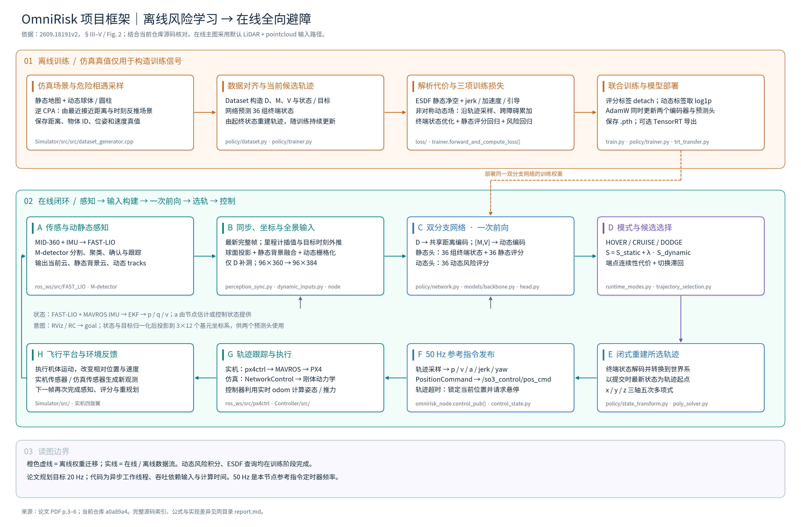
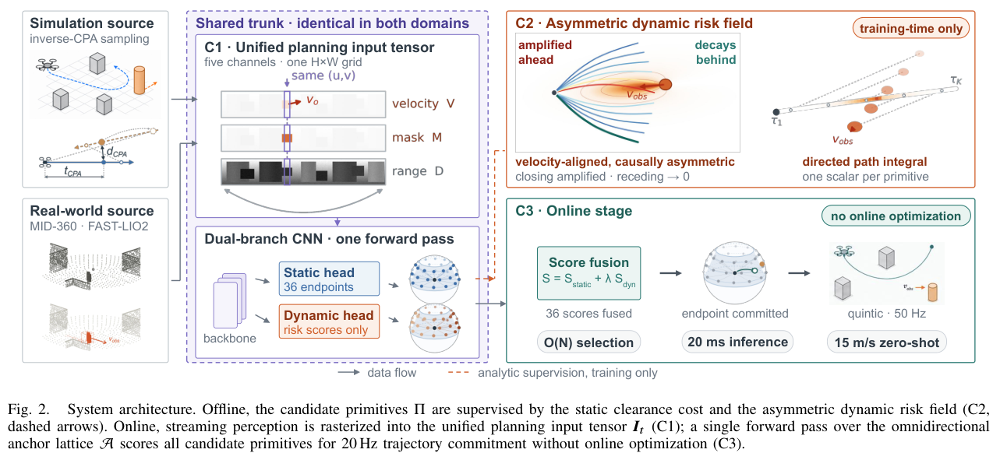
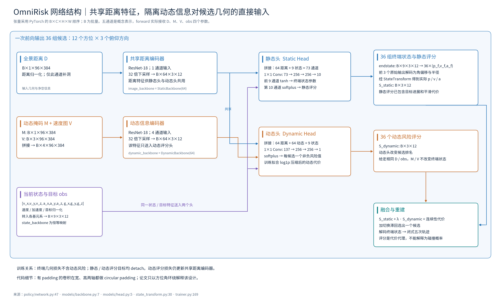
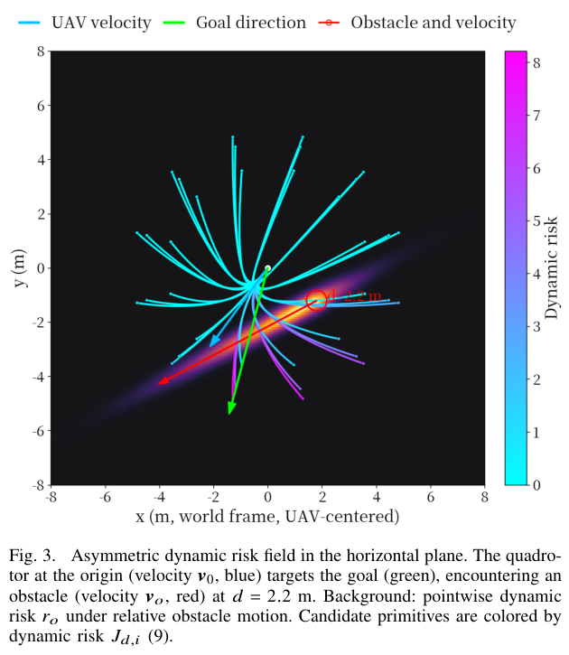

# OmniRisk：论文与项目代码框架解析

**一句话概括：把轨迹风险计算移到离线训练，在线一次预测全向候选并闭式生成避障轨迹。**

本文面向“项目框架与框架图”定向解读。第一手来源是本地 [2609.18191v2.pdf](../../OmniRisk/2609.18191v2.pdf)，共 8 页，标题为 *OmniRisk: Omnidirectional Trajectory-Risk Learning for Agile Quadrotor Dynamic Avoidance*；代码核对基线为 `a0a89a4d29bf8bf778f9ed47c439441f57b80638`。分析日期：2026-11-02。已阅读论文正文、检查原文核心机制图并逐项核对源码；本次生成文档与图件，没有启动 ROS、训练网络或开展飞行验证。

## 1. 项目总框架

先看上方橙色的离线训练，再沿下方在线闭环从 A 到 H 阅读。双分支网络是两个阶段共用的学习核心，训练产物通过虚线进入在线网络。

###### 

下载：[SVG 矢量图](assets/omnirisk-framework.svg) · [PNG 图片](assets/omnirisk-framework.png) · [PDF 矢量图](assets/omnirisk-framework.pdf)。

框架可理解为三个职责层：**感知层把传感器观测转成有统一物理含义的输入；学习规划层生成并评价 36 个候选；执行层把一个选中的候选转成连续飞行指令。** 离线仿真负责提供在线无法直接获得的真值，用来教会网络评价未来风险。

这里“基元”是由起终点位置、速度、加速度确定的一段短轨迹。“全向”指水平方位覆盖 360°，垂直方向只覆盖雷达视场。“固定候选”指 12×3 个方向格固定，格内终端状态由网络调整，轨迹形状并不固定。

论文原始 Fig. 2（PDF p.3）可用于检查总图的主线：左侧仿真/实机共用输入，中部双分支网络，右上方训练期风险监督，右下方在线评分与轨迹生成。



原图把感知与网络做了概括；项目总图补出了当前仓库的帧同步、动态目标栅格化、模式选择、轨迹发布、实机/仿真控制路径。两者一致的关键是：**在线使用预测风险；解析风险场沿轨迹的采样累加发生在训练期间。** 论文原图的“20 ms inference”和“15 m/s zero-shot”是论文实验结果，不能视为当前机器已经实现的性能。

## 2. 在线数据怎样流动

| 环节 | 输入 → 处理 → 输出 | 代码依据 |
|---|---|---|
| 雷达惯性前端 | MID-360 点云/IMU → 定位、运动补偿与点云注册 | [FAST-LIO 启动链](../../ros_ws/src/FAST_LIO/launch/fastlio_ekf.launch#L16) |
| 动态感知 | 注册云、里程计 → M-detector 动静态分离、关联跟踪 → 静态云及 confirmed tracks | [M-detector](../../ros_ws/src/M-detector/README.md)、[节点订阅](../../OmniRisk/omnirisk_node.py#L354) |
| 状态估计 | FAST-LIO 位姿 + MAVROS IMU → 高频 EKF odom | [组合启动文件](../../ros_ws/src/FAST_LIO/launch/fastlio_ekf.launch#L27) |
| 帧组装 | 当前云、静态云、tracks、odom → 最新完整帧与参考时刻状态 | [组帧线程](../../OmniRisk/omnirisk_node.py#L1185)、[同步规则](../../OmniRisk/perception_sync.py#L212) |
| 输入构建 | 投影当前/静态云，融合动态目标并补全距离 → D、M、V、obs | [预处理](../../OmniRisk/omnirisk_node.py#L1342)、[动态栅格化](../../OmniRisk/dynamic_inputs.py#L223) |
| 网络预测 | 距离、掩码、速度图、状态目标 → 36 组终端状态及两组评分 | [forward](../../OmniRisk/policy/network.py#L47) |
| 选择与重建 | 融合评分、连续性与滞回 → 一个候选 → 三轴五次多项式 | [在线提交](../../OmniRisk/omnirisk_node.py#L1507)、[选轨](../../OmniRisk/trajectory_selection.py)、[多项式](../../OmniRisk/policy/poly_solver.py) |
| 参考指令与控制 | 50 Hz 采样 p/v/a/jerk/yaw → PositionCommand → 控制器 | [control_pub](../../OmniRisk/omnirisk_node.py#L1896)、[px4ctrl remap](../../ros_ws/src/px4ctrl/launch/run_ctrl.launch#L15) |

默认实机输入包括 `/cloud_registered_no_point_filter` 当前世界系点云、`/m_detector/std_points` 静态云、`/m_detector/confirmed_tracks` 动态目标，以及 `/ekf_quat/ekf_odom` 状态。目标来自 RViz 或 RC 逻辑。规划输出是 `/so3_control/pos_cmd`，消息为 `quadrotor_msgs/PositionCommand`。主题名可由参数改变，以 [节点默认配置](../../OmniRisk/omnirisk_node.py#L2334) 为准。

**时间处理。** 当前云与 tracks 按时间戳配帧，默认 pointcloud 路径允许静态云在容差内使用前一帧，odom 用缓存插值。动态 tracks 会从其测量时刻外推到该感知参考时刻；默认弹道开关可让这段延迟补偿计入重力。注意它与训练风险场内部的“未来恒速预测”是两段不同的处理。[依据：`_tracks_at`](../../OmniRisk/omnirisk_node.py#L1110)。

**空间处理。** 当前全向配置在以无人机位置为原点、坐标轴与世界系平行的局部规划系中工作，`_planning_rotation` 返回单位阵；不能直接把旧注释里的 body frame 当作实际全向计算坐标。球面图先使用 96×360 网格，再通过统一列映射变成网络的 96×384。仅距离图补洞，掩码与速度图保持对齐；背景速度置零。[依据：`_planning_rotation`](../../OmniRisk/omnirisk_node.py#L1084)、[`_build_dynamic_inputs`](../../OmniRisk/omnirisk_node.py#L958)。

**异步调度。** ROS 回调缓存消息，组帧、预处理、推理、可视化分开运行；最新槽位覆盖尚未处理的旧任务。提交时检查结果时效、序号和模式版本，防止旧推理结果覆盖新状态。控制定时器独立执行，轨迹过期后请求当前位置悬停。这些机制决定“网络输出何时能真正成为控制轨迹”。

## 3. 网络内部框架与张量接口

先看左侧三类输入，再看中间两个编码器和两个头。蓝色距离特征被两头共享，橙色动态特征只进入动态头。



下载：[SVG 矢量图](assets/omnirisk-network.svg) · [PNG 图片](assets/omnirisk-network.png) · [PDF 矢量图](assets/omnirisk-network.pdf)。

论文式 (1) 把感知表示写作 `I=[D,M,V] ∈ R^(H×W×5)`：D 是一个距离通道；M 是一个动态掩码通道；V 是三个笛卡尔速度通道。速度表达障碍物运动，不能误写成本机速度，也不能把掩码理解为风险概率。源码 `forward(depth, mask, vel_img, obs)` 分别接收四项输入，并非将五个图像通道直接送进同一个编码器。

| 对象 | 当前形状（B 为 batch） | 作用 |
|---|---|---|
| D | `B×1×96×384` | 归一化距离图，描述场景几何 |
| M / V | `B×1×96×384` / `B×3×96×384` | 动态区域及障碍物速度，拼成四通道进入动态编码器 |
| obs | 原始 `B×9`，变换后 `B×9×3×12` | 当前速度、加速度、相对目标；按各候选方向变换 |
| 两个编码器特征 | 各 `B×64×3×12` | ResNet-18 进行 32 倍空间下采样 |
| 静态头原始输出 | `B×10×3×12` | 前 9 通道经 tanh，最后 1 通道经 softplus |
| endstate / static_score | `B×9×3×12` / `B×3×12` | 每候选的终端状态参数和静态综合评分 |
| dynamic_score | `B×3×12` | 每候选的动态风险代理评分 |

两个评分头均为三层 1×1 卷积。静态头输入 64+9=73 通道，动态头输入 64+64+9=137 通道，中间宽度均为 256。[依据：`ScoreHead`](../../OmniRisk/policy/models/head.py#L5)。

**终端状态不是直接输出九个物理量。** 前三个原始值解码为相对锚点的方位角偏移、俯仰角偏移及半径，然后得到三维终点；后六个值缩放并旋转成终端速度和加速度。每个格得到 `(p_f,v_f,a_f)`，与起始状态共同确定一条五次轨迹。[依据：`pred_to_endstate`](../../OmniRisk/policy/state_transform.py#L30)。

**头隔离的准确含义。** 固定权重且 D/obs 相同时，改变 M/V 不直接改变候选终端状态，只改变动态评分与最终选择。但训练时动态评分损失仍会更新共享距离编码器，因此不能声称训练梯度也完全隔离。代码和论文 §V-C.2 在这一点上相符。

## 4. 离线学习：怎样把未来风险装进网络

**数据来源。** 仿真器生成静态几何、动态物体、全景距离与物体 ID、位姿和速度等。逆 CPA 采样的意思是：先指定两者何时最接近、错开多远，再反推动态障碍初始状态，从而主动构造拦截、擦肩、多方向受阻等场景。这里 CPA 指“最近接近点”。[依据：论文 §III-B.1；`dataset_generator.cpp`](../../Simulator/src/src/dataset_generator.cpp#L574)。

**静态监督。** ESDF 是记录每个空间位置到障碍物边界距离的场。训练代码由静态点云构建 0.2 m 体素距离场，沿当前网络输出的轨迹取 30 个时刻，查询净空并计算指数惩罚；越接近障碍，代价越大。同时计算 jerk 平滑代价、加速度代价和引导代价。jerk 是加速度对时间的变化率，用来约束运动突变。[依据：`SafetyLoss`](../../OmniRisk/loss/safety_loss.py#L11)、[`OmniRiskLoss`](../../OmniRisk/loss/loss_function.py#L10)。

**动态监督。** 对候选轨迹 π 和障碍 o，论文式 (6)–(9) 使用：

```text
q(t) = π(t) − [c_o + v_o t]            # 未来相对位置
v_rel(t) = π'(t) − v_o                 # 未来相对速度
φ(q) = exp(−qᵀ A_o q)                 # 沿障碍速度方向拉长的高斯场
r_o = φ(q) · softplus(α v_relᵀ n_o)   # n_o 为指向风险升高方向的单位梯度
J_dynamic = Σ_j Σ_o r_o(q(t_j), v_rel(t_j))
```

`A_o` 控制不同方向的风险宽度；沿障碍运动轴的宽度随速度增加。`softplus(z)=ln(1+exp(z))` 是平滑且非负的函数，朝更危险区域运动时放大代价，离开时压低代价。这是按风险度量定义的接近/远离，通常不能一概等同于欧氏距离变化率。外层求和在同一未来时刻同时计算无人机与障碍物位置，因而评价的是未来相遇关系。

论文 Fig. 3（PDF p.5）展示这一机制。先看红色障碍及速度箭头，再比较各条候选轨迹的风险颜色；坐标轴是以无人机为中心的水平世界坐标，单位为米，色条数值越高表示动态代价越大。



图中障碍距原点 2.2 m，沿障碍运动方向形成拉长的风险区域，不同候选被赋予不同代价。它解释了为何几何距离相近的候选可能有不同风险，但只是一帧机制示意，不能单独证明闭环安全性。代码球体模型采用 `exp(−0.5 m²)` 并另有圆柱高度带扩展，公式尺度不应不加说明地与论文 `exp(−qᵀAq)` 混用。[依据：`_aniso_cost_sphere`、`_aniso_cost_cylinder`](../../OmniRisk/loss/safety_loss.py#L138)。

**三种训练目标。** 每个 batch 根据当前网络生成的候选重新计算真值代价，而非使用一套永久固定的候选标签：

1. 终端状态损失：平滑 + 静态安全 + 各自锚点方向引导 + 加速度，**不含动态风险**。每个候选朝自己的方向展开，防止全部挤向全局目标。
2. 静态评分回归：以平滑 + 静态安全 + 全局目标引导 + 加速度为目标，`smooth_l1(pred, target.detach())`。
3. 动态评分回归：`smooth_l1(pred, log1p(weighted_dynamic_cost).detach())`，压缩极端危险样本的数值范围。

默认三项等权联合优化。`detach` 阻止评分损失经真值计算反向修改终端状态。动态真值包含来自 `dynamic_weight` 与安全损失权重的缩放；在线 `fusion_lambda` 则只决定评分融合，不进入训练梯度。[依据：`forward_and_compute_loss`](../../OmniRisk/policy/trainer.py#L169)。

## 5. 在线选择：用一个相遇例子走完链路

假设无人机沿走廊朝目标飞行，一个球从右侧穿过前方。

1. FAST-LIO 提供补偿后的几何与位姿，M-detector 确认球的轨迹及速度；同步模块把它们对齐到同一感知参考时刻。
2. D 描述走廊和球的表面距离；M 标出球对应的动态区域；V 告诉网络该区域正在侧向运动。obs 提供本机运动及目标。
3. 静态头根据走廊几何生成 36 组可调整的终端状态，覆盖前、后、左、右等方向，同时评价净空、平滑和目标进展。动态头评价这些候选与球未来相遇的代价。
4. 在线计算 `S_i = static_i + λ·dynamic_i`，加连续性代价，并应用切换滞回。比如只为演示评分：直行 `(1.0,0.8)`、向左 `(2.0,0.1)`，取 λ=10，则融合分数分别为 9 与 3；在连续性与滞回不改变排序时选择向左。数字是教学示例，并非实验测量。
5. 代码将被选终端状态转成世界系，在提交时用最新 odom 位置/速度及期望加速度作为起始边界，闭式求得三轴五次多项式。50 Hz 定时器采样参考指令，底层控制器计算姿态与推力。
6. 球通过后，新的运动输入让动态评分下降；受威胁保持时间和模式逻辑影响，系统回到巡航或悬停。

当前 YAML 中 `CRUISE` 的 λ=0、`DODGE` 的 λ=10，两者速度 4 m/s、`radio_range=4 m`，因此轨迹时域 `T=2×4/4=2 s`；`HOVER` 不执行规划轨迹。顶层 `fusion_lambda: 100` 不等于这条在线模式路径实际使用的 λ。[依据：`runtime_modes`](../../OmniRisk/config/traj_opt.yaml#L76)、[`build_runtime_config`](../../OmniRisk/runtime_modes.py#L31)。

连续性项按**当前帧候选端点与上一候选 ID 所对应的当前帧端点**之间的归一化距离计罚；它没有直接计算与上一帧世界系历史端点的距离。滞回要求新候选显著更优才切换，当前默认 margin 与 continuity weight 均为 0.8。[依据：`trajectory_selection.py`](../../OmniRisk/trajectory_selection.py)。

## 6. 论文结论、代码边界与使用说明

| 核心问题 | 论文依据 | 应如何理解 |
|---|---|---|
| 为什么需要速度通道？ | 表 I，p.6：横穿场景成功率，Depth-Only 22%，完整输入 92% | 支持显式运动输入的价值；动态掩码本身不能替代速度 |
| 非对称风险是否有用？ | 表 II，p.7：对称场动态碰撞率 34%，完整方法 4% | 支持完整风险监督在所测条件下的效果，不等于安全证明 |
| 在线是否恒定开销？ | 表 III，p.7：完整规划 P95 42.2–45.8 ms；正文网络推理 P95 20.0–20.5 ms | 固定尺寸网络推理不随障碍数变化；前端栅格化仍会变化，6 障碍下有 3% 周期超过 50 ms |
| 多威胁效果怎样？ | 表 IV/V，p.8：6 障碍、10 m/s 时成功率 84%，FAPP 8% | 该条件每方法 50 次；属于论文报告，非本仓库本次复测 |
| 是否做过真实部署？ | 表 VI，p.8：室内/室外总体成功率 90.7%/86.7% | 论文声称冻结权重、相对相遇速度最高 15 m/s；15 m/s 不是无人机巡航速度 |

与框架解释直接相关的实现边界：

- **频率边界。** 论文描述 20 Hz 规划、50 Hz 跟踪；源码明确的是节点 0.02 s 的参考发布定时器。在线规划采用异步线程，实际吞吐需测量，底层控制器还有自己的调度频率。
- **可行性边界。** 论文 §III-A.4 描述排除全时域速度/加速度超限候选；当前 `_run_prepared_inference` 直接在评分上做连续性与滞回选轨，未看到对所有候选整段轨迹逐一实施对应硬剔除。tanh 与尺度解码也不能单独证明轨迹全程满足范数上限，因此框架图没有画一个已实现的硬可行性过滤器。
- **环绕卷积边界。** 论文强调方位角圆周连续；实际 `_CircularConv2d` 对有 padding 的卷积宽、高两轴都环绕。垂直视场并不真的首尾相接，这是实现细节与论文解释的差异。
- **输入路径边界。** 总图画默认点云输入；代码还有上游静态距离图模式和旧深度图回调。旧深度图回调缺少动态输入，不能用它代表完整 LiDAR 动态避障链。
- **闭环边界。** 实机 `px4ctrl → MAVROS → PX4` 与仿真 `NetworkControl → 刚体动力学` 是不同的执行路径。发出悬停参考依赖有效定位和有效控制链，不能将其等同于完成飞行安全验证。

项目贡献集中在：统一有物理尺度的全景输入、用非对称未来风险训练评分器，以及将在线搜索压缩为固定候选的一次前向与选择。动态头主要改变候选选择；候选几何仍由静态头产生，因此能否覆盖可用逃逸方向也受固定 36 格和静态几何生成能力限制。突发加速、回转或弱反射目标导致的确认延迟，需要更新后的感知才能纠正，不能由恒速风险预测直接解决。

后续验证应优先针对这些具体边界：回放突然减速/折返障碍检查风险响应，记录输入到轨迹提交的尾延迟与过期丢弃率，并离线采样所选多项式的全程速度/加速度，核实可行性差异是否影响当前部署。

图件可通过以下命令重新生成，输出 PNG、可编辑文字的 SVG 与 PDF。绘制使用代码原生矢量元素，便于修改模块名称、布局和连线。

```bash
MPLCONFIGDIR=/tmp/omnirisk-framework-mpl python3 docs/omnirisk-framework/generate_framework.py
```

另附 [Mermaid 总图源码](framework.mmd)，可直接复制到支持 Mermaid 的 Markdown 编辑器；[source_map.json](source_map.json) 记录论文身份、核对代码与图件来源。

图件已完成渲染、文本边界和本地链接检查。尝试额外核验网络张量时，当前 Python 环境缺少 `ruamel.yaml`，导入在建模前停止；表中形状来自源码及下采样结构核对，未声称执行过模型前向验证。
