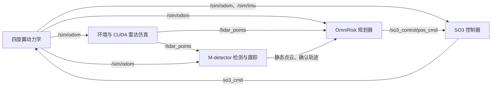

# OmniRisk 论文算法功能仿真复现流程

本文对应 `/home/cjx/OmniRisk` 仓库的 `simulation-reproduction` 分支，整理本机已经跑通的仿真流程。目标是验证“仿真雷达 → M-detector 检测与跟踪 → OmniRisk 推理与轨迹选择 → 控制器 → 无人机运动”的闭环功能。

本文包括一键验证与分终端交互运行两种方式。仿真验证不采集 rosbag、逐帧轨迹或过程数据；一键脚本退出时会清理临时日志。本文是操作说明，不是过程数据报告。

## 1. 本次验证的范围与结果

本次使用发布的预训练权重 `OmniRisk/saved/run_1/epoch60.pth`，没有重新训练网络。实际运行的是 M-detector 完整感知链路，不是给规划器直接输入障碍物真值。

| 场景 | 障碍物设置 | 本次单次运行结果 |
|---|---|---|
| 迎面单球 `head_on` | 球速 2 m/s，反应时间参数 2.5 s | 检测到目标、触发 DODGE、零碰撞、到达目标范围 |
| 侧向单球 `side` | 从航向左侧来球，球速 2 m/s，反应时间参数 2.5 s | 检测到目标、触发 DODGE、零碰撞、到达目标范围 |
| 多方向六球 `multi` | 3–3.5 m/s，分六次生成，间隔约 1 s，包含水平和上方来球 | 检测到目标、多次触发 DODGE、零碰撞、到达目标范围 |

导航目标是世界坐标系中的 `[12, 0, 2]`，沿用代码原有的 2 m 到达判定半径。目标范围内停止不代表厘米级定位到目标点。检测与规划在本机运行时约为 20 Hz。

上述结果仅说明这些设置下的单次功能验证通过。论文中的多随机种子成功率、不同方法对比和更高速障碍物实验，需要另行开展统计实验。实时调度差异也可能使重复运行轨迹和结果有所不同。

## 2. 系统组成、数据流和启动顺序



ROS master 负责节点注册与通信发现；RViz 负责显示和交互，不参与网络推理和飞行控制。

手动启动按以下顺序进行：

1. 检查环境、权重和编译产物。
2. 准备本次验证使用的场景 YAML。
3. 启动 ROS master。
4. 启动动力学仿真和控制器，确认 `/sim/odom` 已输出。
5. 启动环境与雷达仿真，确认 `/lidar_points` 已输出。
6. 启动 M-detector，加载仿真检测配置。
7. 启动 OmniRisk，等待 `OmniRisk Node Ready!`。
8. 可选启动 RViz。
9. 发布导航目标，约 3 s 后触发动态球。
10. 检查碰撞、避障模式和到达状态，最后退出各节点。

一键脚本自动执行上述核心步骤，默认不打开 RViz；添加 `--rviz` 后自动打开图形窗口。

### 2.1 为什么一键命令与作者 README 不同

`experiments/simulation/run.py` 是本次复现新增的验证工具，不是作者原仓库提供的运行入口。作者 README 使用多个终端逐项启动组件，再单独启动 RViz，由用户发目标和操作。两者运行相同的核心模块，但默认配置和控制方式不同：

| 对比项 | 原始 `d8e17c1` README 流程 | 当前一键验证 |
|---|---|---|
| 启动方式 | 分终端运行 Controller、Simulator、M-detector、OmniRisk、RViz | 脚本统一管理这些核心进程，可加 `--rviz` |
| 地图和雷达 | 直接读取原配置，当前原配置是柱林、10 Hz | 临时指定 arena、20 Hz |
| 检测器 | 原 `detector_mid360.launch` 加仿真话题参数 | 加载基础参数及仿真覆盖参数 |
| 规划器 | 手工给话题，导航模式需加 `--flight_mode nav` | 加 `--simulation --flight_mode nav`，统一坐标、高度等设置 |
| 导航目标 | RViz `2D Nav Goal` 或手柄 | 自动发布 `[12,0,2]` |
| 来球 | 取决于仿真 YAML；启用 `sim_scenario` 后可用 `Publish Point` | 启用指定场景并定时触发 |
| 结束条件 | 人工观察、手动退出 | 定时输出判定并停止进程 |

因此，一键流程是“使用仿真适配配置做功能验证”，不能描述成完全照搬作者的演示步骤。希望像作者 README 一样观察并控制仿真时，使用第 5 节分终端流程；希望自动运行同时看见画面时，使用下面的 `--rviz` 命令。

## 3. 本机环境与运行前检查

### 3.1 环境说明

| 项目 | 本机设置及说明 |
|---|---|
| 系统与 ROS | Ubuntu 20.04、ROS Noetic |
| GPU | NVIDIA RTX 2060，计算能力 7.5 |
| CUDA | 本机安装 CUDA 12.8；当前 PyTorch 构建使用 CUDA 12.1 运行时 |
| Python | `omnirisk_env` 内的 Python 3.8.10 |
| PyTorch | 当前环境为 `2.4.1+cu121` |
| 工程目录 | `/home/cjx/OmniRisk` |
| 模型权重 | `/home/cjx/OmniRisk/OmniRisk/saved/run_1/epoch60.pth` |
| 当前分支 | `simulation-reproduction`，由原始 `d8e17c1` 加入仿真适配补丁形成 |

`omnirisk_env` 是项目目录中的 Python venv，不是 Conda 环境。`source omnirisk_env/bin/activate` 将当前终端的 `python` 切换到该环境。Conda 中装过 PyTorch，不代表这个 venv 能直接导入它；本机已配置好当前 venv，正常复现无需重新创建 Conda 环境。

`nvidia-smi` 显示的 CUDA Version 是驱动支持的 CUDA 版本上限，不等同于 PyTorch 的编译运行时版本。驱动支持 CUDA 12.8，同时使用 `torch 2.4.1+cu121` 是正常组合；不需要为了让版本数字一致而重装。

以下步骤针对这台已经配置好的机器。迁移到另一台机器时，仍需先安装 ROS、驱动、编译依赖和 Python 包，不能仅复制本文命令就假定依赖齐全。

### 3.2 检查当前分支、Python 依赖与 GPU

在新终端执行：

```bash
cd /home/cjx/OmniRisk
git branch --show-current
source /opt/ros/noetic/setup.bash
source ros_ws/devel/setup.bash
omnirisk_env/bin/python -c 'import sys, torch, rospy, numpy, scipy, cv2; from ruamel.yaml import YAML; import m_detector.msg; print("Python:", sys.executable); print("PyTorch:", torch.__version__); print("PyTorch CUDA:", torch.version.cuda); print("GPU available:", torch.cuda.is_available())'
nvidia-smi
```

命令作用：

- `git branch --show-current`：确认使用包含仿真补丁的分支。预期为 `simulation-reproduction`。
- `source /opt/ros/noetic/setup.bash`：加载 ROS 系统命令与基础环境。
- `source ros_ws/devel/setup.bash`：加载项目 ROS 包和编译生成的自定义消息。
- `omnirisk_env/bin/python -c ...`：明确使用项目 Python，检查规划器与验证脚本需要的依赖。
- `torch.cuda.is_available()`：正常 GPU 运行时应为 `True`。
- `nvidia-smi`：检查显卡、驱动、显存占用和其他 GPU 进程。

如果终端自动激活了 Conda，先执行 `conda deactivate`，必要时重复，直到退出 Conda 环境，再加载项目环境，避免 Python 与动态库路径混用。

### 3.3 检查模型与可执行文件

```bash
cd /home/cjx/OmniRisk
ls -lh OmniRisk/saved/run_1/epoch60.pth
ls -l Controller/devel/setup.bash Simulator/devel/setup.bash ros_ws/devel/setup.bash
ls -l Simulator/devel/lib/sensor_simulator/sensor_simulator_cuda
ls -l ros_ws/devel/lib/m_detector/dynfilter
```

当前机器已有权重和编译产物，无需重复下载。若权重缺失，才执行：

```bash
cd /home/cjx/OmniRisk
mkdir -p OmniRisk/saved/run_1
wget -O OmniRisk/saved/run_1/epoch60.pth \
  https://github.com/VANdexj/OmniRisk/releases/download/v1.0/omnirisk_epoch60.pth
```

不要在已有完整权重时重复使用 `wget -O`，它会覆盖目标文件。

### 3.4 只有修改了源码或产物缺失时才重新编译

在未激活 venv/Conda 的新终端中，依次执行以下三组命令。编译需要系统 Python；不要使用项目 venv 的 `empy` 进行 ROS 消息生成。

```bash
source /opt/ros/noetic/setup.bash
cd /home/cjx/OmniRisk/Controller
catkin_make -j2 -DPYTHON_EXECUTABLE=/usr/bin/python3
```

作用：编译四旋翼动力学与 SO3 控制器，包括仿真质量参数和起飞服务修复。

```bash
source /opt/ros/noetic/setup.bash
cd /home/cjx/OmniRisk/Simulator
catkin_make -j2 -DPYTHON_EXECUTABLE=/usr/bin/python3 -DOMNIRISK_CUDA_ARCH=7.5
```

作用：编译 CUDA 雷达仿真器。`7.5` 对应本机 RTX 2060，避免旧版 CMake 自动识别架构失败后使用 CUDA 12.8 已不支持的旧架构。其他型号 GPU 需要使用其对应的计算能力。

```bash
source /opt/ros/noetic/setup.bash
cd /home/cjx/OmniRisk/ros_ws
catkin_make -j2 -DPYTHON_EXECUTABLE=/usr/bin/python3 -DROS_EDITION=ROS1
```

作用：编译 M-detector、相关 ROS 包和自定义消息。`-j2` 限制同时编译的任务数，减少内存压力。

仓库的 `bash scripts/build.sh` 用于安装依赖并构建，`bash scripts/build.sh --build-only` 用于跳过安装后构建。本机已经安装好依赖，日常运行无需再次调用完整安装脚本。上述分工作区命令也便于定位具体编译问题。

## 4. 方式一：一键运行完整仿真验证

需要可视化时，在本机图形桌面终端执行：

```bash
cd /home/cjx/OmniRisk
source ros_ws/devel/setup.bash
omnirisk_env/bin/python experiments/simulation/run.py \
  --perception detector --scenario head_on --speed 2 --duration 24 --rviz
```

RViz 将显示无人机、动态球、局部雷达点云、选中轨迹和碰撞计数。脚本等待 RViz 显示项订阅就绪后再自动发目标、触发来球；验证结束窗口随节点关闭。可将场景改为 `side` 或 `multi`。不带 `--rviz` 的命令仍是无界面自动检查。

### 4.1 迎面单球：本次验证命令

```bash
cd /home/cjx/OmniRisk
source ros_ws/devel/setup.bash
omnirisk_env/bin/python experiments/simulation/run.py \
  --perception detector --scenario head_on --speed 2 --duration 24
```

该命令依次启动独立 ROS master、动力学/控制器、CUDA 环境/雷达仿真、M-detector 和 OmniRisk。等待规划器就绪及话题连接完成后，再等待约 3 s，发布 `[12, 0, 2]` 导航目标；约 3 s 后触发来球，随后观察 24 s。

脚本会将雷达设为 20 Hz，使用 arena 地图，即 `maze_type: 8`，没有额外静态立柱，有围墙和顶面。它生成临时场景配置，不修改 `Simulator/src/config/config.yaml`。

### 4.2 侧向单球

上一条命令结束、节点清理完成后执行：

```bash
cd /home/cjx/OmniRisk
source ros_ws/devel/setup.bash
omnirisk_env/bin/python experiments/simulation/run.py \
  --perception detector --scenario side --speed 2 --duration 24
```

该脚本中的 `side` 会把单球生成方向设为相对航向左侧 90°、同高度来球。它覆盖原配置文件中同名 `side` 条目的参数，所以仅在原 YAML 中选择 `side` 不一定等同于本命令。

### 4.3 多方向六球

```bash
cd /home/cjx/OmniRisk
source ros_ws/devel/setup.bash
omnirisk_env/bin/python experiments/simulation/run.py \
  --perception detector --scenario multi --duration 28
```

该命令沿用原 YAML 的六球列表。六球从不同方向依次生成，部分从上方斜向来袭；每个球生成时都会根据无人机当时的位置和速度重新计算拦截路线。

| 球序号 | 相对来向角 | 来向仰角 | 球速 | 触发后生成延迟 | 反应时间参数 |
|---|---:|---:|---:|---:|---:|
| 1 | 0° | 0° | 3.5 m/s | 0 s | 2.0 s |
| 2 | 120° | 30° | 3.0 m/s | 1 s | 2.0 s |
| 3 | 240° | 0° | 3.5 m/s | 2 s | 2.0 s |
| 4 | 60° | 35° | 3.0 m/s | 3 s | 2.0 s |
| 5 | 180° | 0° | 3.5 m/s | 4 s | 2.0 s |
| 6 | 300° | 25° | 3.0 m/s | 5 s | 2.0 s |

### 4.4 参数含义

| 参数 | 默认值 | 功能和作用 |
|---|---|---|
| `--perception detector` | `detector` | 使用真实 M-detector 检测、跟踪输出；完整链路验证应使用此项 |
| `--scenario` | `head_on` | `head_on` 迎面、`side` 侧向、`multi` 六球、`none` 不触发动态球 |
| `--speed` | `2` | 单球场景的球速，单位 m/s；不覆盖 `multi` 列表中的速度 |
| `--lead-time` | `2.5` | 单球场景的预计拦截时间，单位 s；不覆盖 `multi` 列表 |
| `--duration` | `30` | 触发时刻之后的观察时间，单位 s；不含节点启动和前面的等待时间 |
| `--lidar-fps` | `20` | 雷达点云发布频率，单位 Hz |
| `--port` | `11321` | 本次独立 ROS master 端口；已被占用时脚本会报错 |
| `--rviz` | 默认关闭 | 打开适配本次场景的 RViz 窗口；不改变自动发目标、触发和定时退出行为 |

`lead-time` 根据无人机当时的位置和速度构造预计碰撞路线，不是实际测得的碰撞倒计时。无人机变速或避障后，球与无人机的相遇情况会改变。

若端口占用，可以选择另一空闲端口，例如在命令末尾加 `--port 11322`。不要同时运行多组仿真来争用本机 GPU 后再比较性能。

### 4.5 如何判断通过

终端结束时打印 `event: complete` 的 JSON 结论，重点看：

| 输出字段 | 含义 |
|---|---|
| `perception` | 应为 `detector`，表示完整感知链路 |
| `collision_count` | 仿真器碰撞计数，预期为 `0` |
| `arrived` | 发布新目标后是否出现 `Arrive!` |
| `final_goal_error_m` | 最终位置到 `[12,0,2]` 的三维距离，应小于 `2` |
| `dodge_activated` | 发布新目标后是否进入过 `DODGE` 模式 |
| `max_tracks` | 运行期间单条消息中的最大确认轨迹数；不是所有生成球的累计检测数 |
| `min_sampled_surface_clearance_m` | 根据离散采样的球与无人机位置估算的最小表面间距，作为辅助参考 |
| `passed` | 综合判定；动态场景还要求确认轨迹数大于 0 且进入过 DODGE |

脚本正常执行且判定通过时退出码为 `0`，未通过时为非零。可紧接着运行 `echo $?` 查看上一条命令的退出码。

最小间距是采样估算值，不能替代仿真器碰撞计数，也不代表已经验证所有障碍物的安全距离。`max_tracks: 2` 不意味着六球只生成了两个，它只表示某一时刻最多同时输出两个确认轨迹。

脚本退出时停止自己启动的进程，并删除 `/tmp/omnirisk-simulation-*` 中本次运行的临时配置和日志。需要中断时按 `Ctrl+C`；正常中断路径同样执行清理。强制杀死进程或系统掉电无法保证执行清理。

## 5. 方式二：分终端手动启动并用 RViz 观察

这一方式用于查看界面、理解各节点作用或交互触发来球。它使用与一键方式相同的场景设置，但人工发目标和触发的时机可能不同，因此不会保证轨迹逐点相同。

不要同时运行一键脚本与下列手动节点，并让它们连接同一个 ROS master。

### 5.1 先生成临时场景配置

原始 `Simulator/src/config/config.yaml` 默认是柱林地图、10 Hz 雷达，且 `sim_scenario.enabled` 为 `false`，直接运行原始启动命令不会得到上面验证的来球场景。

在一个终端中执行以下命令。默认生成迎面单球配置；将 `scenario = 'head_on'` 改成 `'side'` 或 `'multi'`，即可生成另外两种场景。该命令只创建临时配置，不保存仿真过程数据。

```bash
cd /home/cjx/OmniRisk
omnirisk_env/bin/python - <<'PY'
from pathlib import Path
from ruamel.yaml import YAML

scenario = 'head_on'  # 可选：head_on、side、multi
yaml = YAML(typ='safe')
root = Path('/home/cjx/OmniRisk')
config = yaml.load((root / 'Simulator/src/config/config.yaml').read_text())
config.update(maze_type=8, lidar_fps=20)
config['sim_scenario'].update(enabled=True, scenario=scenario)
if scenario in ('head_on', 'side'):
    config['sim_scenario']['scenarios'][scenario] = [dict(
        bearing_deg=90 if scenario == 'side' else 0,
        elev_deg=0, speed=2.0, lead_time=2.5, aim_up=0)]
path = Path('/tmp/omnirisk-manual-scenario.yaml')
with path.open('w') as stream:
    yaml.dump(config, stream)
print('场景配置：', path, '；场景：', scenario)
PY
```

配置只在仿真器启动时读取。要切换场景，应停止当前完整仿真，重新生成配置，再重新启动各节点；这样也能重置位置、跟踪状态与碰撞计数。

### 5.2 所有手动运行终端都先执行的公共命令

以下公共设置需要在后面的每个新终端中分别执行一次，包括 RViz 和发送目标的终端：

```bash
cd /home/cjx/OmniRisk
source /opt/ros/noetic/setup.bash
export ROS_MASTER_URI=http://127.0.0.1:11321
export ROS_HOSTNAME=127.0.0.1
unset ROS_IP
export OMP_NUM_THREADS=1
export OPENBLAS_NUM_THREADS=1
export MKL_NUM_THREADS=1
```

作用：统一连接本机 11321 端口的 ROS master，并限制 CPU 数学库线程数，减少雷达仿真、检测和 PyTorch 同时运行时的线程竞争。

`export` 只对当前终端及其子进程有效，不会自动同步到其他终端。若忘记这些设置，某些节点或 RViz 可能连接到默认 11311 端口，表现为“节点已启动，但看不到话题”。

以下各终端命令均假定已经执行了本节公共命令。

### 5.3 T0：启动 ROS master

```bash
roscore -p 11321
```

作用：启动 ROS master 和基础服务，负责后续节点注册与话题发现。该终端保持运行。

### 5.4 T1：启动四旋翼动力学与控制器

```bash
source Controller/devel/setup.bash
roslaunch so3_quadrotor_simulator simulator_attitude_control.launch
```

作用：同时启动四旋翼动力学节点和 SO3 控制器。动力学发布 `/sim/odom` 和 `/sim/imu`；控制器订阅规划位置指令 `/so3_control/pos_cmd`，转换为 `so3_cmd`，再作用于动力学模型。

当前 launch 的初始位置为 `[0,0,2]`，里程计配置为 100 Hz；控制器负责仿真起飞/接管状态流程。无需另外启动 MAVROS、PX4 或真实飞控。

等待里程计输出再继续。可在后面的检查终端执行：

```bash
source ros_ws/devel/setup.bash
rostopic echo -n 1 /sim/odom/pose/pose/position
```

### 5.5 T2：启动场景与 CUDA 雷达仿真

```bash
source Simulator/devel/setup.bash
rosrun sensor_simulator sensor_simulator_cuda \
  _config_file:=/tmp/omnirisk-manual-scenario.yaml
```

作用：读取临时场景配置，生成 arena 地图，根据无人机位姿进行 CUDA 雷达射线投射，发布 `/lidar_points`。同时维护动态球、障碍物显示和碰撞计数。

`_config_file:=...` 是 ROS 私有参数，用于覆盖编译时的默认配置路径。只改场景 YAML 不需要重新编译。

当前验证采用 LiDAR 输入，深度图渲染关闭，因此没有 `/depth_image` 图像不是故障。动态球也不会在启动后立即出现，需要后续发布 `/clicked_point` 才生成。

### 5.6 T3：启动 M-detector 检测与跟踪

```bash
source ros_ws/devel/setup.bash
roslaunch m_detector detector_sim.launch
```

作用：先加载原 `mid360.yaml`，再加载 `config/simulation.yaml` 覆盖仿真相关参数，最后启动 `dynfilter`。

主要输入为 `/lidar_points`、`/sim/odom`，主要输出为 `/m_detector/std_points` 和 `/m_detector/confirmed_tracks`。前者给规划器提供静态环境输入，后者提供动态目标的位置、速度和尺寸等信息。

仿真覆盖配置的关键设置如下：

| 配置项 | 本次值 | 原因 |
|---|---|---|
| `points_topic` | `/lidar_points` | 接入仿真雷达 |
| `odom_topic` | `/sim/odom` | 接入仿真位姿 |
| `points_in_world_frame` | `false` | 原始雷达点为随无人机运动的局部坐标，需要按位姿变换 |
| `frame_id` | `world` | 检测结果输出使用世界坐标系 |
| `points_num_perframe` | `40000` | 增大点云处理容量，配合代码容量检查避免越界 |
| `tracker.ballistic_model_en` | `false` | 场景球沿直线匀速运动，不应使用重力抛物线预测 |
| `tracker.target_origin_bbox_filter_en` | `false` | 避免原先固定世界区域过滤条件排除本场景的球 |
| `tracker.target_min_world_z` | `0.3` | 适配仿真目标高度过滤 |
| `tracker.target_max_bbox_volume` | `0.2` | 适配半径 0.2 m 球的包围盒体积 |
| `tracker.target_min_speed` | `0.5` | 适配本次运动目标速度过滤 |

不要仅使用面向实机的默认 `detector_mid360.launch` 而遗漏这些覆盖参数。

### 5.7 T4：启动 OmniRisk 规划器

```bash
source ros_ws/devel/setup.bash
source omnirisk_env/bin/activate
cd /home/cjx/OmniRisk/OmniRisk
python -u omnirisk_node.py \
  --trial 1 --epoch 60 --simulation --flight_mode nav
```

命令各部分作用：

| 命令或参数 | 功能和作用 |
|---|---|
| `source ros_ws/devel/setup.bash` | 让 Python 能找到 ROS 包和自定义消息 |
| `source omnirisk_env/bin/activate` | 使用已经安装 PyTorch 等依赖的项目 venv |
| `cd .../OmniRisk/OmniRisk` | 进入规划器代码目录；注意外层是仓库，内层是同名代码目录 |
| `python -u` | 关闭标准输出缓冲，便于立即看到就绪和模式日志 |
| `--trial 1` | 选择 `saved/run_1` |
| `--epoch 60` | 加载 `epoch60.pth` |
| `--simulation` | 设置仿真话题、局部雷达坐标、2 m 目标高度和仿真运行选项 |
| `--flight_mode nav` | 使用导航模式，向目标飞行并在威胁出现时避障 |

`--simulation` 同时关闭规划器自己的自动起飞请求，由控制器管理该流程；要求同帧静态点云输入，并限制 PyTorch/OpenCV CPU 线程数。规划器的弹道预测开关会读取检测器参数，使两者与匀速球一致。

该开关已默认指定 `/sim/odom` 与 `/lidar_points`。需要明确写出话题时，等价命令为：

```bash
python -u omnirisk_node.py \
  --trial 1 --epoch 60 --simulation --flight_mode nav \
  --odom_topic /sim/odom --lidar_topic /lidar_points
```

等待出现 `OmniRisk Node Ready!` 后，再发导航目标。

如果当前提示符已经是 `~/OmniRisk/OmniRisk$`，不要再次执行 `cd OmniRisk`。参数中的数字直接填写 `1`、`60`，不要写 `<1>`、`<60>`；尖括号在 Bash 中有重定向含义，会触发语法错误。

### 5.8 T5：启动 RViz

```bash
source ros_ws/devel/setup.bash
source Controller/devel/setup.bash
rviz -d /home/cjx/OmniRisk/OmniRisk/omnirisk.rviz
```

作用：打开本机图形窗口，显示无人机、点云和碰撞计数，并提供 `2D Nav Goal` 和 `Publish Point` 工具。`Fixed Frame` 应为 `world`。

如需显示动态球，在 RViz 中选择 **Add → By topic → `/sim/dynamic_obstacle_markers` → MarkerArray**。也可按需添加 `/sim/static_obstacle_markers`。原配置中不一定已经包含这些显示项。

规划器默认 `visualize=False`，它关闭额外的候选轨迹与评分展示。选中轨迹 `/omnirisk/best_traj_visual` 在 RViz 订阅时仍可发布，不受该开关限制；之前把选中轨迹也归入默认关闭项是不准确的。没有轨迹图形时，应检查是否已有有效规划提交以及 RViz 是否订阅正确话题。

本分支还提供适合当前场景的布局，自动包含球的显示项，并使用更近的相机视角。在 T5 中可用下面这条命令代替原始 RViz 启动命令：

```bash
rviz -d /home/cjx/OmniRisk/experiments/simulation/rviz.yaml
```

RViz 的雷达显示采用较长点云衰减时间，移动球可能留下历史点云尾迹；可减小该显示项的 `Decay Time`，或观察动态球 Marker 来看当前球的位置。

也可以给一键脚本连接 RViz：在脚本运行期间，另开终端，执行公共环境命令并启动 RViz。端口必须与脚本的 `--port` 相同；脚本结束后会停止仿真节点。

### 5.9 T6：发布导航目标，再触发动态障碍

方法 A：RViz 鼠标操作。

1. 使用 `2D Nav Goal` 在前方设置目标；鼠标拖动可设置朝向。
2. 观察无人机开始巡航。
3. 约 3 s 后使用 `Publish Point` 点击场景中的可选点云位置，触发一波球。

`2D Nav Goal` 发布 `/move_base_simple/goal`，规划器取其中的 x、y，高度使用 `hover_height=2.0`。`Publish Point` 发布 `/clicked_point`；球生成器只把它作为触发信号，忽略点击点坐标，不会从点击位置发球。

方法 B：终端发布固定目标，便于对应本次验证设置。T6 同样先执行公共环境命令，然后运行：

```bash
source ros_ws/devel/setup.bash
rostopic pub -1 /move_base_simple/goal geometry_msgs/PoseStamped \
  '{header: {stamp: now, frame_id: world}, pose: {position: {x: 12.0, y: 0.0, z: 2.0}, orientation: {x: 0.0, y: 0.0, z: 0.0, w: 1.0}}}'
```

确认无人机开始运动、距目标发布约 3 s 后执行：

```bash
rostopic pub -1 /clicked_point geometry_msgs/PointStamped \
  '{header: {stamp: now, frame_id: world}, point: {x: 0.0, y: 0.0, z: 0.0}}'
```

`rostopic pub -1` 发布一次消息。手动命令自身也有连接和发送耗时，无法精确复制脚本的触发时刻。若需要与本次自动验证相同的时序，应使用第 4 节的一键方式。

再次点击 `Publish Point` 会清除上一波球并生成新的一波。碰撞计数不会因此自动变为一次全新的独立实验；要比较独立场景，请完整重启仿真。

### 5.10 可选手柄节点：无手柄时不启动

```bash
source ros_ws/devel/setup.bash
cd /home/cjx/OmniRisk/OmniRisk
python3 rc_goal_teleop.py _odom_topic:=/sim/odom
```

作用：将连接的手柄输入转换为目标与遥控状态。它默认要求存在 `/dev/input/js0`。没有手柄时会出现 `Cannot open /dev/input/js0`，这是设备缺失，不是规划器或仿真失败。

使用 RViz 或终端发布目标时不需要这个节点。本次通过的自动验证没有启动手柄节点。

## 6. 运行中检查命令及其作用

在一个已执行公共环境命令的检查终端中运行。`rostopic hz` 会持续显示，检查完按 `Ctrl+C` 结束该检查命令。

```bash
source ros_ws/devel/setup.bash
rosnode list
rostopic list
```

作用：查看当前 master 上的节点和话题。如果几乎为空，先核对 `echo "$ROS_MASTER_URI"`，再检查 master 与相关进程。

```bash
rostopic hz /sim/odom
rostopic hz /lidar_points
rostopic hz /m_detector/std_points
rostopic hz /m_detector/confirmed_tracks
rostopic hz /so3_control/pos_cmd
```

这些命令应逐条运行。`/sim/odom` 配置约为 100 Hz，雷达约为 20 Hz，检测器输出正常时应接近雷达频率。控制指令发布频率与轨迹规划提交频率不同，不应要求它们都等于 20 Hz。没有球时，轨迹消息可以正常发布空列表。

```bash
rostopic echo -n 1 /m_detector/confirmed_tracks
rostopic echo -n 1 /sim/collision_counter/text
rostopic echo -n 1 /sim/odom/pose/pose/position
```

作用：分别检查当前确认目标、碰撞计数文本和无人机位置。碰撞文本格式类似 `Collisions: 0 (S0|D0)`，其中 `S` 为静态碰撞、`D` 为动态碰撞。

```bash
rosparam get /dyn_obj/points_topic
rosparam get /dyn_obj/points_in_world_frame
rosparam get /dyn_obj/tracker/ballistic_model_en
rostopic info /so3_control/pos_cmd
```

作用：核对仿真参数是否真正加载，并查看位置指令的发布者和订阅者。预期前三项分别是 `/lidar_points`、`false`、`false`。

T4 日志中的关键现象：

- `OmniRisk Node Ready!`：模型和规划节点已完成启动。
- `New Goal: ...`：收到新的外部目标。
- `runtime mode=CRUISE`：当前按导航模式巡航。
- `runtime mode=DODGE`：根据确认目标进入避障模式。
- `Arrive!`：进入当前目标到达半径；启动时初始目标附近也可能打印一次，应检查新目标之后的到达信息。
- `trajectory_commit_rate`：实际提交新轨迹的频率，本次正常运行约 20 Hz。
- `stale_output_count`：超出结果时效限制而被丢弃的输出计数；若持续增长，应检查计算延迟。

有 DODGE 切换只说明避障逻辑被触发，还需要同时检查碰撞计数和最终到达情况，才能判定该次动态场景通过。

## 7. 常见问题与处理

| 现象 | 原因与处理 |
|---|---|
| Bash 提示 `1` 附近有语法错误 | 写了 `--trial <1>`；改为 `--trial 1 --epoch 60` |
| `cd OmniRisk` 提示找不到目录 | 已经在内层代码目录；使用本文的绝对路径，或直接运行 Python 命令 |
| `Cannot open /dev/input/js0` | 手柄未连接；用 RViz/终端目标时跳过手柄节点 |
| `tensorrt not found.` | 本流程使用 PyTorch 推理，TensorRT 是可选项；若后续模型正常加载可继续 |
| 权重报 `yopo_head` 与 `static_head` 键不匹配 | 发布权重使用旧静态头名称；当前分支已加入严格加载前的名称映射。核对分支及实际运行文件，不要靠 `strict=False` 跳过权重 |
| `ModuleNotFoundError: rospy` 或找不到自定义消息 | 先加载 ROS 和 `ros_ws/devel/setup.bash`，再使用项目 Python；自定义消息还需要编译 |
| `torch.cuda.is_available()` 为 `False` | 检查是否使用了正确 Python、驱动是否可见及 PyTorch CUDA 版本；先运行第 3 节检查 |
| 编译提示不支持 `compute_30` | 在 `Simulator` 中使用本机适配参数 `-DOMNIRISK_CUDA_ARCH=7.5` 重新配置编译 |
| ROS 消息生成出现 `empy` 错误 | 退出 venv/Conda，使用系统 Python 编译，不要混用推理环境中的 `empy` |
| RViz 不出现或提示无法连接显示器 | RViz 是桌面 GUI，应在本机图形桌面终端运行；一键无界面验证本身不依赖 RViz |
| RViz 有无人机但没有轨迹图 | 选中轨迹应订阅 `/omnirisk/best_traj_visual`，并检查有效轨迹是否已提交；候选轨迹评分展示默认关闭 |
| 没有动态球或没有 `/clicked_point` 订阅者 | 确认仿真器读取了临时 YAML，且 `sim_scenario.enabled=true`；节点就绪后再触发 |
| `/lidar_points` 坐标看起来不在世界系 | 该消息 `frame_id` 为 `odom`，在本仿真中是随无人机运动的局部帧；控制器发布 `world → odom` TF。检测器和规划器均应使用局部点云设置 |
| 点云有历史拖影 | 调低 RViz PointCloud2 显示的 `Decay Time`；不要仅凭尾迹判断球的当前形状 |
| 节点都启动了，但无人机不动 | 检查节点是否在同一 master、是否发过目标、检测器是否持续输出、规划器是否提交轨迹以及控制指令是否有订阅者 |
| 检测频率低或过期输出持续增长 | 确认编译了当前分支的稀疏体素优化，使用 20 Hz 场景和线程限制；关闭其他占 GPU/CPU 的任务后复查 |
| 一键脚本报端口已占用 | 停止上一组自身启动的仿真，或指定空闲 `--port`；不要把第二组节点接入旧实验 |

本仿真直接使用模拟里程计，无需启动 FAST-LIO、Livox 硬件驱动、MAVROS、px4ctrl 或 EKF；也不会走 MAVROS 的 GeographicLib 数据下载步骤。完整安装脚本可能涉及这些实机依赖，但它们不是本次纯仿真的启动前提。

## 8. 当前分支补丁分别解决什么问题

这些改动并非全部属于“安装依赖”，其中包括运行适配、缺陷修复和实时性能优化。

| 文件或模块 | 修改目的 |
|---|---|
| `OmniRisk/policy/network.py` | 兼容发布权重中的旧静态头名称 `yopo_head`，映射为 `static_head` 后继续严格加载 |
| `Controller/.../NetworkControl.h/.cpp` | 仿真质量参数与动力学模型匹配；起飞请求按值传入异步线程，避免引用失效 |
| `Simulator/src/CMakeLists.txt` | 允许显式选择 CUDA 计算架构，适配本机 CUDA 工具链 |
| `Simulator/src/src/test_simulator_cuda.cpp` | 支持 ROS 私有参数 `~config_file`，便于指定临时验证场景 |
| `OmniRisk/omnirisk_node.py` | 增加 `--simulation`，统一仿真话题、坐标系、高度和起飞管理；预测模型与检测器一致；限制 CPU 线程竞争 |
| `ros_ws/src/M-detector/config/simulation.yaml` | 匀速球跟踪和目标筛选条件适配 |
| `ros_ws/src/M-detector/launch/detector_sim.launch` | 按“原参数 → 仿真覆盖参数”的顺序启动检测器 |
| `ros_ws/src/M-detector/src/DynObjFilter.cpp` | 输入点数超出容量时显式拒绝，避免缓冲区越界 |
| `ros_ws/src/M-detector/src/DynObjCluster.cpp` | 只扫描实际占用的原始点云体素，减少空体素展开开销；对处理路径中的体素坐标检查边界 |
| `ros_ws/src/M-detector/test/sparse_cluster_test.cpp` | 对聚类标签和跨帧清理进行回归测试 |
| `experiments/simulation/run.py` | 自动管理独立 master、节点启动、目标/来球触发、通过判定与临时文件清理 |

本次没有更换网络结构、发布权重或核心风险评分公式；跟踪配置已经针对仿真球的运动规律和尺寸做了适配，所以实验结果应注明使用当前分支。

## 9. 退出顺序与无需保存过程数据的运行方式

一键方式：等待脚本正常结束，或按 `Ctrl+C`，由脚本清理自己启动的节点和临时文件。

手动方式：建议按以下顺序，在相应终端按 `Ctrl+C`：

1. 停止目标发布、手柄节点及 RViz。
2. 停止 OmniRisk 规划器。
3. 停止 M-detector。
4. 停止环境与 CUDA 雷达仿真器。
5. 停止动力学和控制器。
6. 最后停止 ROS master。

手动方式的临时场景文件 `/tmp/omnirisk-manual-scenario.yaml` 可供下一次使用，也可在退出后自行删除。控制器 launch 中 `record_log=false`，本文不启动 rosbag 或数据集生成器。手动 ROS 启动仍可能产生常规 `~/.ros/log` 运行日志；如要求验证结束后自动删除本次运行日志，优先使用一键方式。

## 10. 最短复现命令清单

已完成环境与编译检查后，在仓库根目录依次执行，每次等上一组结束：

```bash
cd /home/cjx/OmniRisk
source ros_ws/devel/setup.bash

# 迎面单球
omnirisk_env/bin/python experiments/simulation/run.py \
  --perception detector --scenario head_on --speed 2 --duration 24

# 侧向单球
omnirisk_env/bin/python experiments/simulation/run.py \
  --perception detector --scenario side --speed 2 --duration 24

# 多方向六球
omnirisk_env/bin/python experiments/simulation/run.py \
  --perception detector --scenario multi --duration 28
```

若只想诊断规划器与控制器，可把 `--perception detector` 改为 `--perception truth`。该模式用仿真器球状态代替 M-detector 动态跟踪，并桥接点云输入，绕过真实感知链路，其结果只能用于定位问题，不能作为完整感知仿真通过的依据。
