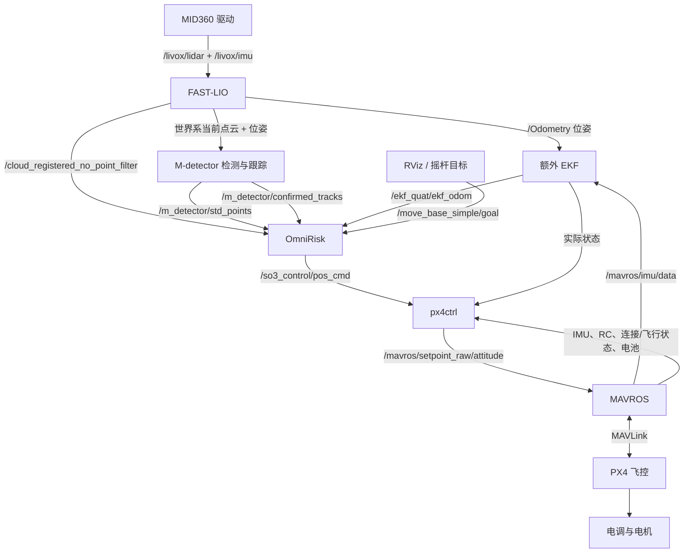
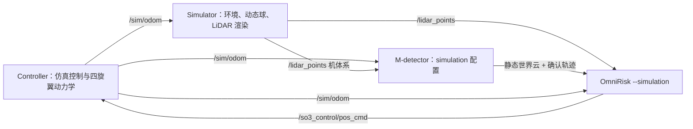
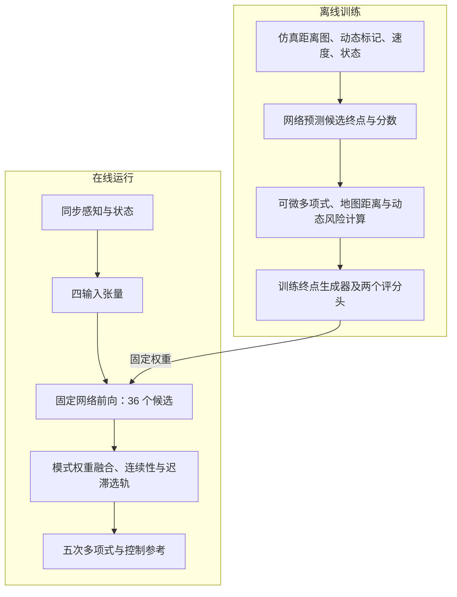

# 实机仿真复现流程：代码审查与原理补充

本文配合[原文《实机仿真复现流程》](实机仿真复现流程.md)阅读，审查基于当前仓库代码、launch、YAML 和消息接口。原文件保持不变。

审查日期：2026-11-02；源码基线：`a0a89a4`。本文进行了静态代码核对，没有启动 ROS、连接飞控或执行本次仿真、实机试飞。下文的“默认值”指本次审查时的文件内容；运行效果、硬件标定和预训练权重的历史训练配置不能仅靠源码确认。

**结论：原文适合作为系统入门介绍，模块划分、ROS 通信和“规划—轨迹跟踪—飞控执行”的分层基本合理，但尚不足以作为可直接执行的完整复现手册。** 原文最后的“4. 实机部署”尚无内容，对仿真链路也没有展开。需要优先补上起降状态约束、模型加载前提、飞行模式与在线参数，并纠正 LiDAR 主流程的加速度输入来源。

阅读导航：[逐项审查](#review) · [OmniRisk 原理](#omnirisk) · [实机步骤](#realflight) · [仿真步骤](#simulation)。

<a id="review"></a>

## 1. 对原文的逐项审查

| 原文位置或说法 | 审查结果 | 需要补充的准确表述及依据 |
|---|---|---|
| 第 1 节的七终端启动命令 | 与当前 README 的实机段一致，但前置条件不完整 | 应先完成环境构建、自定义消息生成、设备网络/串口配置，以及模型准备；启动顺序一致不等于所有接口已经匹配。见第 6 节。 |
| `python omnirisk_node.py --use_tensorrt 1` | 当前本机不能直接按此加载默认文件 | 默认读取当前工作目录中的 `omnirisk_trt.pth`；审查时 `OmniRisk/omnirisk_trt.pth` 不存在，需要在部署设备导出。PyTorch 路径默认 epoch50，本机已有的是 epoch60，应显式指定。见 [parser 和入口](../OmniRisk/omnirisk_node.py#L2286)。 |
| 点云 → M-detector → OmniRisk 的线性数据流 | 大方向正确，但遗漏并行输入 | OmniRisk 同时接收原始注册云、静态云、动态轨迹、EKF 状态和目标；并非只接收 M-detector 输出。见第 2 节。 |
| FAST-LIO `/Odometry` 输出“位置、姿态、速度等” | 对当前发布消息不够准确 | FAST-LIO 内部估计速度，但当前 `publish_odometry()` 没有给 `twist` 填入该速度，不能把此话题直接当作有效速度来源；额外 EKF 发布的速度被规划器和控制器使用。见 [publish_odometry](../ros_ws/src/FAST_LIO/src/laserMapping.cpp#L742)。 |
| 额外 EKF 用飞控 IMU 补充高频状态 | 基本正确 | 它接收 FAST-LIO 位姿，维护四元数和偏置等状态，含延迟校正、历史传播；输出频率仍受实际 IMU、时间戳和计算影响。外参需要按安装设置。 |
| M-detector 检测、聚类、关联、跟踪 | 基本正确 | 当前实机配置还带固定世界原点范围、体积、速度和高度过滤，不是通用任意目标检测器；仿真必须加载专用覆盖配置。见第 3.3 节。 |
| “参考加速度主要来自规划参考”作为网络输入 | **不适用于当前默认 LiDAR 主流程** | `_process_odom_at()` 使用同步里程计速度差分得到的加速度，缺少邻帧时为零；重建新控制多项式时，起点加速度又使用 `desire_acc`。两者必须区分。见第 4.3、4.9 节。 |
| “静态分支使用距离图和状态” | 正确，但“静态”的含义易误解 | 距离图融合当前云、静态云和可见动态球面，包含动态物体的当前几何。静态分支不直接接收 mask/速度图，不代表它只看静态物体。 |
| 36 个候选输出终点与两个分数 | 正确 | 原始终点输出需通过角度、距离、速度/加速度尺度解码；两个分数是学习的代价，动态分数监督目标还做了 `log1p` 压缩。见第 4.4—4.7 节。 |
| `J_static + λ J_dynamic` 后选轨 | 基本正确 | 当前 LiDAR 在线流程的 λ 来自 `runtime_modes`：CRUISE 为 0，DODGE 为 10，不能直接套 YAML 顶层的 100；连续性与迟滞主要作用于 DODGE 连续选轨。 |
| 五次多项式和约 50 Hz 控制参考 | 基本正确 | 50 Hz 是控制定时器名义频率，推理提交后还会立即发布一次；感知、网络推理、成功换轨和 PX4 接口频率是不同指标。 |
| px4ctrl 发布姿态四元数＋归一化推力 | 正确 | 当前调用 `publish_attitude_ctrl()`，忽略三个角速度字段；代码计算了 body rates 不代表实际使用角速度接口。 |
| 默认自动起飞可与 px4ctrl 配合 | 原文没有讲明接口断点 | 规划器自动请求的是 `/network_controller_node/takeoff_land` 服务，px4ctrl 接收 `/px4ctrl/takeoff_land` 话题，类型也不同，不能只改名字就当作接口一致。 |
| 发布 `takeoff_land_cmd: 2` 即可降落 | **缺少必要状态条件** | px4ctrl 在 `CMD_CTRL` 下拒绝降落，须先停止所有 `pos_cmd` 发布，等待命令超时回到 `AUTO_HOVER` 后再请求。发送 `EMPTY` 仍算新命令。见第 6.4 节。 |
| `/ekf_quat/ekf_odom > 50 Hz`、姿态指令 `> 100 Hz` | 可作为观测目标，不能作为唯一验收 | 频率高仍可能位置错误、时间戳错配、轨迹不更新或飞控未接管；应结合消息内容、模式、成功提交频率和延迟分位数。 |
| 原文的截图引用 | 不便于仓库共享 | 指向 `/home/cjx/图片/...png` 的机器绝对路径。本文使用可在仓库阅读的 Mermaid 链路图表达关系。 |

## 2. 先把两条运行链路分清楚

### 2.1 实机链路



FAST-LIO 提供世界系点云，并不表示这些点全部静止：当前扫描中仍有运动目标。M-detector 从中分离静态点并估计目标运动。OmniRisk 同时保留当前观测几何与检测结果，减少仅依靠一种表示造成的信息丢失。

### 2.2 仿真链路



常规仿真直接提供模拟里程计，因此不需要实机的雷达驱动、FAST-LIO、额外 EKF、MAVROS 或 PX4 才能闭环。它能检查检测、规划和模拟控制是否协同，但不验证定位误差、串口链路或真实推力模型。不要把仿真控制器与实机 px4ctrl 同时用于同一条飞控设定值链路。

## 3. 感知与状态估计的进一步说明

### 3.1 FAST-LIO：先估计自身运动，才能比较环境

原文对 IMU 预测、扫描去畸变、扫描与地图匹配及迭代滤波的解释合理。需要再区分三个概念：

1. **去畸变**：一帧点云中各点采集时刻不同，利用估计运动将它们表达在统一参考时刻。
2. **坐标注册**：利用外参及无人机位姿把点变换到世界坐标，便于多帧比较；`/cloud_registered_no_point_filter` 是当前扫描的世界系点云，不是整张历史静态地图。
3. **动静态判别**：点已在世界系不代表它静止，这由后续检测器进一步判断。

当前 [MID360 配置](../ros_ws/src/FAST_LIO/config/mid360.yaml) 中，雷达—IMU 外参、`wxx/Lidar_wrt_Body_*`、点云发布开关都影响输入语义。额外 EKF 还有自己的 `Rr_i`、`tr_i` 和 `rotation_imu`，不能把两套外参混为一谈。配置中的默认平移值来自已有安装约定，迁移机体时必须重新核对。

### 3.2 额外 EKF：高频输出来自状态传播

用简化符号表示其状态：

\[
x=[p,q,v,b_g,b_a].
\]

预测阶段用去偏置角速度推进姿态，用旋转到世界系的加速度与重力推进速度、位置：

\[
\dot p=v,\qquad
\dot v=R(q)(a_m-b_a)+g.
\]

FAST-LIO 的位置和姿态到达后，再用测量误差及不确定性校正状态。当前实现使用四元数名义状态和姿态误差更新；数学上可以把名义状态理解为 16 个数、局部误差为 15 维，四元数的四个分量并非四个独立姿态自由度。

延迟校正依赖历史 IMU/状态覆盖测量时间。超出缓存范围、时间戳不同步、外参错误，都会破坏融合。高频状态也不自动保证坐标原点与 FAST-LIO 点云完全一致：规划器默认直接把二者当作同一个世界系使用，没有替用户完成任意外参或世界原点对齐。

依据：[实际编译的 EKF 源文件](../ros_ws/src/ekf_quat_pose/CMakeLists.txt)、[滤波与状态发布实现](../ros_ws/src/ekf_quat_pose/src/ekf_node_vio_timesync_with_acc_pub.cpp)、[MAVROS 输入配置](../ros_ws/src/ekf_quat_pose/launch/PX4_vio_drone_mavros.yaml)。

### 3.3 M-detector：检测能力由几何证据和目标先验共同决定

原文的“多帧几何一致性—聚类—关联—滤波—生命周期”可以保留。其核心意义是先解释无人机自身运动，再找仍无法用静态环境解释的点；聚成物体后才估计速度，并通过预测与匹配维持目标身份。消息中的 `confirmed`、`matched` 是不同含义：目标可已确认但当前帧暂时没有真实匹配。

当前[实机配置](../ros_ws/src/M-detector/config/mid360/mid360.yaml#L143)的目标限制包括：

| 项目 | 当前值或行为 | 对复现的影响 |
|---|---|---|
| 运动模型 | `ballistic_model_en: true` | 使用已知重力的弹道模型，适合投掷物；不适合所有运动类别。 |
| 有限预测 | `max_prediction_horizon: 0.10 s` | 允许短时传播，不应把很久以前的目标一直外推。 |
| 相对距离 | 水平最多 7 m、相对高度最多 1.5 m | 会过滤远处或高度差过大的目标。 |
| 固定世界框 | x/y 为 `[-6,6]`，z 为 `[-0.1,2]` m | 飞到原点附近范围外后，即使看得到目标，也可能被过滤。 |
| 体积上限 | 包围盒体积 `0.04 m³` | 大物体不能假定沿用小球检测配置就能输出。 |
| 速度门限 | `target_min_speed: 3 m/s`，带短暂宽限 | 慢速物体可能不进入最终确认输出。 |
| 确认次数 | `min_init_hits: 1`；近距离快速确认次数为 2 | 不能照注释概括为“所有目标至少两次命中”；实际走哪条门限取决于近距离候选条件。 |

最后一项在 YAML 中存在数值与注释不一致，应以 [ConfirmationHitThreshold 与建轨实现](../ros_ws/src/M-detector/src/FrameTracker.cpp#L2098)为准。

规划器用确认轨迹的**三维中心距离小于 6 m**作为威胁触发条件，和检测器 7 m 的**水平距离**限制并非同一判据。当前触发不是严格的“未来必撞”或碰撞时间计算，飞离中的目标也可能暂时触发 DODGE。

仿真覆盖配置会关闭弹道和固定原点框，并降低速度门限等，见 [simulation.yaml](../ros_ws/src/M-detector/config/simulation.yaml)。这正是必须使用 `detector_sim.launch` 的原因，不能只把实机 launch 的点云话题换名就认为仿真配置等价。

<a id="omnirisk"></a>

## 4. OmniRisk 的原理与当前实现

### 4.1 核心思路：把昂贵的轨迹评价放到训练阶段

局部避障需要同时判断“怎样接近目标”“是否撞墙”“会不会与运动物体相遇”“动作是否平滑”。如果在线对每条候选轨迹、每个障碍物和多个未来时刻都做复杂评价，计算量会增加。

OmniRisk 在离线训练时利用地图和障碍物参数计算轨迹代价，训练网络同时生成 36 个方向的候选终端状态，并估计每个候选的静态综合代价与动态风险。在线时，网络一次前向给出这 36 个候选及分数，节点再选轨、生成多项式并输出控制参考。



固定的是网络前向的张量形状与候选数。M-detector 的检测/关联、逐目标球面成像等仍与输入点数或目标数有关，不能把整个系统描述成“障碍物再多，端到端开销也绝不变化”。

### 4.2 坐标系与距离图：为什么能向后、向侧面躲

当前 `omnidirectional: true` 时，规划参考系以无人机位置为原点，坐标轴保持世界方位、z 轴与世界竖直方向一致，**不随飞机偏航一起旋转**。代码中 `Rotation_wc = I`。

设无人机位置为 \(p_w\)，世界点为 \(P_w\)，规划系点为：

\[
P_c=R_{wc}^{T}(P_w-p_w),\qquad R_{wc}=I.
\]

实机当前云已经在世界系；仿真的 `/lidar_points` 是机体系，先按模拟位姿变到世界系，再执行上述变换。给已经是世界系的点再次乘机体姿态，会把环境错误旋转。

对规划系点 \((x,y,z)\) 定义：

\[
d=\sqrt{x^2+y^2+z^2},\quad
\theta=\operatorname{atan2}(y,x),\quad
\phi=\operatorname{atan2}(z,\sqrt{x^2+y^2}).
\]

当前球面网格为 `H=96, W=360`，俯仰范围 \([-7^\circ,52^\circ]\)：

\[
u=\operatorname{round}\!\left(\frac{\theta+\pi}{2\pi}W\right)\bmod W,
\quad
v=\operatorname{round}\!\left(\frac{\phi_{max}-\phi}{\phi_{max}-\phi_{min}}(H-1)\right).
\]

同一像素保留最近距离，未命中处初始为 20 m。这里存的是沿射线的距离，不是普通相机的光轴 z 深度。水平覆盖 360°，垂直只有上述带状区域，因此“全向”不代表上下整个球面都能观测。

参考：[球面投影与列映射](../OmniRisk/dynamic_inputs.py#L10)、[规划参考系](../OmniRisk/omnirisk_node.py#L1084)。

### 4.3 四个输入张量到底从哪里来

#### A. `depth`：融合几何后的距离图

默认 `static_input_mode: pointcloud` 的实际顺序是：

1. 对当前注册云和 M-detector 静态云分别投影，得到 `current_range` 与 `static_range`。
2. 逐像素取 `minimum`，得到基础距离图，较近障碍物优先。
3. 把已确认目标近似为球，计算射线与球面的交点，在可见位置补入动态表面距离，并同时构造 mask 与速度图。
4. 对距离图空洞插值补全，保留原有限实测点；水平插值跨越全景接缝，垂直方向不循环。
5. 若显式启用虚拟天花板，再加入上方平面的约束；当前默认关闭。
6. 用统一列查找表把 `96×360` 映射成 `96×384`，除以 20 m，得到 float32 网络输入。

宽度变成 384 是为了匹配网络下采样和 12 个水平方向；它没有产生额外真实视角，也不是取前方的 384°。

这份 `depth` 包含动态目标的当前几何。补洞区域属于模型输入估计，不能把它等同于已经测得的自由空间或障碍物边界。

#### B. `mask`：动态球面的可见投影

当前不是把检测器动态点简单画成几个像素，也不是直接输入三维包围盒。每条确认轨迹提供中心、尺寸、速度，成像时使用：

\[
r_s=\operatorname{clip}\left(\tfrac12\max(d_x,d_y,d_z),0.10,0.20\right)\ \mathrm{m}.
\]

对射线求球面交点，多球重叠时保留最近者；球面距离必须不超过基础场景距离加 0.15 m 的遮挡容差，才被标为可见动态区域。因此位于墙后的目标不会无条件穿透墙写入 mask。

这里的 0.10—0.20 m 是在线成像半径约束，和后文风险场中的高斯尺度、静态损失中的 `r=0.6` 是不同参数。大尺寸目标被截断成 0.20 m 球面，是当前表示的适用范围限制。

#### C. `vel_img`：动态区域的三维目标速度

每个有效动态像素写入该目标在规划系中的 \((v_x,v_y,v_z)\)，单位为 m/s，mask 外为零。它是障碍物速度，**不是光流，也没有预先减去无人机速度**。网络另外从 `obs` 得到无人机运动状态。

#### D. `obs`：速度、加速度、目标偏移

同步感知帧对应的原始状态为：

\[
o=[v_c,a_c,g_c],\qquad
g_c=R_{wc}^{T}(p_{goal}-p_w).
\]

**当前 LiDAR 主流程的 \(a_c\) 来自同步里程计邻近速度的有限差分**：

\[
a_w\approx\frac{v_w(t_2)-v_w(t_1)}{t_2-t_1}.
\]

代码要求邻近样本满足时间容差，缺失合格样本时返回零。旧的 `process_odom()` 和深度图回调路径仍会使用 `desire_acc`，原文把该逻辑概括到默认 LiDAR 路径上了。真实控制多项式的起点加速度则仍来自参考值，见第 4.9 节。

归一化为：

\[
\bar v=v_c/v_{max},\quad \bar a=a_c/a_{max},\quad
\bar g=g_c/\max(\|g_c\|,L_{goal}).
\]

远目标主要保留方向，近目标还保留缩小后的距离信息。随后对每个方向基元做坐标旋转，得到 `9×3×12` 状态网格，而不是直接把单个九维向量拼在图像旁边。

| 张量 | 在线 batch=1 的形状 | 内容 |
|---|---|---|
| `depth` | `[1,1,96,384]` | 融合、补洞、归一化后的球面距离 |
| `mask` | `[1,1,96,384]` | 可见动态区域的 0/1 标记 |
| `vel_img` | `[1,3,96,384]` | 动态目标三维速度，背景为零 |
| `obs` | `[1,9,3,12]` | 归一化后、变换到各基元坐标的状态 |

三张图共用同一列映射，才能保证某个像素的距离、动态标记与速度属于同一方向。依据：[实际预处理入口](../OmniRisk/omnirisk_node.py#L1342)、[差分与状态构造](../OmniRisk/omnirisk_node.py#L1053)、[状态归一化](../OmniRisk/policy/state_transform.py#L133)、[补洞实现](../OmniRisk/depth_completion.py)。

### 4.4 两个网络分支如何协作

[network.py](../OmniRisk/policy/network.py#L17) 中的结构可以写成：

\[
F_d=\mathrm{DepthEncoder}(depth),\quad
F_m=\mathrm{DynamicEncoder}([mask,vel\_img]),
\]

\[
(e,s)=\mathrm{StaticHead}([F_d,obs]),\qquad
d=\mathrm{DynamicHead}([F_d,F_m,obs]).
\]

两个编码器均使用 ResNet18 结构，空间下采样后对应 `3×12` 候选网格。静态头输出 9 个终端参数和 1 个静态分数；动态头输出 1 个动态分数。终端参数经 `tanh` 限制在 \((-1,1)\)，两个分数经 `softplus` 保持非负。

因此，在 `depth` 与 `obs` 固定时，仅改变 mask 或速度图不会直接改变本次生成的候选终端状态；它会改变动态分数，使系统从同一组候选中选择另一条。这有助于保留向前、向后和侧向等多种逃逸动作。训练时两个头共享距离编码器，动态评分损失仍会通过共享特征影响模型学习，不能理解为两套网络完全独立。

编码器对卷积边界使用循环填充，让全景左右边缘连接。当前实现也对少量垂直边缘像素循环填充，这是代码的实现细节，不能据此说俯仰观测上下也物理相连。

### 4.5 “36 个候选”是方向基元，不是 36 条固定航线

当前基元为：

\[
N=12\times3\times1=36.
\]

水平方向相隔 30°；垂直锚点约为 2.83°、22.5°、42.17°。每个锚点上的终端位置还能在水平约 ±15°、垂直约 ±10° 范围调整，距离也可变化。

设网络前三个原始输出为 \(u_0,u_1,u_2\)，某个基元方向为 \((\theta_i,\phi_i)\)，解码为：

\[
\theta=\theta_i+u_0\Delta\theta,\quad
\phi=\phi_i+u_1\Delta\phi,\quad
\rho=(u_2+1)R,
\]

\[
p_T=\rho[\cos\phi\cos\theta,\cos\phi\sin\theta,\sin\phi]^T.
\]

后六个通道缩放为终点速度、终点加速度，再从各基元局部坐标旋转到规划系。最大终点距离接近 \(2R\)，不应把 `radio_range=R` 直接理解成最大终点半径。

这些速度/加速度尺度约束的是解码分量，**并不自动构成整条多项式的速度范数、加速度范数和电机能力的严格约束**。

图像行从高俯仰到低俯仰，基元生成顺序相反；当前全向实现只翻转垂直顺序，不翻转水平方向。训练、解码和选轨必须沿用同一重排，否则会把右侧低风险评分对应到另一方向。

依据：[primitive.py](../OmniRisk/policy/primitive.py)、[state_transform.py](../OmniRisk/policy/state_transform.py#L9)。

### 4.6 静态分数为什么包含“去目标”和“动作平滑”

当前训练代码对每条候选构造五次多项式，在训练地图中查询距离并计算代价。静态评分的监督目标为：

\[
C_{static}=w_s C_{jerk}+w_a C_{acc}+w_c C_{clearance}+w_g C_{goal}.
\]

其中 jerk 是加速度对时间的导数：

\[
C_{jerk}=\int_0^T\|p^{(3)}(t)\|^2dt,\qquad
C_{acc}=\int_0^T\|p^{(2)}(t)\|^2dt.
\]

静态安全代价来自训练地图的欧氏有符号距离场 ESDF。代码把地图点云体素化，分辨率 0.2 m，计算到障碍的距离；沿轨迹取 30 个未来采样点，惩罚函数为：

\[
c_{clearance}(x)=\exp\left(-\frac{D(x)-d_0}{r}\right),\qquad
d_0=1.2,\ r=0.6.
\]

默认静态项取这些采样值的均值。越贴近障碍，代价越高；这是一种软惩罚，参数 `d0` 不能直接解释为系统保证保持的最小净空。

目标项比较候选终点相对起点的位移与目标方向：沿目标方向的推进不足或过冲会受罚，垂直目标方向的偏移也受罚。当前 `similarity_loss()` 的横向权重是 0.5，其旁注还提到历史权重可能用过不同设置，因此不能只靠当前代码倒推公开模型训练过程。

候选终点生成器与评分器的训练目标还不完全相同：终点生成器使用**各自锚点方向**的引导，使 36 个方向都保留可用动作；静态评分器使用**真实全局目标**的引导，帮助在线选轨朝目标推进。终点生成器的直接轨迹损失不包含动态安全项，动态风险主要通过候选评分发挥作用。

依据：[训练目标的实际拆分](../OmniRisk/policy/trainer.py#L172)、[静态距离损失](../OmniRisk/loss/safety_loss.py#L60)、[目标引导](../OmniRisk/loss/guidance_loss.py)、[权重缩放](../OmniRisk/loss/loss_function.py#L63)。上述权重已按训练速度缩放，不能只比较 YAML 中原始数字判断影响大小。

### 4.7 动态风险的数学原理：距离、运动方向与相对速度一起考虑

以下公式对应当前 `SafetyLoss` 的训练评价过程。在线 LiDAR 节点执行网络预测，不会在每次选轨时重新运行这一套解析损失或构建 ESDF。

#### 4.7.1 先看“未来同一时刻是否靠近”

对球形障碍，已知中心 \(c_0\)、速度 \(v_o\)、半径 \(r_o\)。当前损失按匀速预测中心：

\[
c(t)=c_0+v_ot,\qquad r(t)=p(t)-c(t).
\]

必须比较无人机轨迹 \(p(t)\) 与同一时刻的障碍中心 \(c(t)\)，不能只看障碍现在离飞机多少米。飞机要穿过的位置现在空着，几百毫秒后也可能被来球占据。

#### 4.7.2 速度方向决定风险场的形状

令 \(\hat u=v_o/\|v_o\|\)，把相对位置分为沿目标速度方向的分量和横向分量：

\[
r_\parallel=r\cdot\hat u,\qquad
\|r_\perp\|^2=\|r\|^2-r_\parallel^2.
\]

代码用下面的高斯形状表达空间接近程度：

\[
S=\exp\left[-\frac12\left(
\frac{r_\parallel^2}{\sigma_\parallel^2}+
\frac{\|r_\perp\|^2}{\sigma_\perp^2}
\right)\right],
\]

\[
\sigma_\perp=0.4r_o+0.1,\qquad
\sigma_\parallel=1.0r_o+0.5+0.4\|v_o\|.
\]

速度越快，场沿运动轴越长，提供更早的沿途预警；横向尺度保持较窄，给侧移留下低代价通道。以半径 0.15 m、速度 4 m/s 为例，横向尺度是 0.16 m，纵向尺度是 2.25 m。

这个高斯空间项本身围绕预测中心前后对称；“接近更危险、远离更安全”的区别还需要下一步的相对速度项。目标速度为零时，代码通过限幅避免除零，球形场退化到横向尺度控制的各向同性形式。

#### 4.7.3 用风险上升方向判断是在靠近还是逃离

场的梯度 \(\nabla_p S\) 指向风险更高的区域，归一化后记作：

\[
n=\frac{\nabla_p S}{\max(\|\nabla_p S\|,10^{-6})}.
\]

无人机相对障碍速度为：

\[
v_{rel}=\dot p(t)-v_o,\quad z=v_{rel}\cdot n.
\]

若 \(z>0\)，说明相对运动朝向风险增大的方向；若 \(z<0\)，说明正在逃离高风险区域。单个障碍在单个轨迹采样点的代价为：

\[
c_{dynamic}=S\,\operatorname{softplus}(\alpha z),\qquad
\operatorname{softplus}(x)=\ln(1+e^x),\quad \alpha=1.
\]

`softplus` 在接近时给较大代价，远离时平滑降低，但不会硬截断成零。举例，在相同 \(S=0.5\) 下，\(z=+4\) 的代价约 2.009，而 \(z=-4\) 约 0.009；\(z=0\) 时仍有 \(0.5\ln2\) 的基础惩罚。这解释了为什么仅有距离不够：两条同样贴近障碍的轨迹，一条迎上去，一条正逃离，风险应有区别。

多障碍的代价相加，再对一条候选的 30 个时间采样点**等权求和**：

\[
C_{dynamic}=w_cw_{dynamic}\sum_{k=1}^{30}\sum_j
S_j(t_k)\,\operatorname{softplus}(\alpha z_j(t_k)).
\]

当前实现没有把这个和再乘时间步长，也没有取均值；不能在解释或重新训练时随意替换聚合方式而认为分数尺度不变。静态安全项默认取均值，动态项取和，这是两者的具体差异。

对于圆柱，xy 平面仍使用沿运动轴拉伸的风险场，z 方向在柱体高度带内不加额外距离惩罚，超出高度带后按 `aniso_sigma_z=0.5` m 软化。在线当前统一用球面投影轨迹目标，不代表圆柱训练表示已被在线逐项复用。

依据：[动态求和及风险函数](../OmniRisk/loss/safety_loss.py#L106)、[球形与圆柱风险实现](../OmniRisk/loss/safety_loss.py#L135)。

#### 4.7.4 网络学到的是压缩后的代价，不是碰撞概率

当前训练代码使用：

\[
s_i\approx C_{static,i},\qquad
d_i\approx\ln(1+C_{dynamic,i}).
\]

两者用 `Smooth L1` 回归，监督值先 `detach()`。`detach` 使评分回归的误差不通过目标值这一侧继续牵动候选轨迹；候选生成本身由前述轨迹损失训练。

在线融合直接使用预测的 \(d_i\)，没有先用 `expm1` 还原。因此 \(\lambda\) 是对**压缩风险分数**的权衡，不能套用原始解析风险量纲解释。

\(S\) 没有概率密度归一化，风险头也没有用碰撞/不碰撞标签校准概率；分数还依赖采样数与权重。所以 `dynamic_score=0.8` 不能解释成“80% 会撞”，分数小也不构成严格无碰撞证明。这里描述的是当前训练实现；本地 checkpoint 是否由完全相同的训练版本生成，需要额外的训练记录或模型元数据确认。

#### 4.7.5 弹道跟踪与风险预测的边界

当前实机跟踪器和 `_tracks_at()` 可以按重力作短时传播，而训练风险函数对候选未来时间采用 \(c_0+v_ot\)。这两件事分别服务于“感知时间对齐”和“训练风险评价”，不能概括成整个系统未来两秒都按同一条重力抛物线精确预测。

默认组帧要求确认轨迹与主点云同时间戳，`_tracks_at()` 中的额外传播时间通常为零；该函数带有限预测能力，不代表会随意接受上一帧轨迹替代当前帧。也不要把用于显示的预测轨迹话题直接替换 `/confirmed_tracks`，其类型和时间语义不同。

### 4.8 模式、分数融合与选轨稳定性

必须区分两个层次：

- `--flight_mode dodge|nav` 决定任务行为：默认原地避障演示，还是主动导航。
- `HOVER / CRUISE / DODGE` 是运行时模式，按当前威胁与导航意图切换。

模式优先级为：**有威胁 → DODGE；没有威胁但有导航意图 → CRUISE；否则 HOVER**。确认目标在三维 6 m 内会触发威胁，最后一次威胁后继续保留 0.2 s。`dodge` 任务下收到外部目标也能进入导航，不能把它理解为永远拒绝航点。

当前 [traj_opt.yaml](../OmniRisk/config/traj_opt.yaml) 和 [runtime_modes.py](../OmniRisk/runtime_modes.py) 对在线 LiDAR 模式给出：

| 参数 | CRUISE | DODGE | 含义 |
|---|---:|---:|---|
| `velocity` | 4 m/s | 4 m/s | 在线速度尺度 |
| `radio_range` | 4 m | 4 m | 终端距离解码尺度，最大距离接近 8 m |
| `fusion_lambda` | 0 | 10 | 动态分数融合权重 |
| `trajectory_time` | 2 s | 2 s | \(T=2R/v\) |
| `acc_max` | 约 2.67 m/s² | 约 2.67 m/s² | \((4/6)^2\times6\)，终端分量缩放尺度 |
| `goal_length` | 8 m | 8 m | 状态目标归一化尺度 |

顶层 `velocity: 6`、`radio_range: 5`、`fusion_lambda: 100` 仍服务训练/导出或其他路径；当前 LiDAR 在线运行使用的是上述模式快照。配置在启动时读取，不会在飞行中自动重读修改后的 YAML。

每条候选先计算：

\[
J_i=s_i+\lambda d_i.
\]

CRUISE 的 λ 为零，不表示完全忽略动态物体：物体当前几何仍在 depth 中；只是运动风险分数没有加入融合。DODGE 才显式提高动态评分的作用。

例如，假设向前候选的静态分数为 1.0、动态分数为 0.8，侧移候选分别为 1.8 和 0.02。只看静态分数会偏向更容易到目标的向前动作；DODGE 使用 λ=10 时，两者总分为 9.0 和 2.0，便会偏向侧移。这个示意解释了“同一次前向生成多方向动作，再按风险改变选择”，数字并非本次运行测得。

连续 DODGE 期间还可加入终点连续性代价。当前代码用**这一帧中上一 action ID 对应的终点**作参照：

\[
\widetilde J_i=J_i+w_{cont}
\frac{\|P_i-P_k\|}{\max_j\|P_j-P_k\|},\quad w_{cont}=0.8.
\]

`k` 是上一候选 ID，不是另存的上一帧绝对终点；分母为零时不加此项。随后只有当新候选满足：

\[
\widetilde J_{new}+0.8<\widetilde J_{old}
\]

才切换，否则保持上一候选。这可减少相近分数引发的左右摇摆，但也意味着当前选择不一定是每帧裸分数最小者，参数过大还可能延迟必要换向。

模式切换会提高版本号、清空待处理槽位并使旧控制轨迹失效，避免把 CRUISE 参数算出的旧结果提交到 DODGE。依据：[模式选择](../OmniRisk/omnirisk_node.py#L428)、[实际选轨入口](../OmniRisk/omnirisk_node.py#L1507)、[连续性与迟滞](../OmniRisk/trajectory_selection.py)。

### 4.9 从候选终点到可执行轨迹

网络输出的候选给出终点位置、速度和加速度，节点用五次多项式补出中间运动。单轴为：

\[
p(t)=\sum_{k=0}^{5}c_kt^k,
\]

满足六个边界条件：

\[
p(0)=p_0,\ \dot p(0)=v_0,\ \ddot p(0)=a_0,
\quad p(T)=p_T,\ \dot p(T)=v_T,\ \ddot p(T)=a_T.
\]

因此无需在线迭代优化这六个系数，直接按 [Poly5Solver](../OmniRisk/policy/poly_solver.py#L4) 的矩阵表达式求解，并求导得到速度、加速度与 jerk。

当前 LiDAR 实现对延迟作了一个重要处理：

- **终点位置锚定感知时刻**：网络的相对终点加上该帧里程计位置，保持它与输入环境的空间关系。
- **起点位置和速度取构造轨迹时的最新里程计**，不直接从旧感知时刻开始执行。
- **起点加速度取上一规划参考 `desire_acc`**，和网络 `obs` 中的速度差分加速度来源不同。

这样能减轻直接追踪旧起点的问题，但推理分数仍对应感知时刻的输入。延迟期间状态明显变化后，新起点构造出的曲线并不保证与训练评分时的曲线完全一致。

单条多项式内部具有连续导数；重规划时起点来自实际状态，并不强制等于上一条参考曲线同一时刻的位置、速度，所以不能宣称所有轨迹拼接处严格 C² 连续。终端分量限幅和平滑损失也不能替代整段轨迹的硬动力学可行性检查。

### 4.10 控制采样、悬停与遥控目标

`control_pub()` 由 0.02 s 定时器驱动，成功提交轨迹时还会立即调用一次。它检查 home、任务行为、模式版本、轨迹刷新时间和轨迹时域，再发布位置/速度/加速度/jerk/yaw 参考。

默认全向规划保持先前偏航，`yaw_dot=0`，无需先转头再侧飞。`callback_set_goal()` 使用目标 x、y，但把 z 固定为 `hover_height`；它没有按输入 `frame_id` 做任意坐标变换。因此 `/move_base_simple/goal` 应按当前世界坐标发送，RViz 的目标高度也不会原样传入规划。

规划器在满足 z 大于 0.5 m、竖直速度绝对值小于 0.1 m/s 时锚定 home；默认目标悬停高度为 0.6 m，仿真覆盖为 2 m。这只是规划器内部接管判断，不等价于完整的飞控起飞成功确认。

摇杆节点将右摇杆转换为**世界 X/Y 方向的附近目标**，有死区、滤波和目标变化限速，同时发布 `/rc_goal_active`。回中后规划器保持当时捕获的水平位置，并以受限参考竖直速度回到悬停高度；真实动态威胁仍优先。收到遥控活动状态后，规划器会按它仲裁目标，不能假定 RViz 与回中摇杆始终互不影响。

USB 摇杆是高层目标输入，不等价于 px4ctrl 所需的 `/mavros/rc/in` 模式/接管通道。默认 `no_RC: false` 时，px4ctrl 会等待自己的 RC 数据。

依据：[目标与 RC 仲裁](../OmniRisk/omnirisk_node.py#L467)、[控制参考发布](../OmniRisk/omnirisk_node.py#L1896)、[摇杆实现](../OmniRisk/rc_goal_teleop.py)。

## 5. 同步、延迟与“话题有数据但没有避障”

### 5.1 主点云时间戳是组帧依据

默认 LiDAR 流程按主点云的 `header.stamp` 寻找完整感知帧：

| 输入/约束 | 当前规则 |
|---|---|
| 确认轨迹 | 必须与主点云完全同时间戳；没有目标时也需要正常发布空数组。 |
| 静态云 | 优先同时间戳；pointcloud 模式允许最多早 0.06 s 的静态云，仿真覆盖为不允许跨帧。 |
| EKF 里程计 | 优先同时间戳或前后插值；单侧偏差容差 0.03 s，可在范围内用最近值。 |
| 输入缓存 | 0.25 s 的短缓存。 |
| 等待同步 | 上游结果须满足主点云到达后的 0.15 s 到达期限。 |
| 可选 range_image 模式 | 另要求同帧静态距离图与 pose，且严格校验上游里程计来源及图像契约。 |

当前默认使用静态云路径，可选距离图接口不是原文启动流程的必需输入。替换检测器时，不能把检测完成的“发布时刻”填入原测量时间戳，否则话题都有消息也可能始终无法组帧。

依据：[select_latest_complete](../OmniRisk/perception_sync.py#L212)、[组帧线程](../OmniRisk/omnirisk_node.py#L1185)。

### 5.2 处理最新完整帧，避免排队追赶旧场景

节点把同步、预处理、推理和可视化拆成工作阶段，阶段之间使用容量为 1 的可覆盖槽位。若计算赶不上感知，尚未开始的旧任务可被更新任务覆盖。

这会丢弃部分感知帧，但能控制排队延迟。覆盖次数上升不必然是错误；若成功换轨频率持续降低或大量结果被过期丢弃，则需要排查计算性能和上游延迟。

### 5.3 两种超时不能混淆

**结果提交门限**：从主点云到达本节点的单调时钟开始计时，预处理、推理、后处理总年龄超过 120 ms 时拒绝提交。它不等于从激光实际采样开始计算的完整端到端年龄，上游 FAST-LIO 或检测延迟还可能额外存在。日志中的 150 ms 告警阈值也是另一项配置。

**已执行轨迹刷新门限**：距上一次有效控制轨迹提交超过 0.2 s，或模式版本不符、采样超出轨迹时域等，会锁存当时的里程计位置和偏航，改发悬停参考。

过期悬停仍依赖可用里程计；“持续发布了悬停消息”不证明实际定位可靠、飞机已悬停或飞控已经执行。px4ctrl 的命令接收超时又是独立的 0.1 s，并且按接收时刻判断，不靠规划器的 `trajectory_flag` 停止跟踪。

依据：[提交检查](../OmniRisk/perception_sync.py#L250)、[轨迹有效性](../OmniRisk/control_state.py)、[fallback 与控制入口](../OmniRisk/omnirisk_node.py#L1876)。

<a id="realflight"></a>

## 6. 实机复现步骤应如何补全

本节给出按当前代码整理的操作模板；这些命令在本次审查中没有被执行，不构成当前硬件已验证的飞行流程。

### 6.1 先确认环境、模型与坐标约定

各终端以仓库根目录为起点加载环境：

```bash
cd /home/cjx/OmniRisk
source /opt/ros/noetic/setup.bash
source ros_ws/devel/setup.bash
```

首次部署可参考 [scripts/build.sh](../scripts/build.sh)；它会安装依赖及构建，不是单纯的启动脚本。`--no-sim` 跳过仿真工作区构建，但实机自定义消息等仍涉及 `Controller/src/utils`，不能把整个 Controller 目录直接删除。硬件设备的串口名、MID360 IP/网卡和外参须对应实际安装。

在根目录检查 Python 与消息接口：

```bash
omnirisk_env/bin/python -c 'import torch, rospy, numpy, scipy, cv2; from m_detector.msg import TrackedObjectArray; from quadrotor_msgs.msg import PositionCommand; print("CUDA:", torch.cuda.is_available()); print("ROS messages: OK")'
ls -lh OmniRisk/saved/run_1/epoch60.pth
```

PyTorch 初次联调建议显式指定已有权重：

```bash
cd /home/cjx/OmniRisk/OmniRisk
../omnirisk_env/bin/python omnirisk_node.py --trial 1 --epoch 60 --flight_mode dodge
```

这是 T5 的替代启动方式，应在感知节点已运行后执行。若需要 TensorRT，先在部署设备、匹配的 CUDA/TensorRT 环境下导出：

```bash
cd /home/cjx/OmniRisk/OmniRisk
../omnirisk_env/bin/python trt_transfer.py --trial 1 --epoch 60
../omnirisk_env/bin/python omnirisk_node.py --use_tensorrt 1 --flight_mode dodge
```

二者选择一种，不同时运行两个规划器。导出脚本会检查非零输入、内存连续性、静态头不受 mask 直接影响、深度敏感性及转换误差；通过这些检查仍需要验证实际场景中的分数和选轨一致性。TensorRT 只加速网络前向，无法自动消除点云处理、同步和控制链路的延迟。

### 6.2 启动与核对输入

原文的 T1—T4 顺序合理，补上各阶段的通过条件：

| 阶段 | 应核对内容 |
|---|---|
| MAVROS | `connected: true`；IMU 有合理姿态、角速度和加速度；RC、飞行模式和落地状态可读。 |
| 雷达＋FAST-LIO＋EKF | 雷达正常出点；静止时定位稳定；位置轴向、重力方向和世界点云符合实际；额外 EKF 有连续速度。 |
| px4ctrl | 已通过 RC 等待，实际加载的是 `ctrl_param_omnirisk.yaml`；确认当前 FSM 状态。 |
| M-detector | 静态云持续发布；确认轨迹即使为空也按原点云时间戳输出；目标过滤区域与试验场地相符。 |
| OmniRisk | 权重加载成功、节点就绪；成功组帧并能提交轨迹或进入预期 HOVER；不是仅仅 Python 进程存活。 |

原文的 MAVLink `511` 是请求设置消息间隔，`5000` 单位为微秒，即请求 200 Hz；飞控是否支持、是否接受以及链路是否承载得住，需要测量 `/mavros/imu/data` 等实际 ROS 输出，不能由命令字符串保证。

当前实机默认悬停高度与 px4ctrl 起飞高度均为 0.6 m。px4ctrl 起飞高度相对起飞时位置上升，而规划器 `hover_height` 用作世界 z 目标；如果起飞地面在当前世界系不接近 z=0，两者即使填同一个数也未必指向同一高度。

### 6.3 起飞：使用 px4ctrl 的话题接口

规划器内置自动起飞访问旧控制器服务 `/network_controller_node/takeoff_land`，当前 px4ctrl 不提供该服务。服务不可用时规划器会告警并跳过自动起飞；应按当前控制器话题触发：

```bash
rostopic pub -1 /px4ctrl/takeoff_land quadrotor_msgs/TakeoffLand 'takeoff_land_cmd: 1'
```

px4ctrl 仍会检查定位有效、速度接近静止、已落地、RC 悬停/命令模式开关与摇杆回中等条件；请求不是无条件执行。规划器通常在 home 未设置前不发位置命令，以免干扰起飞。但若地面坐标已满足其高度阈值，home 也可能提前锚定，所以必须检查实际坐标和节点日志。

任务演示时使用 `--flight_mode dodge`，没有威胁和外部目标时维持 home；导航时显式选择 `--flight_mode nav`，再发世界系目标。使用 RViz 单航点和使用摇杆持续生成附近目标应按实际仲裁逻辑选择，避免把摇杆回中引发的保持误判为网络失效。

### 6.4 降落：必须退出 px4ctrl 的命令跟踪状态

当前 FSM 的 `CMD_CTRL` 分支明确拒绝降落，报错要求停止命令超过 `msg_timeout.cmd`。其判据是最近收到命令的时间，`EMPTY`、悬停命令仍会保持“收到命令”。

因此原文需要补成以下顺序：

1. 停止 OmniRisk 以及任何其他 `/so3_control/pos_cmd` 发布者，或由已实现的外围门控停止这条输出。当前仓库没有可直接假定存在的统一实机任务管理服务。
2. 等待超过当前 0.1 s 命令超时，并从日志确认 px4ctrl 从 `CMD_CTRL` 返回 `AUTO_HOVER`；同时保持控制器要求的悬停/接管状态。
3. 再发布降落请求，观察进入 `AUTO_LAND`。

```bash
# 按上述状态步骤停止规划器后，在已加载 ROS 环境的终端检查剩余发布者
rostopic info /so3_control/pos_cmd

# 确认已回到 AUTO_HOVER 后再执行
rostopic pub -1 /px4ctrl/takeoff_land quadrotor_msgs/TakeoffLand 'takeoff_land_cmd: 2'
```

依据：[FSM 的 AUTO_HOVER、CMD_CTRL 与降落判断](../ros_ws/src/px4ctrl/src/PX4CtrlFSM.cpp#L146)、[只按接收时间判断命令新鲜度](../ros_ws/src/px4ctrl/src/PX4CtrlFSM.cpp#L518)、[命令消息读取](../ros_ws/src/px4ctrl/src/input.cpp#L226)。

### 6.5 px4ctrl 的控制原理补充

默认 `pose_solver: 0`，从位置误差生成速度修正，再从速度误差生成加速度修正。忽略限幅时：

\[
v_{cmd}=v_d+K_p(p_d-p),\qquad
a_{cmd}=a_d+K_v(v_{cmd}-v).
\]

实际实现对位置误差和速度误差分别限幅，再对总加速度对应的倾角等进行限制。用世界重力向量 \(g=[0,0,-9.81]^T\) 表示时，所需总推力方向近似来自 \(a_{cmd}-g\)。推力方向结合期望 yaw 决定姿态，再映射为归一化推力。

当前还使用：

\[
q_{send}=q_{imu}\,q_{odom}^{-1}\,q_{desired}
\]

对齐外部定位参考姿态与飞控 IMU 姿态。它不替代雷达/IMU 的机械安装外参标定。推力映射参数也必须对应实际飞机，不能把 YAML 中“沿用已有参数”的注释当作本机已验证的证据。

当前发布姿态与推力后，PX4 再执行姿态/角速度闭环及电机分配；PX4 固件代码未包含在本仓库中，具体内环参数和行为取决于目标飞控版本。

依据：[默认控制算法](../ros_ws/src/px4ctrl/src/controller.cpp#L33)、[位置速度反馈](../ros_ws/src/px4ctrl/src/controller.cpp#L690)、[姿态接口发布](../ros_ws/src/px4ctrl/src/PX4CtrlFSM.cpp#L567)、[控制器配置](../ros_ws/src/px4ctrl/config/ctrl_param_omnirisk.yaml)。

<a id="simulation"></a>

## 7. 仿真复现应单独增加的内容

更完整的既有操作说明见[《仿真复现流程（中文版）》](仿真复现流程_中文版.md)。以下保留与原文补充最相关的差别。

### 7.1 自动功能检查

在已有依赖和编译产物齐全的机器上，从根目录执行：

```bash
cd /home/cjx/OmniRisk
source ros_ws/devel/setup.bash
omnirisk_env/bin/python experiments/simulation/run.py --perception detector --scenario head_on --speed 2
```

侧向与多球分别可用：

```bash
omnirisk_env/bin/python experiments/simulation/run.py --perception detector --scenario side --speed 2
omnirisk_env/bin/python experiments/simulation/run.py --perception detector --scenario multi
```

逐次运行；需要观察场景可在对应命令末尾加 `--rviz`。脚本使用独立 ROS master，默认端口 11321；生成临时 arena 场景、20 Hz LiDAR 配置，启动动力学、感知与规划，自动发目标并触发来球，结束后停止节点并删除临时文件。

该脚本是当前仓库的辅助验证工具，不应当作论文全部统计实验已复现。`--perception truth` 绕过实际 M-detector，只能诊断规划/控制，不代表完整感知链路通过。

### 7.2 手动交互流程

各终端从仓库根目录开始，按对应工作区加载环境：

```bash
# T1：模拟控制与动力学
source Controller/devel/setup.bash
roslaunch so3_quadrotor_simulator simulator_attitude_control.launch

# T2：环境与 LiDAR
source Simulator/devel/setup.bash
rosrun sensor_simulator sensor_simulator_cuda

# T3：仿真检测配置
source ros_ws/devel/setup.bash
roslaunch m_detector detector_sim.launch

# T4：规划器
source ros_ws/devel/setup.bash
cd OmniRisk
../omnirisk_env/bin/python omnirisk_node.py --trial 1 --epoch 60 --simulation --flight_mode nav

# T5：RViz（此终端仍从根目录开始）
source ros_ws/devel/setup.bash
rviz -d OmniRisk/omnirisk.rviz
```

RViz 的 `2D Nav Goal` 对应目标话题，动态球触发使用 `/clicked_point`。手动启动直接读取原始仿真配置，场景和频率不一定与自动脚本的临时覆盖相同。`--simulation` 会改用 `/sim/odom`、机体系 `/lidar_points`、2 m 悬停高度，并关闭规划器自己的自动起飞；模拟控制器处理起飞。

如另启摇杆，可用 `_odom_topic:=/sim/odom _fixed_height:=2.0`，并先理解第 4.10 节的目标仲裁；单航点验证无需额外开启摇杆。

### 7.3 如何报告结果

至少报告 `collision_count`、`max_tracks`、`dodge_activated`、`arrived`、`final_goal_error_m`、`passed` 及场景参数。当前目标到达使用 2 m 半径，不能把 `arrived=true` 描述成厘米级到点控制。

脚本中的最小表面间距是离散采样估计，不能替代碰撞计数；`max_tracks` 是某条消息中最多同时存在的目标数，不是所有投放球的累计检测数。单次成功检查证明该次场景功能通过，不足以支持成功率、极限速度或论文性能数值。

依据：[仿真验证脚本](../experiments/simulation/run.py)、[仿真控制启动](../Controller/src/so3_quadrotor_simulator/launch/simulator_attitude_control.launch)。

## 8. 建议加入复现记录的观测项目

```bash
rostopic hz /ekf_quat/ekf_odom
rostopic hz /cloud_registered_no_point_filter
rostopic hz /m_detector/std_points
rostopic hz /m_detector/confirmed_tracks
rostopic hz /so3_control/pos_cmd
rostopic hz /mavros/setpoint_raw/attitude
rostopic info /so3_control/pos_cmd
rostopic info /mavros/setpoint_raw/attitude
rostopic echo -n 1 /m_detector/confirmed_tracks
rostopic echo -n 1 /mavros/state
```

仿真把状态与主点云观测换成 `/sim/odom` 和 `/lidar_points`。除话题频率外，还应记录下表信息：

| 现象 | 优先核对 |
|---|---|
| 规划器启动即失败 | 权重路径与 epoch、TRT 引擎、Python 环境、自定义消息，以及 `/dyn_obj/tracker/max_prediction_horizon` 是否已由检测配置加载。 |
| 点云和目标都有发布，始终没有推理/换轨 | 确认轨迹时间戳是否与主点云相等，静态云是否满足条件，里程计能否覆盖该时间，完整帧计数是否增加。 |
| 目标看得见，但没有确认轨迹 | 检测证据、确认门限、速度/体积/高度过滤、固定世界原点框、弹道与匀速模型是否匹配。 |
| 有确认目标，却不进入 DODGE | 是否真的在三维 6 m 内；数据是否成功组帧；确认消息、节点模式日志和实际控制状态是否一致。 |
| 网络有输出，控制看起来仍悬停 | home 是否锚定，是否 HOVER、摇杆是否回中/超时、目标是否已到达、结果是否过期、轨迹是否超过刷新门限。 |
| `pos_cmd` 有约 50 Hz，却没有新避障动作 | 可能一直重复悬停/到达保持；检查 `trajectory_commit`、控制模式和新轨迹的内容。 |
| 推理很快，但端到端反应慢 | 检查上游测量年龄、同步等待、点云解码、投影、动态成像、补洞、推理与提交各阶段，不能只报网络耗时。 |
| 向错误方向躲避 | 世界/机体坐标误设、姿态或速度坐标、外参、图像列方向、网格与基元重排。 |
| 降落请求被拒绝 | px4ctrl 是否仍在 CMD_CTRL，是否仍有任何位置命令发布者，不能靠 `EMPTY` 停止接管。 |
| RViz 轨迹漂亮但机体偏离 | 控制跟踪误差、推力模型、质量/倾角限制与延迟；显示轨迹本身不等价于实际执行轨迹。 |

代码已有分阶段计数、耗时与延迟统计，应将成功提交频率、过期丢弃、同步超时和 P95 延迟一起观察。只测 ROS 话题频率无法判断整个系统是否合理避障。

## 9. 后续查代码的阅读顺序

| 要回答的问题 | 优先阅读 |
|---|---|
| 实际启动订阅什么、默认什么模式？ | [omnirisk_node.py 初始化和订阅](../OmniRisk/omnirisk_node.py#L85)、[入口 settings](../OmniRisk/omnirisk_node.py#L2286) |
| 一帧感知如何变成张量？ | [组帧](../OmniRisk/omnirisk_node.py#L1185)、[预处理](../OmniRisk/omnirisk_node.py#L1342)、[dynamic_inputs.py](../OmniRisk/dynamic_inputs.py) |
| 36 个终点怎样生成？ | [network.py](../OmniRisk/policy/network.py)、[primitive.py](../OmniRisk/policy/primitive.py)、[state_transform.py](../OmniRisk/policy/state_transform.py) |
| 两个分数的监督目标是什么？ | [trainer.py](../OmniRisk/policy/trainer.py#L172)、[loss_function.py](../OmniRisk/loss/loss_function.py)、[safety_loss.py](../OmniRisk/loss/safety_loss.py) |
| 在线模式、权重、迟滞如何生效？ | [runtime_modes.py](../OmniRisk/runtime_modes.py)、[trajectory_selection.py](../OmniRisk/trajectory_selection.py)、[实际推理提交](../OmniRisk/omnirisk_node.py#L1507) |
| 轨迹怎样输出及过期？ | [poly_solver.py](../OmniRisk/policy/poly_solver.py)、[control_state.py](../OmniRisk/control_state.py)、[control_pub](../OmniRisk/omnirisk_node.py#L1896) |
| 为什么不能直接起飞、直接降落？ | [px4ctrl_node.cpp](../ros_ws/src/px4ctrl/src/px4ctrl_node.cpp)、[PX4CtrlFSM.cpp](../ros_ws/src/px4ctrl/src/PX4CtrlFSM.cpp)、[input.cpp](../ros_ws/src/px4ctrl/src/input.cpp#L226) |
| 如何进一步研究外围替换与实机迁移？ | [已有架构与实机迁移指南](OmniRisk架构解析与实机迁移指南.md)、[已有实机系统数据链路](实机系统数据链路.md)；其中涉及历史基线的结论应与当前源码再次对照。 |
