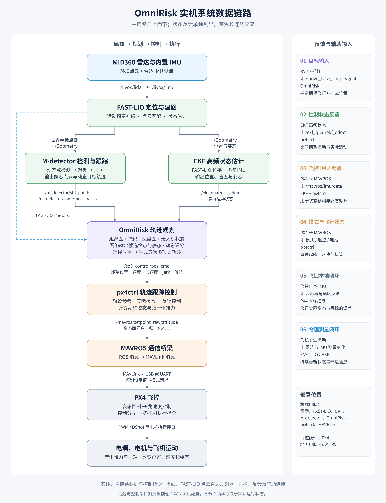

# OmniRisk 实机系统数据链路



[PNG 高清图片](images/omnirisk_realflight_pipeline.png) · [SVG 矢量图片](images/omnirisk_realflight_pipeline.svg)

以下保留可编辑的字符框图。

采用与终端一致的固定等宽字符框图。所有模块按单列排列；框内的 `→` 明确标出数据去向，反馈关系通过“输入 / 回传 / 反馈”标注。

```text
┌─────────────────────────────────────────────────┐
│  MID360 雷达与内置 IMU                          │
├─────────────────────────────────────────────────┤
│  采集：环境距离、雷达自身的角速度与比力         │
│  输出：/livox/lidar、/livox/imu → FAST-LIO      │
└─────────────────────────────────────────────────┘

┌─────────────────────────────────────────────────┐
│  FAST-LIO 定位与建图                            │
├─────────────────────────────────────────────────┤
│  输入：MID360 点云 + 雷达内置 IMU               │
│  输出：/Odometry → EKF、M-detector              │
│  输出：/cloud_registered_no_point_filter        │
│        → M-detector、OmniRisk                   │
└─────────────────────────────────────────────────┘

┌─────────────────────────────────────────────────┐
│  EKF 高频状态估计                               │
├─────────────────────────────────────────────────┤
│  输入：FAST-LIO /Odometry                       │
│  输入：MAVROS /mavros/imu/data                  │
│  输出：/ekf_quat/ekf_odom → OmniRisk、px4ctrl   │
│  内容：位置、速度、姿态                         │
└─────────────────────────────────────────────────┘

┌─────────────────────────────────────────────────┐
│  M-detector 检测与跟踪                          │
├─────────────────────────────────────────────────┤
│  输入：FAST-LIO 世界坐标点云 + /Odometry        │
│  输出：/m_detector/std_points → OmniRisk        │
│  输出：/m_detector/confirmed_tracks → OmniRisk  │
│  内容：静态点云；动态目标 ID、位置、速度与尺寸  │
└─────────────────────────────────────────────────┘

┌─────────────────────────────────────────────────┐
│  OmniRisk 轨迹规划                              │
├─────────────────────────────────────────────────┤
│  输入：FAST-LIO 当前点云 + EKF 运动状态         │
│  输入：M-detector 静态点云与动态目标            │
│  输入：RViz / 摇杆导航目标                      │
│  输出：/so3_control/pos_cmd → px4ctrl           │
│  内容：期望位置、速度、加速度、jerk 与偏航      │
└─────────────────────────────────────────────────┘

┌─────────────────────────────────────────────────┐
│  RViz / 摇杆目标                                │
├─────────────────────────────────────────────────┤
│  输入：鼠标设置目标，或 USB / MAVROS 遥控输入   │
│  输出：/move_base_simple/goal → OmniRisk        │
│  输出：/rc_goal_active → OmniRisk（摇杆节点）   │
│  显示：RViz 订阅点云、位姿与轨迹等消息          │
└─────────────────────────────────────────────────┘

┌─────────────────────────────────────────────────┐
│  px4ctrl 轨迹跟踪控制                           │
├─────────────────────────────────────────────────┤
│  输入：OmniRisk 轨迹参考 + EKF 实际运动状态     │
│  输入：MAVROS IMU、模式、遥控与电池状态         │
│  输出：/mavros/setpoint_raw/attitude → MAVROS   │
│  内容：期望姿态四元数 + 归一化推力              │
│  请求：通过 MAVROS 服务切换模式、解锁 / 上锁    │
└─────────────────────────────────────────────────┘

┌─────────────────────────────────────────────────┐
│  MAVROS 通信桥梁                                │
├─────────────────────────────────────────────────┤
│  输入：px4ctrl 控制设定值与服务请求             │
│  发送：MAVLink → PX4（USB / UART）              │
│  接收：PX4 的 IMU、模式、遥控与电池数据         │
│  输出：飞控 IMU → EKF、px4ctrl                  │
│  输出：飞控状态、遥控与电池 → px4ctrl           │
└─────────────────────────────────────────────────┘

┌─────────────────────────────────────────────────┐
│  PX4 飞控                                       │
├─────────────────────────────────────────────────┤
│  输入：MAVROS 发送的姿态、推力及模式请求        │
│  输入：飞控自身 IMU 与其他飞行状态              │
│  执行：姿态控制 → 角速度控制 → 控制分配         │
│  输出：电机执行指令 → 电调与电机                │
│  回传：IMU、飞控状态 → MAVROS                   │
└─────────────────────────────────────────────────┘

┌─────────────────────────────────────────────────┐
│  电调、电机与飞机运动                           │
├─────────────────────────────────────────────────┤
│  输入：PX4 电机执行指令                         │
│  执行：电调驱动电机，螺旋桨产生推力与力矩       │
│  结果：飞机位置、速度与姿态变化                 │
│  反馈：改变 MID360 和飞控 IMU 的实际测量        │
└─────────────────────────────────────────────────┘
```

## 核心控制链路

```text
OmniRisk
   │ 期望位置、速度、加速度等轨迹参考
   ▼
px4ctrl
   │ 期望姿态与归一化推力
   ▼
MAVROS
   │ MAVLink（USB / UART）
   ▼
PX4 飞控
   │ 电机执行指令
   ▼
电调、电机与飞机运动
   │ 新的运动和环境测量
   └──→ MID360 / 飞控 IMU → 状态估计 → 规划与控制
```

## 查看与编辑

- 直接打开 Markdown 预览即可；无需 Mermaid 插件。
- 图形是 `text` 代码块，可直接修改模块文字和数据去向。
- 中文字符通常占两个等宽字符，修改文字时需要相应调整右侧空格以保持边框对齐。
- 若文字或边框错位，请使用支持中文等宽显示的字体。

## 接口说明

- 话题名对应当前仓库默认实机配置，可通过启动参数或配置文件修改。
- FAST-LIO 使用雷达内置 IMU；后级 EKF 使用通过 MAVROS 传来的飞控 IMU。
- 当前 M-detector 默认订阅 FAST-LIO 的 `/Odometry`；OmniRisk 和 px4ctrl 使用 `/ekf_quat/ekf_odom`。
- 当前 px4ctrl 向 MAVROS 发送姿态与推力设定值，角速度字段被设为忽略，由 PX4 执行内环控制。
