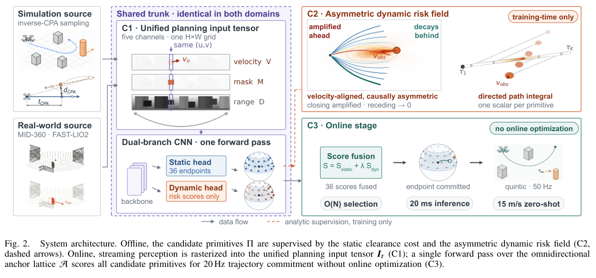
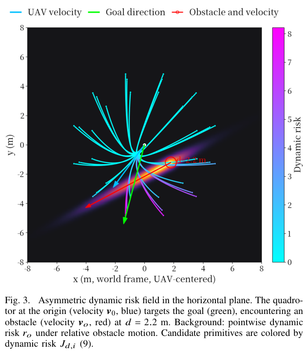
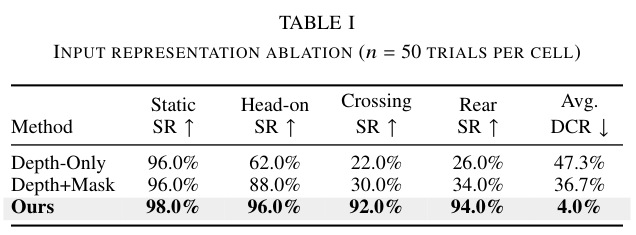
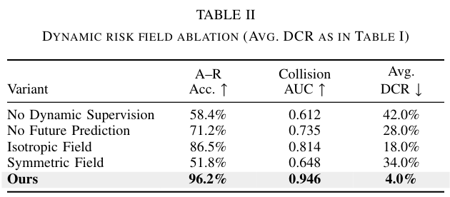
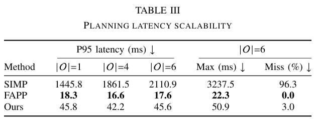
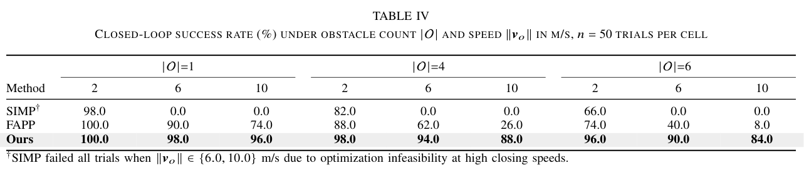
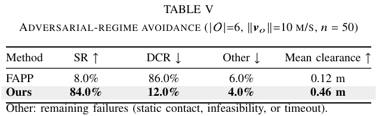
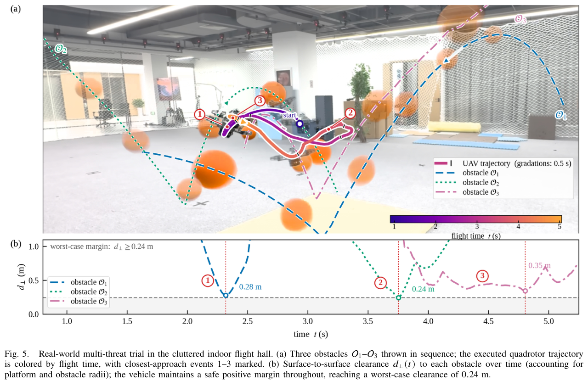
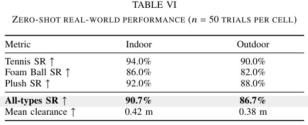

# OmniRisk：从研究动机到方法、证据与替代方案的精读

> **论文**：OmniRisk: Omnidirectional Trajectory-Risk Learning for Agile Quadrotor Dynamic Avoidance。Yifan He、Yang Liu、Wenhao Zhao 等。
> **版本与来源**：用户提供的 [2609.18191v2.pdf](../../OmniRisk/2609.18191v2.pdf)，首页标注 arXiv:2609.18191v2、2026-09-20，共 8 页。本文页码均为从 1 开始的 PDF 页码。
> **交付模式**：explain。工程系统/学习规划方法；中文；从必要概念讲到公式、实验和研究边界。
> **使用技能**：PaperForge（paper-reading-zh）与 paper-deep-reader。前者用于研究思路、反例与延展，后者用于机制、公式和图表核查。
> **视觉状态**：visual，已直接检查关键图 2、3、5 与表 I–VI 的页面和裁图。图 1 的场景由图 5 更完整地覆盖；图 4 的硬件信息在正文说明。
> **证据约定**：“论文报告”表示作者的陈述或数据；“本文推导/判断”表示本次分析；“教学例子”使用自设数字，不是论文实验。没有运行训练、仿真或真实飞行复现实验。外部资料用于校准背景，不替代本地 PDF 的结果。

## 1. 核心思想一句话总结

用离线计算的轨迹风险训练网络，在固定候选集中快速选择动态避障动作。

## 2. 论文背景与动机

### 2.1 从一个具体危险场景开始

一架无人机正穿过石块之间的通道，旁边突然有球横穿。它要解决三件事：知道球往哪里走，找到自己来得及执行的避让轨迹，并在碰撞之前完成计算。如果只知道球“现在离我两米”，依然无法区分它正在撞过来、即将擦肩而过，还是已经远离。[论文 §I、图 1，PDF p.1]

**本文推算**：相对速度为 15 m/s 时，每多耗时 50 ms，双方就又接近 0.75 m。这不是制动距离公式，却说明了为什么规划延迟本身会消耗安全裕度。论文针对的是规划阶段；传感器扫描、检测、跟踪确认和执行器响应同样占用反应时间。

### 2.2 先补齐必要概念

| 术语 | 白话解释 | 在本文中的作用 |
|---|---|---|
| LiDAR 点云/距离全景图 | 激光测得的表面点，以及把这些点按水平角、仰角摊成的距离图片 | 表达周围障碍物的几何位置，距离单位为米 |
| 动态掩码 | 在图片上标记哪些像素属于已跟踪的运动物体，取值 0 或 1 | 区分运动表面与其他表面；不直接提供运动方向 |
| 速度通道 | 为运动像素填入三维速度分量，单位 m/s | 明确告诉网络障碍物怎样移动 |
| 轨迹基元 | 一段可以执行的短期运动曲线 | 每次提出 36 个候选，比较后执行其中一个 |
| 动力学可行性 | 轨迹所需速度、加速度等没有超出平台能力 | 排除“图上能绕过去，飞机实际上做不到”的候选 |
| 风险场 | 给空间位置和运动状态赋予危险代价的函数 | 离线为候选轨迹生成监督分数；不是经过校准的碰撞概率 |
| 蒸馏 | 用计算昂贵的规则生成训练信号，让网络近似它 | 把逐障碍物、逐时间点的风险计算搬到训练阶段 |

轨迹的三阶位置导数称为 **jerk（加加速度）**，表示加速度变化得有多快。抑制 jerk 有利于轨迹平滑，但不能单靠它保证不碰撞。

### 2.3 研究问题与前人工作的不足

论文要回答：**怎样在有限机载算力和稀疏激光观测下，对多个高速、来自不同方位的动态威胁，及时选出可执行的安全轨迹？**[论文 §III-A，PDF pp.2–3]

| 路线 | 已能做到什么 | 这里的困难 | OmniRisk 的改变 |
|---|---|---|---|
| PANTHER、SIMP 等时空规划 | 把未来障碍位置、安全时间或碰撞约束纳入规划 | 约束/搜索规模与场景复杂度相关；本文测试中 SIMP 明显超时 | 用固定规模网络近似候选风险，减少在线逐障碍推理 |
| FAPP 等快速规划 | 用较轻量的表达高效规划 | 本文高密度高速测试中成功率下降；作者将其归因于局部细化单条轨迹 | 同时保留并评分多个方向的候选 |
| Deep-PANTHER 等学习规划 | 学习替代昂贵的在线计算 | 泛化、信息输入与输出可行性仍须分别处理 | 提供明确运动通道与可重建的候选轨迹 |
| YOPO 的一次规划/指导学习 | 用基元锚点覆盖运动模式，预测偏移与分数；用轨迹代价梯度训练 | 不能仅凭已有静态几何机制解决本文的动态风险问题 | 结合全向输入、动态风险监督与双分支输出 |

前三条的具体局限主要依据 OmniRisk 的相关工作与实验；没有独立重跑这些基线。YOPO 的机制另核对了其[作者仓库介绍](https://github.com/TJU-Aerial-Robotics/YOPO#introduction)与[论文 DOI](https://doi.org/10.1109/LRA.2024.3399589)。这意味着，“一次前向、多基元、代价训练”已有基础，OmniRisk 的贡献应放在动态信息表示与轨迹风险学习的具体组合上评价。Deep-PANTHER 与 FAPP 的书目信息也经 Crossref 核对，机制描述以本地论文为准。[论文 §II、参考文献 1–3、14–15，PDF pp.2、8]

### 2.4 科研 idea 可能怎样产生

**下面是基于前序知识的思路重建，不能当作作者真实的研究时间线。**

**第一步，先定位失效原因。** 同样距离的物体会引发完全不同的未来碰撞，说明单帧距离不足以定义动态风险。可以先比较静态通过、迎面相遇、横穿和追赶：如果静态正常而横穿失败，就应追问网络是否拥有横向速度信息，不能马上归因为网络不够深。

**第二步，检查计算究竟花在哪里。** 一条轨迹要在多个未来时刻与多个障碍物比较；候选越多，重复工作越多。若许多相遇模式反复出现，就能提出一个问题：能否保留明确的轨迹代价，却把重复的评价映射提前学会？这是从实时约束走向离线学习的自然路径。

**第三步，选择容易监督的中间量。** 直接学一个最终动作，需要处理多种同样正确的避让方式；只学专家轨迹，也容易受专家偏好限制。已有多基元方法提示，可以保留一组动作，让网络学“每个动作有多危险”。这样一个场景可以为所有候选提供监督，而不是只给一个成功动作。

**第四步，设计比碰撞/不碰撞更细的信号。** 如果几乎所有随机样本都不碰撞，二值监督很稀疏。距离可以提供连续信号，但对来袭与远离的物体区别不够；加入运动方向与未来时间后，就能同时表达“会不会接近”和“何时接近”。

**第五步，把接口做成可部署的形式。** 障碍物列表的长度随物体数变化，而全景图大小固定。把距离、掩码和三维速度投影到同一个网格，有利于固定推理规模，也让仿真与实机使用相同物理量。代价是分辨率与可见性限制，不能凭固定大小就宣称信息没有损失。

**第六步，专门生成危险样本。** 与其随机扔球等待罕见的近碰，不如先指定最接近的时刻和距离，再反求障碍物初始状态。论文称为 inverse-CPA sampling：CPA 是 closest point of approach，即最接近事件。[对应论文 §III-B，PDF p.3]

可迁移的研究习惯是：沿“失败模式 → 缺少的信息 → 重复计算 → 可监督中间量 → 部署接口 → 有效训练分布”逐步提问。这里每一步都产生可以检验的假设。

## 3. 核心方法/模型详解

### 3.1 核心直觉与整体框架

先在仿真中计算各条候选轨迹未来的危险程度，再让网络学会直接预测。飞行时同时比较多个可执行方向，综合静态通行、目标前进与动态风险，选择一条轨迹。计算代价被转移到了训练阶段，在线表现依赖预测是否准确、候选是否覆盖可行解。[论文 §III、§V，PDF pp.2–6]

**图 2 的阅读任务**：分清离线监督与在线计算。先看仿真与实机的共同接口，再看右上监督、右下部署，注意“risk scores only”和训练专用虚线。



**关键观察**：静态头输出 36 个终端状态，动态头输出对应风险；风险场和沿轨迹积分位于训练阶段，在线只有网络、分数融合、选择与轨迹重建。这意味着昂贵评价被近似成固定结构前向计算。**边界**：该架构图不能证明网络近似误差足够小，也不能证明 36 个候选一定包含安全解；这些需要实验和更强的反例测试。[图 2，PDF p.3]

完整链条可写成：

```text
离线：采样场景/相遇状态 → 合成五通道输入 → 网络生成候选
      → 用真值几何、运动计算候选代价 → 训练轨迹头与评分头

在线：激光点流、里程计、运动跟踪 → 时间同步与投影
      → D/M/V + 自身速度/加速度/目标 → 双分支一次前向
      → 筛除不可行候选 → 静态分 + 动态分 + 连续性偏好
      → 选择终端状态 → 五次多项式 → 控制器跟踪
```

论文给出的规划/轨迹提交频率为 20 Hz，轨迹跟踪为 50 Hz；规划暂时延迟时继续跟踪上一条轨迹。这能维持控制连续性，但上一条轨迹对新出现的威胁是否仍安全，需要另外判断。[论文 §III-B、§V-D，PDF pp.3–4、6]

### 3.2 输入：为什么恰好是五个通道

论文式 (1) 为：

$$
I_t=[D_t,M_t,V_t]\in\mathbb R^{H\times W\times5}.
$$

其中 $H,W$ 是仰角与水平角的网格尺寸；$D_t$ 占 1 个距离通道，$M_t$ 占 1 个二值通道，$V_t$ 占 3 个速度分量通道。自身速度 $v_0$、加速度 $a_0$ 和目标 $g$ 是额外状态输入。[式 (1)、§V-C，PDF pp.3、5]

对于点 $p=(x,y,z)$，用 $\theta=\operatorname{atan2}(y,x)$、$\varphi=\arcsin(z/\|p\|)$ 找到像素，并按式 (3) 记录该方向最近的表面距离。**教学例子**：同一像素有 3 m 与 5 m 两个返回，距离值为 3 m。这对近处障碍有用，但不能同时完整表达后方被遮挡物体。

运动点由 M-detector 从点流中检测出来，再按质心距离用匈牙利匹配关联，即在相邻时刻寻找整体代价较小的对象对应关系。只有经过持续关联确认的轨迹才进入动态表示。**三维速度来自跟踪器的估计，不是单帧 LiDAR 直接测得的全部运动真值。**[论文 §IV-B，PDF p.4]

测量到达规划器时已经过去 $\Delta t$。论文用式 (4) 补偿：

$$
c_o^r=c_o^m+v_o^m\Delta t+\tfrac12g_{\rm grav}\Delta t^2,
\qquad v_o^r=v_o^m+g_{\rm grav}\Delta t.
$$

$m,r$ 分别表示测量时刻与同步后的状态；这里将重力记为 $g_{\rm grav}$，以区别导航目标 $g$。**教学例子**：忽略重力时，10 m/s 的物体延迟 50 ms 就移动了 0.5 m。同步用于纠正“拿过去的位置做现在的规划”。注意，式 (4) 的延迟补偿包含重力，后续式 (6) 的未来风险预测采用恒速模型，两者时间区间与假设不同。

距离图允许跨帧累积与补全，掩码和速度图不随深度补全扩散，防止把空白区域误填成运动表面。训练时还扰动掩码：假阳性区域赋零速度；漏掉的动态掩码位置仍可保留相应速度，用于降低模型对掩码的单独依赖。这种增强不能完全等同于真实跟踪丢失，因为后者可能让掩码和速度一起消失。[论文 §IV-C，PDF p.4]

### 3.3 候选：固定的是方向数量，不是所有曲线

论文使用 12 个水平方位 × 3 个仰角带，共 $N=36$ 个方向锚点。每个角度单元内的终端位置、速度、加速度由网络调整，所以 36 条轨迹随输入变化。这里的“全向”指水平 360°，垂直范围仍受传感器视场约束。[论文 §III-A.4，PDF p.3]

每条候选由初始 $x_0=(p_0,v_0,a_0)$、终端 $x_f^{(i)}=(p_f^{(i)},v_f^{(i)},a_f^{(i)})$ 和时间长度 $T$ 确定。对每个坐标轴，采用五次多项式：

$$
p(t)=b_0+b_1t+b_2t^2+b_3t^3+b_4t^4+b_5t^5.
$$

**本文补充推导**：在固定时长、固定两端位置/速度/加速度、没有其他路径约束时，最小化 $\int_0^T[p'''(t)]^2\,dt$ 的变分条件为 $p^{(6)}(t)=0$，因此解为五次多项式。六个边界条件恰好确定六个系数：$b_0=p_0,b_1=v_0,b_2=a_0/2$，其余满足

$$
\begin{bmatrix}T^3&T^4&T^5\\3T^2&4T^3&5T^4\\6T&12T^2&20T^3\end{bmatrix}
\begin{bmatrix}b_3\\b_4\\b_5\end{bmatrix}
=\begin{bmatrix}p_f-p_0-v_0T-a_0T^2/2\\v_f-v_0-a_0T\\a_f-a_0\end{bmatrix}.
$$

**最小例子**：$T=1$，从 $p_0=0$ 到 $p_f=1$，两端速度、加速度为零，得到 $p(t)=10t^3-15t^4+6t^5$，在 $t=0.5$ 时到达 0.5。三维分别求解即可。闭式重建不需要每次数值优化整个曲线，但平滑不等于全程安全；终端状态受限也不自动保证中途速度、加速度受限。论文另声明筛除违反全程速度/加速度约束的候选，具体筛查实现与数值精度仍须核查。[论文 §III-A.4、§V-D，PDF pp.3、6]

### 3.4 静态代价：怎样鼓励远离石块

ESDF 是“每个位置离最近障碍表面多远”的距离场。训练时仿真提供这个几何真值，式 (5) 在候选的 $K$ 个均匀时间点 $\tau_j=jT/K$ 上计算：

$$
J_{c,i}=\frac1K\sum_{j=1}^K\exp\left[-\frac{d(\pi_i(\tau_j))-d_{\rm safe}}{\sigma_{\rm static}}\right].
$$

$\pi_i$ 是第 $i$ 条候选；$d$ 为静态距离，$d_{\rm safe}$ 为期望裕度，$\sigma_{\rm static}$ 控制代价衰减尺度，三者使用相容的长度单位。**教学例子**：取裕度 0.5 m、尺度 0.2 m，在距离 0.7、0.5、0.3 m 处，单点代价依次为 0.368、1、2.718。它给“更宽敞的路”更低代价，不只在碰撞后才有惩罚。**边界**：这是软代价；采样之间的漏碰与几何误差不会因公式光滑而消失。[论文 §V-A，PDF p.4]

### 3.5 动态风险：先算未来相遇，再区别接近与远离

**第一层：相对位置与速度。** 式 (6) 将无人机候选和障碍物放在同一未来时刻比较：

$$
q(t)=\pi_i(t)-(c_o^r+v_o^rt),\qquad
v_{\rm rel}(t)=\dot\pi_i(t)-v_o^r.
$$

$o$ 表示一个障碍物，$c_o^r,v_o^r$ 为同步后的中心位置与速度；$q$ 的单位为米，$v_{\rm rel}$ 为 m/s。恒速预测使障碍位置可快速计算。不同时间经过同一地点，不等于相撞；所以必须比较 $\pi_i(t)$ 和 $c_o(t)$，不能只判断两条空间曲线是否交叉。[式 (6)，PDF p.5]

**第二层：把高速物体的危险区拉长。** 令 $e_o=v_o^r/\max(\|v_o^r\|,\epsilon_v)$，$\epsilon_v>0$ 避免除零。式 (7) 为：

$$
A_o=\sigma_\perp^{-2}I_{3\times3}+
(\sigma_\parallel^{-2}-\sigma_\perp^{-2})e_oe_o^\top,
\qquad \phi_o(q)=\exp(-q^\top A_oq).
$$

$I_{3\times3}$ 为单位矩阵；$\sigma_\perp$ 是横向长度尺度，反映物体几何；$\sigma_\parallel$ 是纵向尺度，随障碍物速度扩大。远离零速退化区时，令 $q_\parallel=e_o^\top q$、$q_\perp=q-q_\parallel e_o$，可改写为

$$
q^\top A_oq=\frac{q_\parallel^2}{\sigma_\parallel^2}
+\frac{\|q_\perp\|^2}{\sigma_\perp^2}.
$$

这就是一个椭球的加权距离。**教学例子**：纵向尺度 2 m、横向尺度 0.5 m，离中心同为 1 m，沿纵向的 $\phi=e^{-0.25}\approx0.779$，沿横向为 $e^{-4}\approx0.0183$。它提前关注运动方向附近，同时保留侧向逃离空间。尺度扩大是在改变风险偏好，不是物体实际变长；$\phi$ 也不是概率密度。[式 (7)，PDF p.5]

**第三层：给进入风险核心的运动更高代价。** 论文先求朝向风险核心的法向：

$$
h_o=\nabla_q\phi_o=-2\phi_oA_oq,\qquad
n_o=\frac{h_o}{\max(\|h_o\|,\epsilon_g)},\qquad
z_o=\alpha v_{\rm rel}^\top n_o,
$$

再用式 (8)：

$$
r_o(q,v_{\rm rel})=\phi_o(q)\operatorname{softplus}(z_o)
=\phi_o(q)\ln(1+e^{z_o}).
$$

$\epsilon_g>0$ 稳定归一化；$\alpha>0$ 控制方向敏感度，按量纲应使 $z_o$ 无量纲。softplus 是平滑、始终为正的函数：输入大且正时近似线性，输入很负时接近零。**教学例子**：$\phi=e^{-1}$，$\alpha=1$，向内投影速度为 3 时风险约 1.122，反向为 −3 时约 0.0179，相差约 63 倍；投影为零时仍有 $\phi\ln2$ 的风险。远离不会让代价严格归零。

**本文推导的重要边界**：在恒速障碍导致 $A_o$ 固定时，

$$
\frac{d}{dt}(q^\top A_oq)=2q^\top A_ov_{\rm rel}.
$$

因此 $z_o>0$ 对应椭球加权距离减小。它不总等于欧氏距离 $\|q\|$ 减小。例如在二维取 $A=\operatorname{diag}(1/16,1)$、$q=(2,1)$、$v_{\rm rel}=(1,-0.25)$，有 $q^\top v_{\rm rel}=1.75>0$，实际距离在增加；但 $q^\top Av_{\rm rel}=-0.125<0$，门控仍认为在接近风险核心。这符合式 (8) 的定义，却提示“接近”一词需要说明度量。论文自身也列出了与欧氏距离符号一致的特殊条件。[论文 §V-B.3，PDF p.5]

图 3 回答风险形状如何影响不同方向候选。先看以米为单位的横纵轴、红色障碍运动箭头和右侧风险色条，再区分背景的点风险与轨迹颜色表示的累计风险。



**关键观察**：风险带沿障碍运动方向延伸，不同候选穿越它的位置、方向和时刻不同，因而得到不同累计分数。这意味着空间接近与运动趋势共同影响评价。**边界**：这是单个示例的机制图，不能说明所有速度、角度和加速度下都正确，也不能拿候选颜色直接当作碰撞概率。后面的消融实验才检验该设计是否改善预测和避障。[图 3，PDF p.5]

**第四层：沿整条候选累计。** 式 (9) 为：

$$
J_{d,i}=\sum_{j=1}^K\sum_{o\in\mathcal O_t}
r_o\big(q(\tau_j),v_{\rm rel}(\tau_j)\big).
$$

$\mathcal O_t$ 是障碍集合。它把每个时间点、每个障碍的危险加起来。均匀采样下，真正时间积分约为 $(T/K)J_{d,i}$；论文在固定配置中把这个常数吸收到风险缩放因子里。因此改变 $T$ 或 $K$ 时，要重新审视分数尺度，不能默认完全无影响。[式 (9)，PDF p.5]

### 3.6 双分支如何训练，为什么不直接学最优动作

静态分支处理 $D$ 与自身状态/目标，输出候选终端状态及静态分；动态分支另接收 $M,V$ 的特征，输出每条候选的动态分。水平方向采用 circular padding，即图片最左、最右边首尾相接，避免把相邻的 −180°、+180° 当作两块遥远区域。它解决接缝连续性，不自动保证完整的三维旋转等变性。[论文 §V-C，PDF p.5]

训练包含三类目标：

1. **轨迹生成目标**：直接降低平滑、静态距离、锚点对齐与加速度代价，使各方向候选可用；不加入动态风险。
2. **静态评分目标**：回归候选的综合静态代价，包含目标前进偏好。生成阶段朝各自锚点展开，选择阶段再追求实际目标，有助于保留候选多样性。
3. **动态评分目标**：学习当前候选的风险。式 (10) 为

$$
\mathcal L_{\rm risk}=\frac1N\sum_{i=1}^N
\ell_{\rm smooth\text{-}L_1}\left(
\widehat J_{d,i},\operatorname{sg}[\ln(1+w_{\rm scale}J_{d,i})]\right).
$$

$\widehat J$ 为网络预测，$w_{\rm scale}$ 是缩放常数；smooth-$L_1$ 是小误差像平方、大误差近似线性的回归损失；$\operatorname{sg}$ 表示停止梯度，即把标签当作固定目标，不通过它反向推动候选改形。每个 minibatch 都用当前候选重新算标签，不是一次生成后永不变化的固定标签集。[论文 §V-C.3，PDF p.5]

**教学例子**：$w_{\rm scale}=1$ 时，原风险 0、1、99 的标签为 0、0.693、4.605。对数压缩避免少量极高风险主导训练。它还意味着部署时融合的动态分是对数域代价；“回归分数很小”不等于“碰撞概率很小”。

一个容易忽略的限制是：**固定 $D,v_0,a_0,g$，只改变 $M,V$，静态头的候选几何不变；动态分支只能改变选择。** 如果运动物体也改变了 $D$，候选仍可能间接变化。两个分支共享深度编码器，动态评分梯度也能更新它，所以参数训练层面并非完全隔离；隔离主要指输入通路与动态标签不直接优化终端状态。[论文 §V-C.2，PDF p.5；代码 `OmniRisk/policy/network.py`、`trainer.py`]

### 3.7 在线选择与一个贯穿例子

论文式 (11) 选择：

$$
i^*=\arg\min_i\left(\widehat J_{s,i}+\lambda\widehat J_{d,i}
+\mathcal R_{\rm con}(i)\right).
$$

$\lambda$ 调节动态风险重要性；$\mathcal R_{\rm con}$ 为时间连续性与切换迟滞，避免相近分数引起左右反复切换。迟滞也可能推迟对新危险的反应，需要用危险场景标定，不能只看轨迹是否好看。[论文 §V-D，PDF p.6]

**最小例子，以下全部为教学场景**：无人机位于 $(0,0)$、速度 $(2,0)$ m/s，目标在正前方；球位于 $(2,2)$、速度 $(0,-2)$ m/s。假设一条直行候选为 $\pi_f(t)=(2t,0)$，则在 $t=1$ s 时，它和球都到达 $(2,0)$。另一条候选如果在同一时刻到达 $(2,-1)$，两者相距 1 m；但这还要检查机体/球的半径，以及整段轨迹和静态墙壁。

实际流程是：投影后球的像素有距离、动态掩码与速度 $(0,-2,0)$；静态头生成 36 条候选；动态头根据运动信息预估直行与侧移的代价。为演示融合，设直行的静态/动态预测分为 $(0.2,4)$，侧移为 $(1,0.1)$，$\lambda=1$ 且暂忽略连续性项，则总分为 4.2 和 1.1，选择侧移。最后由选中终端状态重建五次曲线，由控制器跟踪。这里的分数和侧移位置均未来自实际模型推理，不代表系统已成功躲过该场景。

**对数融合的额外含义**：$\log(1+J_d)$ 对单独动态分的排序不变，但和静态分相加后，不保证与原始风险相加有同样选择。例如候选 A 的静态/原风险为 $(0,9)$，B 为 $(3,0)$：原风险相加选 B，对数风险相加则选 A，因为 $\ln10<3$。因此 $\lambda$ 是效用权衡参数，不是无关紧要的换单位。

### 3.8 代码对照能补充什么，不能替代什么

本次只读核查的代码提交为 `94fabb25b2aad6a324e7ca81c87f1b5e704cc151`：

- `OmniRisk/policy/network.py`：确认静态/动态输入通路。
- `OmniRisk/policy/trainer.py`：确认 `log1p(...).detach()` 标签与静态终端损失。
- `OmniRisk/loss/safety_loss.py`：取 30 个时刻；高斯为 $\exp(-\tfrac12m^2)$，PDF 为 $\exp(-q^\top A q)$。二者可重参数化对应，但同名尺度不能直接照搬；实现区分球与圆柱。
- `OmniRisk/config/traj_opt.yaml`：当前为 96×384 输入、12×3 锚点；运行模式与权重不自动等同论文实验配置。

这些核查用于定位复现入口，没有验证论文成功率。

## 4. 实验与结果分析

### 4.1 先明确评价协议与指标

**成功率 SR** 指在规定时间内无碰撞到达目标的试验比例，越高越好；碰撞、动力学不可行都算失败。**动态碰撞率 DCR** 是发生动态碰撞的试验比例，越低越好；它与 SR 之和不必为 100%，因为还有静态碰撞、不可行和超时。[论文 §VI-A、表 V，PDF pp.6、8]

**P95 延迟** 是 95% 测量值不超过的延迟，不是最大延迟。规划延迟从规划输入到达开始，到轨迹提交结束，包含张量构建和网络推理；不包含上游传感、检测及跟踪确认。**deadline miss** 是规划周期耗时超过 50 ms，并不自动判整次飞行为失败。基线使用相同同步输入、每条件 50 个配对评价种子，且评价种子与训练种子分离；平台是 Jetson Orin NX，在多进程争用条件下测试。[论文 §VI-A，PDF p.6]

这种设计有助于比较规划器本身，但无法据此得到完整的“物体出现到电机响应”延迟。种子分离也不能单独证明场景分布、速度范围和物体模型都有充分域外覆盖。下文的统计数值均为论文报告，本次未重跑。

### 4.2 表 I：改善首先来自多了什么信息

**表 I 如何读**：按行比较距离、距离加掩码、完整输入，按列看迎面、横穿、追赶的 SR 与平均 DCR。它检验运动身份标签是否足够；箭头表示优劣方向，每场景单元 50 次。



**关键观察**：横穿 SR 从 22% 到 30%，加入完整运动通道后为 92%；后方追赶从 26%、34% 到 94%；平均 DCR 从 47.3%、36.7% 降至 4%。为什么这支持运动信息的重要性：在相同架构和训练预算下，静态 SR 均约 96%–98%，动态场景的差距却很大，表明几何能力并非唯一瓶颈。[表 I、§VI-B，PDF p.6]

**支持等级：在本文测试分布内较强。边界**：它没有证明“所有只用深度的系统都不能估速度”；多帧深度、记忆网络或光流可能恢复运动。这里比较的是被消融的输入方案，也没有穷尽前端速度误差、错配和完全漏检。接下来必须检查：即使有速度，风险标签怎样设计才有效。

### 4.3 表 II：未来预测、拉长形状与方向门控分别有用吗

**表 II 如何读**：先看各行删除的机制，再比较 A–R、AUC 与 DCR。**A–R 准确率** 检查速度反转帧对的接近/远离区分；**碰撞 AUC** 衡量未来碰撞排序能力，0.5 近似随机、1 为完美区分，不衡量概率校准。



**关键观察**：完整方法 A–R 为 96.2%、AUC 为 0.946、平均 DCR 为 4%。保留预测但删除门控的 Symmetric Field，A–R 为 51.8%、AUC 为 0.648、DCR 为 34%；去掉未来预测时 AUC 为 0.735、DCR 为 28%；改成各向同性时 DCR 为 18%。这意味着完整设计在作者评价下优于这些单项删减，不能只把收益归结为“有神经网络”。[表 II、§VI-C，PDF pp.6–7]

**支持等级：中等。边界**：表格未给各项 AUC/A–R 的样本数、不确定性和逐场景分解；删除模块也可能改变标签尺度。A–R 用当前欧氏距离变化打标签，而式 (8) 的门控用椭球度量，两者并非总一致。“对称场在障碍已通过后留下多余惩罚，导致碰撞”是作者解释，仍需要动作持续时间、滞后和失败轨迹分析来更直接支持。

一个公平的强对照应当保留未来预测、匹配标签尺度，并重新校准融合权重。未来距离积分本身已经能区分许多接近/远离情形；因此表 II 不能证明“没有门控就无法预测动态碰撞”，只能支持门控在当前组合与协议中的增益。

### 4.4 表 III：究竟快在哪里，是否从不超时

表 III 回答计算是否随障碍数恶化。先看障碍数为 1、4、6 的 P95 列，再看 6 个障碍条件下的最大值和超时率，单位均为毫秒或百分比。



**关键观察**：OmniRisk 的 P95 为 45.8、42.2、45.6 ms，6 障碍时最大 50.9 ms，超时率 3%；FAPP 的对应 P95 为 18.3、16.6、17.6 ms，最大 22.3 ms，超时率 0%；SIMP 的 P95 从 1445.8 增至 2110.9 ms，6 障碍时超时率 96.3%。正文另报网络推理 P95 约 20.0–20.5 ms。[表 III、§VI-D，PDF p.7]

这意味着 OmniRisk 在测试规模内的规划耗时比较稳定，明显改善了 SIMP 的延迟，但**FAPP 更快**。其价值需要结合后面的安全性收益评价。$N=36$ 固定时，候选选择关于障碍数是常数规模；网络输入形状固定也使前向操作量固定。**边界**：处理点云、关联对象、投影速度的成本仍可能增长，论文也把残余耗时变化归于栅格化；不能把整个感知规划控制系统称为严格 $O(1)$，更不能把 P95 小于 50 ms 写成所有周期都不超时。

**支持等级**：固定网络结构的推理规模论证较强；“1–6 个障碍时运行稳定”的实验支持中等；“任意多障碍均实时安全”不受现有证据支持。延迟数据也没有报告周期总数与置信范围。

### 4.5 表 IV：多花的计算是否换到了闭环收益

**表 IV 如何读**：每个障碍数分组内，速度依次为 2、6、10 m/s，最右是最难条件。它检验威胁变快、变多后的到达目标能力；每单元 50 次，粗体是最优值。



**关键观察**：6 个障碍时，随速度从 2 增至 6、10 m/s，OmniRisk 的 SR 为 96%、90%、84%，FAPP 为 74%、40%、8%，SIMP 为 66%、0%、0%。脚注将 SIMP 高速失败归于优化不可行。**推理桥**：评价同时要求实时执行与无碰撞到达，因此差异支持本文方案在该协议下更能完成高速多威胁任务。[表 IV、§VI-E，PDF pp.7–8]

**支持等级：中等偏强，限于该协议。边界**：84% 相当于 42/50，8% 是 4/50，差异很大，但每条件样本仍有限。论文正文给出的 Wilson 95% 区间分别为 [71.5%,91.7%]、[3.2%,18.8%]。配对种子有利于公平比较，不过缺少逐种子配对结果，无法在本次阅读中做配对显著性检验。SIMP 的失败也不能外推为所有优化方法都无法处理高速动态环境；参数、预算和约束配置会影响结果。

### 4.6 表 V：失败究竟是哪一种

表 V 把最困难条件进一步拆开。先读 SR、DCR、Other 的互补关系，再看以米为单位的平均净空。Other 包含静态接触、不可行或超时，表下脚注不能省略。



**关键观察**：OmniRisk 为 84% 成功、12% 动态碰撞、4% 其他失败，平均净空 0.46 m；FAPP 为 8%、86%、6%、0.12 m。为什么这支持风险处理收益：差距主要对应动态碰撞下降，而非仅仅“跑得更快”或改变失败归类。[表 V，PDF p.8]

**边界**：仍有 6/50 动态碰撞，不能给出安全保证；“平均净空”没有在表中完整说明是否只统计成功试验、如何跨时间聚合，使用时应核查日志或补充协议。缺少“同样 36 候选 + 在线精确风险评分”的对照，也无法把收益全部单独归于蒸馏，而非候选覆盖、风险函数、输入信息或组合训练。

### 4.7 图 5：真实飞机是否连续躲开了多个球

图 5 回答单次真实连续避让是否成立。先看 (a) 的三条障碍轨迹和按飞行时间着色的无人机轨迹，再看 (b)：横轴是秒，纵轴是考虑双方半径后的表面间净空（米），正值表示留有间距。



**关键观察**：标注的三次接近事件分别约为 0.28、0.24、0.35 m，曲线在展示时段内保持正净空。这意味着至少该例能连续调整运动，而不是只给出某一瞬间的避让姿态。[图 5，PDF p.7]

**支持等级：对该次试验为直接证据，对整体可靠性较弱。边界**：这是一条选出的成功轨迹；三球是顺序抛出，不等同于六物体同时夹击。图中未给净空测量误差和同步误差条，也不能仅凭曲线证明每个模块的因果作用。整体成功率需要看表 VI。

### 4.8 表 VI：仿真训练能否直接迁移到实机

**表 VI 如何读**：按行比较物体、按列比较室内外；每单元 50 次，底部汇总 SR 与平均净空。它检验冻结权重后的实机迁移。



**关键观察**：室内/室外网球 SR 为 94%/90%，泡沫球为 86%/82%，毛绒玩具为 92%/88%；每个环境 150 次的汇总为 90.7%/86.7%，平均净空 0.42/0.38 m。论文报告相对相遇速度最高 15 m/s，但该表没有逐速度区间统计。[表 VI、§VI-F，PDF pp.7–8]

这意味着冻结策略确实在两个真实环境与多种物体上完成了大部分任务，支持接口对齐与仿真训练的实用价值。**支持等级：中等。边界**：不能理解为“全部实机试验都在 15 m/s 下进行”，也没有实机 FAPP/SIMP 对照。泡沫球失败更多，作者归因于弱反射引起的确认延迟与丢轨，这提醒我们前端可观测性仍决定后端上限；风险裕度和掩码增强的各自贡献没有在实机单独消融。

### 4.9 主张—证据判断与缺失信息

| 主张 | 最强证据 | 支持等级 | 主要边界 |
|---|---|---|---|
| 显式运动通道有助于横穿/后方避障 | 表 I 的输入消融 | 较强，限定架构与数据分布 | 未对比多帧深度/记忆模型 |
| 完整非对称风险优于所列删减版本 | 表 II 的 AUC 与 DCR | 中等 | 尺度匹配、重调参和不确定性不足 |
| 推理成本不随障碍数改变 | 固定输入/网络与约 20 ms 推理 | 结构论证较强 | 前端与张量构建不属于同一结论 |
| 在高速密集测试中安全性更好 | 表 IV、V 的 84% 对 8% | 中等偏强 | 不等于普遍优于所有优化方法 |
| 仿真权重可直接迁移 | 表 VI、图 5 | 中等 | 环境数量少、无实机基线、仍有失败 |
| 严格无碰撞保证/所有周期不超时 | 没有相应证明；存在碰撞与 3% 超时 | 不支持 | 经验成功率与形式安全是不同要求 |

**最可信的结论**：在本文固定结构与测试条件下，显式运动信息和多候选风险评分显著改善高速动态避障。**最易夸大的结论**：把它概括为整个系统恒定延迟、始终满足截止时间、或者不依赖上游跟踪。

论文还缺少影响独立复现的完整信息：训练样本规模与场景划分、全部网络/训练超参数、风险尺度具体函数、候选可行性检测细节、融合和迟滞的标定程序、逐试验结果及失败轨迹。代码可提供部分实现配置，却不能自动补齐论文实验 provenance。总体上，这是值得进一步复现的工程学习规划结果；证据足以支持条件性性能收益，尚不足以支持普遍安全或完整机制归因。

## 5. 论文的贡献与影响

### 5.1 最小创新单元和可借鉴的科研思路

本文较有价值的组合是：用同一个物理意义明确的全向距离/运动接口连接仿真与实机；用连续、速度对齐、带方向门控的轨迹风险生成密集监督；在固定多候选集合上学习评价，使部署时无需逐障碍物在线积分。它将“在线算得准”转换为“离线标签、输入信息、候选覆盖和网络近似共同足够好”。[论文 §II–V，PDF pp.2–6]

从最接近的 YOPO 路线看，**Before** 是基元锚点、偏移/评分和轨迹代价指导学习；**After** 增加全向动态信息与专门风险头；**Diff** 在于动态状态如何进入、风险怎样定义以及候选生成与动态评分如何隔离；**Trade-off** 是速度表示、仿真覆盖和有限候选集的假设更强。不能把全部前向规划框架都算作本文独创。

短期研究价值在于提供容易拆分消融的接口和代价；部署价值在于可预测的网络操作量与多方向选择。长期更值得追问的是：计算预算固定时，应该保留哪部分在线安全判断，哪部分可以交给学习？这比单纯再提高一次平均成功率更能影响方法设计。

### 5.2 换一种方法能不能实现相同目的

**能提出可行替代路线，但相同任务目标不等于已经达到相同的成功率、尾部延迟或泛化能力。** 必须先固定观测、动力学、算力与时间预算，然后比较。下面是本文分析，不是论文已完成的对照实验。

| 替代方案 | 怎样实现同一任务 | 可能保留的优势 | 代价与必须验证的条件 |
|---|---|---|---|
| 保留 36 候选，在线解析算风险 | 用当前轨迹和跟踪状态直接计算式 (6)–(9)，不训练动态头 | 无风险回归误差，方便诊断 | 成本随 $N K|\mathcal O|$ 增长，但可向量化；在 Orin 上究竟多慢要实测，不能预设不可用 |
| 多候选在线评分 + MPC/MPPI | MPC 优化未来控制；MPPI 对多条控制序列采样并加权，能调整候选形状/时机 | 动态威胁可以改变轨迹，而不限于选现有曲线 | 需要控制求解/采样预算和碰撞评价成本；同样存在模型与局部搜索问题 |
| 预测未来占据，再查询候选碰撞 | 网络输出未来时空网格中哪里被占据，轨迹做批量查询 | 中间表示更直接，也容易接不同规划器 | 网格分辨率、内存和未来时间分辨率受限；概率校准仍需评估 |
| 多帧深度/点流 + 记忆网络 | 用时间序列隐式估运动，降低显式跟踪依赖 | 可能改善低质量速度通道问题 | 需要时序训练、真实运动激励与更强域迁移验证；不能从单帧消融推断它必败 |
| 强化学习直接产生动作/轨迹 | 用闭环碰撞、目标前进、控制代价训练策略 | 可对长期闭环效用优化，不只模仿手工风险 | 稀有危险探索和奖励设计困难；若输出轨迹，还须处理可行性与验证 |
| 速度障碍/屏障安全过滤 | 排除会碰撞的相对速度，或修改动作以满足安全约束 | 可作为快速局部避障或学习策略的保护层 | 简单速度空间几何不自动满足四旋翼加速度约束；模型/观测误差下仍需余量 |

最优先的对照应是**同样候选、同样输入，只替换动态风险头为在线解析评分**。按当前代码 $N=36,K=30$，6 个障碍物仅对应 6480 次候选—时刻—障碍组合评价。这一数量本身不能证明快或慢，却足以说明值得认真做批量计算基准。若它能在预算内达到更好闭环表现，动态风险蒸馏的必要性就应重新表述；若它导致截止时间失守，则离线学习的部署收益得到更直接证据。

**解析 CPA 能不能代替完整风险？** 若双方都恒速，相对运动 $q(t)=q_0+vt$，最接近时刻可由 $\|q(t)\|^2$ 对时间求导得到：

$$
t^*=\operatorname{clip}\left(-\frac{q_0^\top v}{\|v\|^2},0,T\right),
\qquad d_{\rm CPA}=\|q_0+vt^*\|.
$$

当 $v=0$ 时距离不变，单独处理即可。**教学例子**：相对位置 $(2,2)$、相对速度 $(-2,-2)$，得到 $t^*=1$ s、$d_{\rm CPA}=0$。但无人机候选是五次曲线时，距离平方是最高十次多项式，驻点方程最高九次；通常需数值求根或离散评价。因此简单 CPA 可做预筛或短时近似，不能原封不动替代整条高阶候选的碰撞检查。

### 5.3 最脆弱的假设：有限表示和候选足以保留安全决策

**本文判断**：最脆弱的假设是固定输入与 36 条候选保留了必要信息和动作，评分即可选对。它有两种失效源。

**信息不足**：遮挡、丢点、错配使不同未来产生相同输入，网络无法区分。**动作不足**：安全行为要求集合之外的等待、减速、曲率或高度变化；精确评分也无法从全不安全候选中选出安全轨迹。

恒速预测、低反射目标与域外风险误差则分别涉及标签模型、感知与泛化，应分别测试。[论文 §V-C.2、§VI-F，PDF pp.5、8]

### 5.4 最强反例应怎样设计

**反例设计 A：证明评分解决不了候选缺失。** 固定静态狭窄走廊与无人机状态，设置两个交错横穿障碍，使通过需要特殊减速/等待或特定曲率。读取网络 36 条候选，用高分辨率时空碰撞检测判断它们是否全部碰撞；另用离线高预算求解器寻找满足相同动力学约束的无碰撞轨迹。如果找到，就得到“全局存在可行轨迹，但当前候选集合没有”的实例。

这个构造目前只是实验方案，不能预先宣称一定成功；候选本身可能已经包含减速动作。关键指标是安全候选覆盖率，以及提高候选密度后失败能否消失。它能精确挑战“动态评分就足够”，而不会误把感知错误算成规划结构问题。

**反例设计 B：恒速预测反转。** 固定相同初始中心/速度，一个物体保持匀速，另一个在两次规划之间突然转向或减速。若输入完全相同、未来却不同，网络不可能事先知道哪种发生。应比较闭环新观测到来后能否及时纠正，扫描加速度、更新时间、确认延迟，而不是仅用一个极端瞬间宣布算法无效。

**反例设计 C：度量失配。** 扫描斜向位置和速度，分别标记欧氏距离变化与 $q^\top Aq$ 的变化符号，统计两者相反的比例，再看这些样本的 A–R、候选排序和真实碰撞。它能检验方向门控错配是有益保守、无关差异还是危险误判。两种符号不一致本身只是定义差别，必须证明影响决策才构成性能反例。

### 5.5 一周能完成的最小复现实验

优先验证一个可控问题：**风险头的决策误差和候选覆盖不足，分别造成多少失败？** 不必先搭真实飞机。

| 时间 | 具体工作 | 交付与判断依据 |
|---|---|---|
| 第 1 天 | 固定论文版本、当前代码提交与配置，定义场景/种子和几何碰撞指标 | 可重复配置与输入快照；明确不沿用未记录的运行模式 |
| 第 2 天 | 实现或抽取球/圆柱恒速预测与离线风险评价；用对向、交叉、远离例子检查符号 | 数值样例；检查恒速、零速、接近中心、极远距离 |
| 第 3 天 | 获取网络同一批输入的 36 候选及风险分，和解析真值逐候选比较 | 排序相关、选中动作遗憾值、危险低估率；不只报均方误差 |
| 第 4 天 | 对比学习评分与在线解析评分，固定同样候选、权重和输入 | 平均/P95/最大耗时、超时率；桌面速度不能冒充 Orin 结果 |
| 第 5 天 | 加速度、速度噪声、掩码和速度同时丢失的压力测试 | 场景参数—失误关系；使用明确、独立的测试种子 |
| 第 6 天 | 运行闭环小规模对照；对全不安全候选尝试离线高预算求解 | 区分风险回归、候选覆盖、预测与感知导致的失败 |
| 第 7 天 | 整理配对结果、失败回放与不确定性 | 可复查报告，不把几次成功展示当整体性能 |

**可操作指标**：在存在安全候选的帧中，所选轨迹是否仍危险；所有候选都危险的帧占比；与解析最小风险候选相比的风险差；整次闭环任务成功率。采用独立的几何碰撞真值，不能只用训练风险函数给自己打分。只有完成闭环测试才能声称任务层面的复现；纯风险排序测试只是局部验证。

### 5.6 后续研究 idea：在截止时间内学习“是否已经有足够安全的选择”

**研究提议，尚未验证，也未完成系统性新颖性检索**：把问题从“预测一个风险分数”转向“在固定截止时间内，判断当前候选是否足够可靠，并把剩余计算用于最需要的地方”。

单个风险值无法区分输入不足、候选缺失与风险低估。可先预测候选、风险和不确定性，再用限额几何检查验证少数候选；证据不足时，投入局部候选扩展或减速决策。

可借鉴 anytime planning（随预算逐步改善）、可达集合（动力学和误差界限定的可能位置）与统计校准。这些均已有研究；域外数据不满足校准假设时，不确定性分数不能承诺形式安全。

**最小验证**：固定每周期 50 ms 预算，对比固定 36 候选、统一增密候选、按不确定性/候选覆盖分配预算三种方案；使用相同感知、算力与压力场景。目标是同时降低碰撞和超时，并能标出“没有足够证据安全执行”的情况。如果只是在容易场景更快，困难场景仍无法识别候选缺失，这个 framing 就没有实现预期价值。

参考 [RSS 2024 官方奖项候选名单](https://roboticsconference.org/2024/program/awards/)中系统接口、敏捷安全运动与配置空间距离表示等主题，可以关注可复用接口与明确约束。**这是选题启发，不是奖项标准或提议质量证明**；新问题仍须由反例与闭环证据检验。

## 6. 结论

### 6.1 五句话、三句话、一句话的 take-aways

**五句话**：动态避障需要几何和运动信息。离线轨迹风险为网络提供监督。静态头生成 36 候选，动态头评分，再闭式重建。本文高速测试成功率高，但仍会超时和碰撞。后续应检验信息、候选与风险近似的失效。

**三句话**：学习评价依赖候选可用。固定推理规模不保证感知或整体安全。各环节要分开诊断，再用闭环验证。

**一句话**：提前学会评价能节省在线时间，但不能替代缺失的信息和动作。

**最终判断**：值得精读并做局部复现，尤其适合学习如何从实时约束设计输入接口与监督信号；借鉴时应保留其部署边界，并优先增加“相同候选的解析评分”与“候选覆盖率”两个强对照。本报告完成的是论文和相关代码的阅读分析，未验证作者数据真实性、未重跑性能结果，后续研究提议也未宣称新颖性已经成立。
